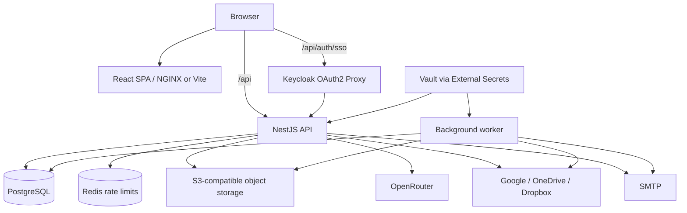
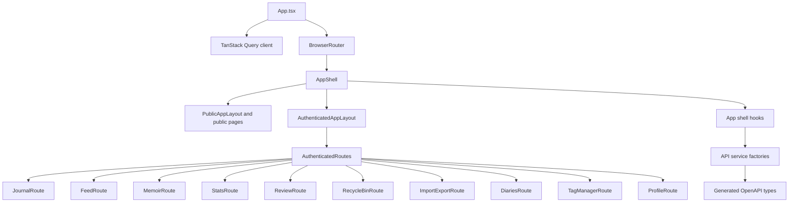

# Architecture Overview and ADR Index

How Thoughty is put together, and the architecture decision records (ADRs) that explain why. Entity-level detail is in the [Data Model](./data-model.md); runtime deployment is in the [Deployment Guide](./deployment.md).

## System Architecture at a Glance

Thoughty is a TypeScript-first modular monolith: one NestJS API and one route-driven React single-page application.

- PostgreSQL holds all journal data; S3-compatible object storage holds attachment files.
- Redis, when configured, shares rate-limit counters between API replicas.
- OpenRouter provides optional AI. SMTP sends account and memoir emails.
- A separate worker process runs the background jobs (see [Background Worker](#background-worker)).
- Users sign in with a local Thoughty account or, in production, with Keycloak single sign-on through the platform's OAuth2 Proxy, which guards only the SSO exchange route. Vault supplies secrets in production.



## Backend Architecture

`AppModule` registers the global JWT and throttling guards, so every request is authenticated (unless its route is marked public), throttled, and DTO-validated before a feature module runs a user-scoped query. The feature modules live in `thoughty-server/src/modules`:

| Module | Responsibility |
|---|---|
| `auth` | SSO exchange, local and Google sign-in, tokens and sessions, email verification, 2FA, password recovery, account deletion |
| `entries` | entry CRUD (title, time, mood, feelings), full-text search, revisions, tags, visibility, favorites, pins, archive, reordering, task list ticks, backlinks, highlights, delete-all |
| `recycle-bin` | deleted entries kept for 30 days: list, restore, delete forever, empty, and the hourly purge |
| `diaries` | diary containers, ordering, default diary, moving entries when a diary is deleted |
| `attachments` | upload validation, object storage, audio transcription |
| `ai` | OpenRouter credentials and usage, tag suggestions, inspiration, rephrasing, summaries, chat, semantic search, duplicates, tag organization, writing insights |
| `stats` | statistics, heatmap, mood stats, connections graph, writing-tendency analysis |
| `review` | year in review: totals, rhythm, themes, highlights, moods, and the on-request AI mood arc |
| `io` | import and export formats, TXT format settings, Day One and Journey imports parsed in the browser ([ADR 0020](./adr/0020-browser-side-app-imports-and-streamed-archives.md)), the streamed Markdown folder export |
| `books` | book composition, covers, previews, saved versions |
| `cloud-sync` | provider connections, file browsing, schedules, queued jobs |
| `config` | user preferences and profile, encrypted settings, data export, the feature-flag endpoint (no feature reads flags yet) |
| `feature-requests` | community idea board and votes |
| `social` | public feed, follows, comments, likes, leaderboard, achievements (karma and badges) |
| `account-purge` | permanent deletion of deleted accounts after the grace period |
| `memoir` | guided memoir: question catalogue, program settings, answers as entries, weekly delivery and email |
| `metrics` | Prometheus metrics (the health endpoint is `HealthController` in `AppModule`) |

Cross-cutting runtime code goes in `src/common`, entities and migrations in `src/database`, and operational scripts in `thoughty-server/scripts`.

### Background Worker

`thoughty-server/src/cloud-sync-worker.ts` boots `AppModule` as a Nest application context without HTTP and starts four loops that API replicas never run. The worker stays at one replica ([ADR 0006](./adr/0006-database-backed-cloud-sync-worker.md)). Manual uploads, downloads, and "sync now" run inline in the API request, not through the queue.

| Service | Interval | Work |
|---|---|---|
| `CloudSyncWorkerService` | jobs every 5 s, schedules every 60 s | turns due sync schedules (stored in `settings`) into `cloud_sync_jobs` rows, claims them with `FOR UPDATE SKIP LOCKED`, runs the sync, retries, and recovers stale jobs |
| `MemoirDeliveryWorkerService` | every 60 s | moves due `memoir_programs` to their next question and sends the weekly email |
| `RecycleBinPurgeWorkerService` | hourly | hard-deletes entries in the recycle bin for over 30 days and removes their files |
| `AccountPurgeWorkerService` | hourly | permanently deletes accounts deleted more than `ACCOUNT_PURGE_AFTER_DAYS` (default 30) ago: their stored files, then the user row and everything that cascades from it |

## Frontend Architecture

The frontend is one React SPA under `thoughty-web/src`. Its main boundary is the route, not a microfrontend.



- Route files stay thin. Components render; hooks own shared state, URL parameters, and API calls.
- Server state goes through TanStack Query. The entry list keeps the previous page on screen while the next one loads.
- The journal sends its first list request once everything that shapes it is known: the profile config (page size; a failed config request falls back to 10 at once), the default or route diary, and on a permalink the page that holds the entry. Until then the list query is disabled and the journal shows as loading, so no request is sent with defaults and thrown away.
- Query-string parameters are product behavior: diary scope, import/export presets, entry permalinks.
- API types are generated from the server's OpenAPI document ([ADR 0004](./adr/0004-openapi-as-contract-source.md)). A test fails if the frontend stops calling a documented product endpoint.

## Data Ownership Rules

- `entries` owns entry lifecycle rules; other modules call its services. `diaries` owns the default diary and moving entries off a deleted diary.
- Deleting an entry only sets `deleted_at`; `recycle-bin` owns restoring and purging. Queries that bypass TypeORM's entity filtering (raw SQL, `update`, `delete`) must add `deleted_at IS NULL` themselves.
- `attachments` owns object-storage keys and file validation. Original filenames are never storage keys.
- `config` owns preferences and encrypted integration settings. `cloud-sync` owns job status, locking, retries, and provider sync state.
- `memoir` owns the question catalogue and which entry answers which question. Answers are created through the `entries` service, so entry rules still apply.
- The public feed reads only entries that are both public and moderation-visible ([ADR 0013](./adr/0013-public-social-content-and-moderation.md)). New social features must not reuse private-entry assumptions without extending that ADR.
- Repeated entry-list reads are served from a short-lived per-pod cache (30 s by default, `ENTRIES_CACHE_TTL_SECONDS`) that entry mutations invalidate.

## ADR Process

Write or update an ADR when a change affects:

- runtime topology or deployment ordering
- the persistence model, ownership boundaries, or deletion behavior
- security, privacy, authentication, authorization, or abuse controls
- the API contract or the frontend/backend boundary
- background processing, queues, or sync
- observability, backup, recovery, or production operations
- the product's shape, such as social feeds, real-time messaging, paywalls, or offline sync

Status is `Proposed` for a decision that guides upcoming work, `Accepted` for implemented or committed architecture, and `Superseded` when a newer ADR replaces it.

## Decision Records

| ADR | Status | Decision |
|---|---|---|
| [0001](./adr/0001-documentation-structure.md) | Accepted | Split Documentation Out of Root README |
| [0002](./adr/0002-modular-monolith-and-route-driven-ui.md) | Accepted | Adopt a Modular Monolith with a Route-Driven UI Shell and Feature-Oriented Code Structure |
| [0003](./adr/0003-typescript-first-technology-stack.md) | Accepted | Standardize on a TypeScript-First Full-Stack Platform |
| [0004](./adr/0004-openapi-as-contract-source.md) | Accepted | Use Backend OpenAPI as the Source of Truth for API Contracts |
| [0005](./adr/0005-selective-cqrs-in-entry-domain.md) | Accepted | Apply Selective CQRS in the Entry Domain |
| [0006](./adr/0006-database-backed-cloud-sync-worker.md) | Accepted | Run Scheduled Cloud Sync Through a Separate Worker and Database-Backed Queue |
| [0007](./adr/0007-code-quality-and-verification-gates.md) | Accepted | Keep Code Quality Enforcement Lightweight but Continuous |
| [0008](./adr/0008-security-authentication-and-owasp-baseline.md) | Accepted | Establish a Secure-by-Default Authentication and OWASP Baseline |
| [0009](./adr/0009-rate-limiting-and-abuse-controls.md) | Accepted | Apply Layered Rate Limiting for Baseline Abuse Resistance |
| [0010](./adr/0010-journal-data-model.md) | Accepted | Model the Journal Around Diaries, Dated Entries, Revisions, and Attachments |
| [0011](./adr/0011-attachments-and-object-storage.md) | Accepted | Store Attachments as Metadata in PostgreSQL and Blobs in S3-Compatible Object Storage |
| [0012](./adr/0012-delivery-health-and-operational-model.md) | Accepted | Keep Delivery and Operational Verification Simple, Explicit, and Repository-Owned |
| [0013](./adr/0013-public-social-content-and-moderation.md) | Accepted | Define Public Social Content and Moderation Before Building Feed Features |
| [0014](./adr/0014-real-time-notifications-and-messaging.md) | Proposed | Choose a Real-Time Notifications and Messaging Model Deliberately |
| [0015](./adr/0015-observability-baseline.md) | Accepted | Establish a Privacy-Aware Observability Baseline |
| [0016](./adr/0016-backup-and-disaster-recovery.md) | Accepted | Define Backup and Disaster Recovery for Journal Data |
| [0017](./adr/0017-feature-flags-and-entitlements.md) | Accepted | Separate Feature Flags from User Entitlements |
| [0018](./adr/0018-offline-and-mobile-sync.md) | Proposed | Decide Offline and Mobile Sync Before Building Mobile Apps |
| [0019](./adr/0019-explicit-delivery-jobs.md) | Accepted | Use Explicit Delivery Jobs and Non-Blocking Verification |
| [0020](./adr/0020-browser-side-app-imports-and-streamed-archives.md) | Accepted | Read Other Apps' Exports in the Browser and Stream the Full Export |

## ADR Template

```markdown
# ADR NNNN: Title

- Status: Proposed | Accepted | Superseded
- Date: YYYY-MM-DD

## Context

What problem, constraint, or opportunity requires a decision?

## Decision

What are we choosing?

## Rationale

Why is this choice better than the alternatives for Thoughty right now?

## Consequences

What does this make easier, harder, required, or explicitly deferred?
```
