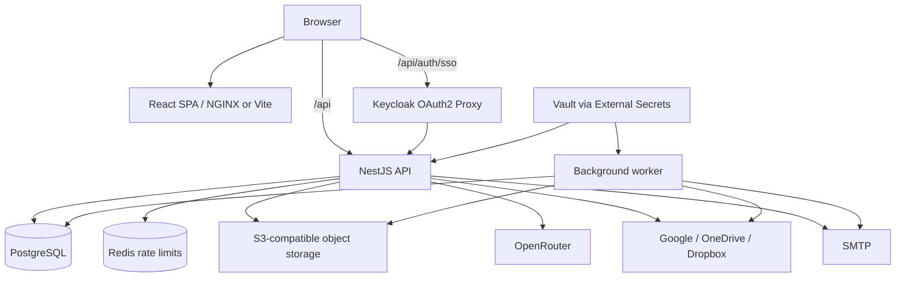
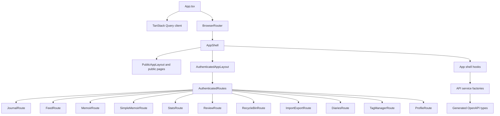

# Architecture Overview and ADR Index

How Thoughty is put together, and the architecture decision records (ADRs) that explain why. Entity-level detail is in the [Data Model](./data-model.md); runtime deployment is in the [Deployment Guide](./deployment.md).

## System Architecture at a Glance

Thoughty is a TypeScript-first modular monolith: one NestJS API and one route-driven React single-page application.

- PostgreSQL holds all journal data; S3-compatible object storage holds attachment files.
- Redis, when configured, shares rate-limit counters between API replicas.
- OpenRouter provides optional AI. SMTP sends account and memoir emails.
- A separate worker process runs the background jobs (see [Background Worker](#background-worker)).
- Users sign in with a local Thoughty account or, in production, with Keycloak single sign-on through the platform's OAuth2 Proxy, which guards only the SSO exchange route. Vault supplies secrets in production.



## Backend Architecture

`AppModule` registers the global JWT, throttling and feature flag guards, so every request is authenticated (unless its route is marked public), throttled, refused while its feature is switched off ([Feature flags](#feature-flags)), and DTO-validated before a feature module runs a user-scoped query. Validation is one global `ValidationPipe` (`src/common/validation`) that whitelists DTO properties and converts nothing implicitly; every boolean and every number, in a query string, a multipart form or a JSON body, is read from the raw value by `@StrictBoolean()` and `@StrictInt()`, since implicit conversion would turn `"false"` into `true` and `""` into `0` ([Request validation](./development.md#request-validation)). The feature modules live in `thoughty-server/src/modules`:

| Module | Responsibility |
|---|---|
| `auth` | SSO exchange, local and Google sign-in, tokens and sessions, email verification, 2FA, password recovery, account deletion, account activity |
| `entries` | entry CRUD (title, time, mood, feelings), full-text search, revisions, tags, visibility, favorites, pins, archive, reordering, task list ticks and the open tasks across the journal (`GET /api/entries/open-tasks`, `EntryOpenTasksService`, read from the entries with no table of their own), backlinks, highlights, the calendar month (`GET /api/entries/calendar?month=YYYY-MM`: short summaries of a month's entries under the same filters as the list, which share `EntryFilterQueryDto` and `applyEntryListFilters`), the journal list itself (`GET /api/entries`, `EntryListService`: a batch at a time for the infinite scroll, from the start, `after` a batch's `nextCursor`, `before` its `prevCursor`, `from` its own `prevCursor`, or `around` an entry (404 `ENTRY_NOT_FOUND` when the filters leave it out), answered with `total`, `offset` (entries before the batch) and both cursors, null at either end; a cursor is `lead_date_time_index_id` (`entry-list-cursor.ts`), the sort values themselves, compared as one row of ascending values so entries written or deleted between batches neither repeat nor go missing; the entries are found by that key first, then read with their diary and files), a random entry among the list's filters (`GET /api/entries/random`: the list's filters and order plus `excludeId`, answered with the entry's id, date and index, which the journal opens the list around; PostgreSQL picks with `ORDER BY random() LIMIT 1`, so only one row leaves the database; sealed capsules are never picked and `ENTRY_RANDOM_NO_MATCH` (404) says nothing matched), the first entry of a year or month among the list's filters (`GET /api/entries/first`) and an entry by its date and same-day index (`GET /api/entries/by-date`, for cross-references), the comfort reads (`GET /api/entries/comfort-reads?excludeId=`, `EntryComfortReadsService`: up to three of the writer's favorites or entries tagged `gratitude`, `grateful` or `reconnaissance` in any case, picked with `ORDER BY random() LIMIT 3`, with their day, index, title and a plain excerpt; never a sealed capsule or `excludeId`, and an empty list when none qualify; the web asks for them after the composer saves a very-low-mood entry. A route of its own because the list filters combine with AND, so favorites *or* a tag is not one query, and `random` gives one ID per call without text, which would take several calls that can repeat an entry), the reader (`GET /api/entries/reader`: the list's filters with an optional day `date` or month `month` and `entryId`, answered with the entry whole and its oldest-first neighbours `previousId`/`nextId`, its `position` and the `total`; `LAG`, `LEAD`, `ROW_NUMBER` and `COUNT(*)` windows over the matches in book order find them in one query, because the list's pages follow its own order (pins, relevance) and could not give an entry's chronological neighbours without reading every page; sealed capsules are left out of the reading, and `ENTRY_READER_NO_MATCH` / `ENTRY_READER_NOT_FOUND` (404) say nothing matched or the entry is not among them), delete-all |
| `recycle-bin` | deleted entries kept for 30 days: list, restore, delete forever, empty, and the hourly purge |
| `diaries` | diary containers, ordering, default diary, writing goals, default entry templates, moving entries when a diary is deleted |
| `saved-searches` | named journal filter combinations with their diary scope: list, save, rename, delete, at most 50 per writer |
| `composer-drafts` | the new entry still being written, one per writer (`GET`/`PUT`/`DELETE /api/composer-draft`, `ComposerDraftsService`): each save and discard names the revision it was written on and is one statement, so a device behind is refused (`COMPOSER_DRAFT_CONFLICT`); in the data download and gone with the account |
| `life-eras` | named date ranges of the writer's life: list, add, change, delete, at most 100 per writer; the journal's `eraId` filter lives in the entries module's `applyEntryListFilters`, era chapters in `buildBook`, and `books` and `memoir` read eras through `LifeErasService` |
| `people` | people mentioned with `@handle`: list with counts, rename and date (a birthday or an anniversary, checked in `person-dates.ts`; Highlights reads the day's people through `PersonDatesService` in `PersonDatesModule`, imported by the entries module), merge, delete, at most 1,000 per writer; mentions are parsed and linked on every entry save by `EntryMentionsService` in the entries module (composer, edits and both imports), and the journal's `personId` filter lives in `applyEntryListFilters` |
| `attachments` | upload validation, object storage, audio transcription; `sendAttachmentFile` (`attachment-file-response.ts`) streams a stored file with its safe headers and byte ranges for both the owner's file route and a share link's |
| `share-links` | private share links ([ADR 0024](./adr/0024-private-share-links.md)): `ShareLinksService` makes, lists and revokes the writer's links (`/api/share-links`, at most 100 unexpired), and `SharedContentService` answers the public `GET /api/shared/:token…` routes for a reader without an account (the entry, a book version's file, the entry's own attachments), counting views, with one `404` for every refusal; `sharedResponseHeaders` (an Express middleware `configureApp` mounts on `/api/shared`) sets their private link headers before any guard, pipe or filter runs |
| `access-tokens` | personal access tokens and the public API: `AccessTokensService` makes (shown once, hash kept), lists and revokes a writer's tokens (`/api/access-tokens`, a session's routes, at most 10), and authenticates the `Authorization: Bearer thy_…` of a public API request for `AccessTokenGuard`; `PublicApiService` answers `/api/v1` (`GET diaries`, `GET entries`, `POST entries`) on the journal's own `EntriesService`, as the token's writer and within its scopes ([Security](./security.md#authentication-and-sessions)) |
| `ai` | OpenRouter credentials and usage, tag suggestions, inspiration, rephrasing, summaries, chat, semantic search, duplicates, tag organization, writing insights |
| `stats` | statistics, heatmap, writing goal progress, daily writing streak, mood stats (with the tags beside good and low moods), the words used most this month, connections graph, writing-tendency analysis |
| `review` | year in review: totals, rhythm, themes, highlights, moods, and the on-request AI mood arc |
| `io` | import and export formats, TXT format settings, Day One, Journey, daily-notes (Obsidian, Logseq) and Google Keep (Takeout) imports parsed in the browser ([ADR 0020](./adr/0020-browser-side-app-imports-and-streamed-archives.md)), the streamed Markdown folder export |
| `books` | book composition, covers, previews, saved versions; `BookEntrySourceService` selects entries from the journal, a saved search (through `saved-searches` and the entry list filters of `entries`) or hand-picked IDs |
| `cloud-sync` | provider connections, file browsing, schedules, queued jobs |
| `config` | user preferences and profile, encrypted settings, data export, the feature-flag endpoint (`GET /api/config/feature-flags`; the flags themselves are `src/common/feature-flags`) |
| `feature-requests` | community idea board and votes |
| `social` | public feed (its topics and word search), follows of writers and topics, comments and their controls (who may comment, hidden and pinned comments), likes, saved entries, leaderboard, achievements (karma and badges) |
| `account-purge` | permanent deletion of deleted accounts after the grace period, expired sign-up requests and account activity older than a year |
| `memoir` | guided memoir: question catalogue (a year of questions and themed chapters a writer adds), program settings and chosen themes, answers as entries, skipping or setting aside this week's question (`POST /api/memoir/skip`, `POST /api/memoir/snooze`), weekly delivery and email |
| `opt-in-email` | what the opt-in emails share: the setting table's columns (`OptInEmailSetting`, one table per email), the settings service (`get`/`update`, validating the zone and the diary), the delivery base (`OptInEmailDeliveryService`: claim due rows, one email per writer and schedule period, verified addresses of live accounts, language, unsubscribe links, ID-only logs), the worker loop base, the email layout (HTML and plain text, entry cards of at most 200 characters), the signed unsubscribe token carrying the email's kind, and the public `POST /api/email-unsubscribe` that turns off whichever email a token names |
| `on-this-day-email` | the opt-in "On this day" email: its setting (`GET`/`PUT /api/on-this-day-email`), its own one-click unsubscribe route (kept for the links already sent), and the daily delivery, which reads past entries through `EntriesQueryService.findOnThisDay` (the query Highlights uses) and schedules in the writer's zone with `common/utils/time-zone.util.ts` (shared with the memoir) |
| `monthly-recap-email` | the opt-in monthly recap: its setting (`GET`/`PUT /api/monthly-recap-email`) and the delivery on the 1st of the writer's month, which counts the month just ended with `YearReviewService.loadEntries` and the year in review's tag and recorded-mood helpers, and picks one memory of that month in an earlier year with `EntriesQueryService.findMonthMemory` |
| `time-capsules` | sealing a new entry as a time capsule (`TimeCapsuleService.createSealed`, from `POST /api/entries` with `seal`; the schedule in `time-capsule-schedule.ts` reads the writer's day and hour with the time-zone utils), opening it early (`POST /api/entries/:id/unseal`) or on time (the worker's `TimeCapsuleDeliveryService` and the capsule email), the sealed copy given back to exports and the data download (`reveal`), and the capsules opened lately that Highlights shows; `assertEntryNotSealed` guards the writes, AI and attachment reads that refuse a sealed entry |
| `reread-reminders` | asking to reread an entry on a day (`PUT`/`DELETE /api/entries/:id/reread-reminder`, `RereadReminderService`, the day window in `reread-reminder-dates.ts`, shared with the time capsules' tomorrow-to-50-years rule) and the due reminders Highlights shows (`RereadReminderService.findDue`, read by `EntriesQueryService.getHighlights` with the writer's `today`, which On This Day and `currentDate` go by too; see [The writer's day](./development.md#the-writers-day)) |
| `content-lock` | the PIN lock: the PIN (`ContentPinService`: bcrypt, wrong tries counted under a row lock with a growing lockout, change, reset and removal with a proof, the emailed code through `TwoFactorService`), the unlocks (`ContentUnlockService`, `content_unlocks`), `ContentUnlockMiddleware`, which reads `X-Content-Unlock` before any guard and runs the request with what it unlocks, and locking an entry or a diary (`PATCH /api/entries/:id/lock`, `PATCH /api/diaries/:id/lock`, `ContentLocksService`). The read side is `src/common/content-lock`: the request's access in an `AsyncLocalStorage` (`isContentUnlocked`, locked outside a request and in `runWithoutUnlock`), and the helpers every query uses (`readableEntrySql`, `hideLockedEntries`, `readableEntryWhere`, `isEntryWithheld`, `assertEntryUnlocked`, `423 CONTENT_LOCKED`); `toEntryResponse` withholds a locked entry itself |
| `metrics` | Prometheus metrics, including the north-star metric and sign-up funnel as account counts ([Operations](./operations.md#north-star-metric-and-sign-up-funnel)); the health endpoint is `HealthController` in `AppModule` |

Cross-cutting runtime code goes in `src/common`, entities and migrations in `src/database`, and operational scripts in `thoughty-server/scripts`.

Modules that outgrow one service split it by responsibility, and source files stay under 500 lines. In `auth`, `SignUpService` runs registration (verify-first wherever email can be sent: it records the request, emails the link or, for an address with an account, a notice, and creates the account from the link; `SignUpController` holds its two routes); `AuthService` signs users in (registration at once where no mail server is configured outside production, password login and its two-factor step, Google and Keycloak sign-in); `ProviderAccountService` finds the account of a Google or Keycloak identity by its subject, else links the account with its verified address (taking over one whose address was never verified), else creates one with a free username and its default diary; `IdentityVerificationService` verifies Google ID tokens and Keycloak access tokens against the providers' keys; `AuthSessionService` issues, rotates, lists and revokes refresh-token sessions; `PasswordService` changes and resets passwords; `AccountService` reads and deletes the user's own account; and `AccountActivityService` (`auth/account-activity`) records and lists the account's sign-ins and security changes and sends the new-browser sign-in email. `ClientSoftwareMiddleware` runs on every request and keeps the browser and system names of its `User-Agent` in an `AsyncLocalStorage` (`currentClientSoftware()`), so the services and controllers that record an event (`AuthSessionService`, `AuthService`, `TwoFactorService`, `PasswordService`, the PIN, share link, export and data download controllers) pass only the account and the kind. In `entries`, the `EntriesService` facade routes reads to `EntriesQueryService` (the list and its search, dates, tag usage, highlights, revisions) and `EntryLookupService` (the first entry of a year or month, an entry by date or id with the page that shows it, backlinks), and writes to `EntriesCommandService` ([ADR 0005](./adr/0005-selective-cqrs-in-entry-domain.md)). The entries DTOs are one file per concern in `entries/dto` (writes, bulk operations, tags, queries, responses), re-exported by `entries.dto.ts`. Every response that carries an entry (the list, highlights, the entry found by date or id, and the `entry` each edit, task tick, visibility, favorite, archive and pin answers with) builds it with `toEntryResponse` (`entries/entry-response.mapper.ts`), the snake_case `EntryResponseDto`, never the TypeORM entity. The revision history answers `EntryRevisionResponseDto` (`toEntryRevisionResponse`), without the owner's id, and an attachment upload or link answers `AttachmentRecordResponseDto` (`toAttachmentRecordResponse`). Actions that return no data answer `SuccessResponseDto` (`{ success }`) or, for the password, email verification and account deletion steps, `SuccessMessageResponseDto` (`src/common/dto`). In `src/common/utils`, `file-converter.util.ts` re-exports the journal file formats, one module each (`file-converter-text`, `-markdown`, `-json`, `-csv`, with the TXT format settings in `-format` and the shared entry shape in `-entry`), and `book-converter.util.ts` builds books and re-exports the book model (`book-model.util.ts`) and its Markdown and HTML renderers (`book-render.util.ts`); `book-pages.util.ts` holds the limits, normalization and Markdown escaping of the book's own pages (dedication, epigraph) and the closing page's lines (`bookClosingPageLines`). `book-language.util.ts` is the one dictionary of the words a book or journal document writes itself, in English and French (`bookCopy`), with its dates, month headings and entry counts formatted through `Intl` for the language (`formatBookDate`, `formatBookMonth`, `formatBookEntryCount`, which swap the narrow no-break space `Intl` uses for a no-break space the PDF's standard fonts can draw); `BooksService` and `IoService` read the writer's `language` setting through `ConfigService` (`resolveBookLanguage`), `buildBook` and `buildJournalDocument` keep it on the `Book`, and every renderer takes its words from it. The PDF names those pages and its table of contents with named destinations (`BOOK_PDF_DESTINATIONS` in `book-pdf.util.ts`: `dedication`, `epigraph`, `contents`, `about`), which the web's book preview reads for its **Go to** list (`readSections` in `BookPreview/bookPdf.ts`) beside the chapters from the outline. Inline images (``) are parsed by `inline-image.util.ts`; `book-inline-image.util.ts` cuts an entry around the pictures a book or document embeds for the Markdown, HTML, EPUB and PDF renderers, and `hydrateBookImages` (`book-image.util.ts`) loads their data within the image budgets for books and the PDF, HTML and EPUB exports. `EntryInlineImagesService` (`entries`) keeps the references of a saved entry to its own attachments and resolves the file names an app import sends.

### Background Worker

`thoughty-server/src/cloud-sync-worker.ts` boots `AppModule` as a Nest application context without HTTP and starts seven loops that API replicas never run. The worker stays at one replica ([ADR 0006](./adr/0006-database-backed-cloud-sync-worker.md)). Manual uploads, downloads, and "sync now" run inline in the API request, not through the queue.

| Service | Interval | Work |
|---|---|---|
| `CloudSyncWorkerService` | jobs every 5 s, schedules every 60 s | turns due sync schedules (stored in `settings`) into `cloud_sync_jobs` rows, claims them with `FOR UPDATE SKIP LOCKED`, runs the sync, retries, and recovers stale jobs; nothing while the `cloudSync` flag is off, so due schedules and queued jobs wait |
| `MemoirDeliveryWorkerService` | every 60 s | moves due `memoir_programs` to their next question (a question set aside with **Not this week** whose day has come in the writer's zone first) and sends the weekly email |
| `OnThisDayDeliveryWorkerService` | every 60 s | (both email loops extend `OptInEmailWorkerService` and `OptInEmailDeliveryService`) claims due `on_this_day_emails` rows (`next_send_at <= now`, partial index on enabled rows) in batches of 50 with `FOR UPDATE SKIP LOCKED`, moves each to the next local day (`nextDailySend`, DST-aware through `zonedTimeToUtc`: a skipped hour lands after the jump, a repeated one on its first occurrence, in every zone), and, when the writer has past-year entries for the local day (`EntriesQueryService.findOnThisDay`, the Highlights query) and a verified address on a live account, writes `last_sent_on` in the same transaction and sends the email after the commit, so overlapping runs or a moved hour never send a day twice |
| `MonthlyRecapDeliveryWorkerService` | every 60 s | the same claim on `monthly_recap_emails`, moving each row to the 1st of the next local month (`nextMonthlySend`, DST-aware); when the month just ended has entries or a memory from an earlier year, and the writer has not had an email this local month, it writes `last_sent_on` and sends the recap after the commit |
| `TimeCapsuleDeliveryWorkerService` | every 60 s | (extends `OptInEmailWorkerService`) claims due `time_capsules` (`open_at <= now`, still sealed, entry outside the recycle bin, live account; partial index `idx_time_capsules_due`) with `FOR UPDATE SKIP LOCKED`, opens each in the same transaction (`TimeCapsuleService.openCapsule`), and after the commit emails each once to a verified address with the shared email layout, without an unsubscribe link |
| `RecycleBinPurgeWorkerService` | hourly | hard-deletes entries in the recycle bin for over 30 days and removes their files |
| `AccountPurgeWorkerService` | hourly | deletes the sign-up requests whose link expired, then permanently deletes accounts deleted more than `ACCOUNT_PURGE_AFTER_DAYS` (default 30) ago: their stored files, then the user row and everything that cascades from it |

### Feature Flags

Four runtime flags switch a feature off without a redeploy ([ADR 0017](./adr/0017-feature-flags-and-entitlements.md)). `FeatureFlagsService` (`src/common/feature-flags`, one instance per process through the global `FeatureFlagsModule`) starts from the defaults (every flag on), applies `FEATURE_FLAGS` (`ai=false,cloudSync=false`, read on every call), then the provider at `FEATURE_FLAG_PROVIDER_URL` when one is set: its answer is kept for `FEATURE_FLAG_CACHE_TTL_MS` (60 s by default), asked once at a time, with a 3 s timeout; when the provider fails, the flags it last gave stay (the defaults before any) and it is asked again after the same delay. A flag the answer leaves out is on.

Routes take `@RequireFeature(flag)`, on a controller or a handler; the global `FeatureFlagGuard`, registered after the JWT and throttling guards (so a stranger still gets `401`), refuses them with `503 FEATURE_DISABLED`, and the decorator documents that answer. Services that act outside a guarded route call `isEnabled` or `assertEnabled` themselves.

| Flag | Refused while off | Kept working | Elsewhere |
|---|---|---|---|
| `ai` | every `/api/ai` route but reading and removing the personal key (`GET`/`DELETE /api/ai/credentials`), audio transcription, the year's AI mood reading (`POST /api/review/mood`), the weekly reflection (`POST /api/review/week`), writing tendencies (`POST /api/stats/personality-analysis`) | the stored key, models and transcripts; the saved mood arc and weekly reflection | auto-tagging on save adds no tag; a book's AI narrative or chapter framing answers `FEATURE_DISABLED` (a plain book still works) |
| `bookConverter` | every `/api/books` route | saved versions and their private links (governed by `publicSharing`) | |
| `cloudSync` | every `/api/cloud-sync` route but `POST /disconnect` | connections, schedules, queued jobs | the worker neither turns due schedules into jobs nor runs queued ones; they run once the flag is back |
| `publicSharing` | the feed, comments and their controls, likes, saves, follows (of writers and topics) and leaderboard; making a private link (`POST /api/share-links`); the reader's side of every link (`/api/shared/…`) | listing and revoking one's own links; achievements | nothing becomes public (below) |

While `publicSharing` is off nothing becomes public: a new public entry, a private entry changed to public (`PUT /api/entries/:id`, `PATCH …/visibility`) and making entries public in bulk answer `503 FEATURE_DISABLED` (`entries/entry-publishing.ts`), and an import saves every entry private. An entry already public keeps its stored visibility, can be edited as it is or made private, and is simply shown to no one while the flag is off; links keep their expiry and views, and both come back as they were once the flag is on. Diary and settings defaults stay as saved.

The web loads the flags once for the signed-in app (`FeatureFlagsProvider`, mounted in `App.tsx`: TanStack Query, `staleTime` one minute, again when the window regains focus), and `useFeatureFlag(name)` reads them anywhere below it. While they load, when the request fails, or outside the provider (unit tests), every flag reads as on (`FEATURE_FLAG_DEFAULTS`, the API's documented default), so a feature never flashes off; a failed refetch keeps the flags last read. A switched-off feature is hidden where it would be offered, with `FeatureOffNote` (or `FeatureOffSection` in the profile) saying it is off for now and that nothing was lost: AI buttons and panels, the meaning search (a meaning search goes back to words), the book route of Import/Export and the memoir's, person's and bulk **Make a book**, the cloud sync sections (no cloud request is sent), the feed (its navigation item and page), making a private link (the dialog still lists and revokes links), and every choice that would make an entry or a diary default public (new entries are saved private). The reader's page of a link says "Sharing is paused" for `FEATURE_DISABLED`, the same for every token. Hiding is only for the writer: the API enforces each flag itself.

## Frontend Architecture

The frontend is one React SPA under `thoughty-web/src`. Its main boundary is the route, not a microfrontend.



- A private share link's page (`/s/<token>`) is not part of this tree: `main.tsx` renders `SharedLinkPage` on its own, lazily, with no `AuthProvider`, router, query client or app chrome, and it calls only `/api/shared/…` with plain `fetch` ([ADR 0024](./adr/0024-private-share-links.md)). The writer's side is `ShareLinkDialog` (`components/ShareLinks`), opened from an entry's More actions and from each saved book version.
- The composer's draft (`components/ComposerDraft`) lives with the composer's state in `useEntryForm`, which the app shell keeps across views: `useComposerDraftSync` writes every change to `localStorage` at once and to `/api/composer-draft` two seconds after typing stops (at once on blur, `visibilitychange` and `pagehide`, at most every three seconds), naming the revision it last saw. On sign-in `planComposerDraft` weighs this device's copy against the server's draft: a copy never sent comes back and is sent, the draft this device saved last comes back silently, and a draft from another device is offered (`ComposerDraftOfferBar`) rather than put in. A `409 COMPOSER_DRAFT_CONFLICT` turns into the same offer, and nothing more is sent until the writer chooses. Publishing discards it at its revision (a save still on its way is undone), sign-out removes the local copies, and `useLeaveWarning` asks before the page closes on text the server does not have yet (and on unsaved changes in the entry editor). A diary's default template is filled in by `useDiaryTemplatePrefill`, also in `useEntryForm`: once the draft is `ready` and no offer waits, it fills an empty composer once per diary picked and per entry saved, from a layout effect so no keystroke can come between the render that found the composer empty and the fill (`diaryDefaultTemplate` resolves the diary's `defaultTemplateId` against the built-in and custom templates, the default diary's for **All diaries**; the built-in ones are built by `getEntryTemplates(raw, config.language)` from `utils/translations.builtInTemplates.ts`), and swaps or clears it only while the fields still match what it left, which includes filling the same template again when a language change gives it another text. While they do, `useComposerDraftSync` is told the template is untouched and treats the composer as holding no draft: nothing is saved, kept on the device or warned about.
- A signed-in writer on a path with no view (`/login` after signing in, say) goes to `landingView` (`useAppShellModel`, from `landingViewFor` in `utils/landingView.ts`): the simple memoir screen (`/memoir/simple`, view `memoirSimple`) while the `memoirSimpleMode` setting is on, the first-run welcome page (`/welcome`, view `welcome`, `components/Welcome`) while the settings say `onboardingDone` is `false` (only an explicit `false`, so settings that could not be read never show it), and the journal otherwise; completing the emailed sign-up link opens the welcome page directly, the account being new. `WelcomeRoute` leaves the page with `replace`, so the back button never returns to it, and the daily journal choice sets the default diary's `defaultTemplateId` through `PUT /api/diaries/:id` before saving the setting; `AppShell` shows the loader until the settings are read, so the journal never flashes first. The presentation page's **Open your journal** goes to the same view. `AuthenticatedAppLayout` draws the simple memoir screen without the menu, quick capture or footer, keeping the skip link, the PIN lock and quiet mode contexts and the toasts.
- Route files stay thin. Components render; hooks own shared state, URL parameters, and API calls.
- Server state goes through TanStack Query. The journal list is an infinite query (`useJournalList`): each page of the query is a batch of `GET /api/entries` (20 entries, a meaning search's 50 matches in one), started from the start, `around` the entry a jump opens, then `after` the last batch's `nextCursor` and `before` the first batch's `prevCursor`. A jump's anchor belongs to the filters the list is first read with once it is set (`filtersResetting` holds the list while a cross-reference or permalink resets them, the diary following the address a render later), and any later filter change starts the list over. Reading the list again (a saved change) refetches every batch from its own place: a window opened `around` an entry is read again `from` its first entry's cursor, so the entry it opened at may be gone. `maxPages` keeps 10 batches (200 entries): scrolling on lets go of the batches at the other end, and `useKeepScrollPlace` keeps the first entry on screen where it was while batches come and go (where the browser's own scroll anchoring has not already). The list keeps the previous batches on screen while a new key loads. The entry list renders one flat, keyed list of `article`s and memoizes each card (`EntryViewMode` reads the entries to listen to through a getter), so a batch draws only its own cards: measured in the mock with 3,000 entries, a batch costs the same at 200 entries shown as at 20, which is why the list is windowed by batch rather than virtualized.
- The journal sends its first list request once everything that shapes it is known: the profile config (a failed config request lets it go at once), the default or route diary, and on a permalink the filters it resets, after which it asks `around` the entry with no lookup first. Until then the list query is disabled and the journal shows as loading, so no request is sent with defaults and thrown away.
- Query-string parameters are product behavior: diary scope, import/export presets, entry permalinks, the saved search on screen (`view=<id>`, written beside `diary` when one is applied and dropped as soon as a filter changes), and the journal layout (`layout=calendar` with `month=YYYY-MM`; switching layout adds a history step, changing month replaces it, and a diary change keeps both). The calendar month is a TanStack query under the journal's entry key (`['app', 'entries', 'calendar', …]`), so every change that reloads the list reloads the month too. The life eras are one TanStack query (`['lifeEras']`, `useLifeEraList`) shared by the filter bar, the calendar, the memoir answer form and the profile section; changing or deleting an era also reloads the journal's entry queries and the saved searches, since an era's dates decide what its filter shows. The era filter itself is journal state (`filterEraId`) like the other filters, sent as `eraId` by the list and the calendar and kept in saved searches. The people are one TanStack query (`['app', 'people']`, `usePeopleList`) that every journal entry refresh reloads (it is part of `JOURNAL_ENTRY_QUERY_KEYS` and `fetchEntries` invalidates it), since saving entries changes who is mentioned. The journal hands the people to its composer, editor and entry list through `MentionPeopleContext`, so mentions link and `@` suggests people only there (focus mode, portaled out of the composer or editor, still reads the context and reuses `useMentionAutocomplete` and `MentionSuggestions`, placing the list under the caret line with `belowCaretLine` and moving it from an animation frame callback in each frame the text scrolls, `useScrolledFrames`, so it never trails a smooth scroll); the feed has no provider and shows mentions as text. The composer's and the editor's Markdown editor is loaded on first use (`MarkdownEditor/LazyMarkdownField`, shared by both): the plain textarea standing in for it meanwhile has the same `@` suggestions, whose list sits outside the `Suspense` boundary so it stays open as the editor takes over, and a writer typing in the stand-in goes on in the editor with the same focus and selection (handed over by the stand-in's ref cleanup and the editor wrapper's ref). The people check before sharing (`usePeopleCheck` and `PeopleCheckDialog` in `components/PeopleCheck`, matching in `utils/peopleCheck.ts` with `findMentions` and a whole-word pattern of names and handles) wraps the journal's ways of making an entry public in `useJournalPeopleCheck` (the composer's submit, the editor's save, the card's visibility button and the bulk **Make public**), and the share link (`AuthenticatedShareLinkDialog` with the entry, through `ShareLinkDialog`'s `beforeCreate`) and image card (`ShareImageDialog`'s `checkPeople`) dialogs read the same context; its **Replace** on saved entries goes through `useRewriteEntries`, which saves each with `PUT /api/entries/:id` and reloads `JOURNAL_ENTRY_QUERY_KEYS`. The person filter (`filterPersonId`) follows the journal address (`person=<id>`, kept on a diary change): a link or the back button sets it, opening a person from outside clears the other filters (unless a saved search in the address restores its own), and the filter bar writes it back; the list waits for it like it waits for the route diary. The person view's **Make a book** (`usePersonBook`) finds or saves the saved search of exactly that view (`personViewFilterState`, the same filters `usePersonFilterRoute` sets) and opens the book converter with route state (`buildBookConverterRoute` with a `BookStart` of kind `person`; the journal's picked entries are kind `entries`), which `initialBookOptions` turns into the converter's opening settings; no book endpoint changed, the saved-search source already applying `personId`.
- The writer's font settings follow one path from the API to the screen: `types/config.ts` turns each stored value into CSS (`resolveFontFamily`, `normalizeFontSize`, `resolveFontColor`, and for the spacing steps `resolveLineHeight` and `resolveLetterSpacing`). The font family and size apply to the whole app (`AuthenticatedAppLayout`); the color and spacing apply to entry text only, through `entryTextStyle` (color, line height and letter spacing as an inline style; `{ title: true }` leaves out the line height), which the composer, the entry editor, the journal's entry body, focus mode and the reader use, and `entrySpacingStyle` for the print view. `normal` spacing returns no value, so each view keeps its own stylesheet's spacing. The Markdown editor fixes its own line height with `!important`, so `MarkdownEditor` passes the spacing as custom properties (`entrySpacingVariables`) that `MarkdownEditor.css` applies to the editor's text. The easy-to-read font is the `@fontsource/atkinson-hyperlegible` package, whose regular and bold `@font-face` rules `main.tsx` imports; its license (SIL OFL 1.1) is served beside the app at `/licenses/atkinson-hyperlegible-OFL.txt` (`thoughty-web/public/licenses`).
- Heavy, rarely used libraries load on demand: the book preview imports PDF.js (and its worker, a separate same-origin script) only when it opens ([ADR 0021](./adr/0021-in-app-book-preview-with-pdfjs.md)), and the build puts every translation file in its own `translations` chunk.
- API types are generated from the server's OpenAPI document ([ADR 0004](./adr/0004-openapi-as-contract-source.md)). A test fails if the frontend stops calling a documented product endpoint.
- Every API call goes through `authFetch` (`contexts/useAuthSession.ts`), which adds the access token, refreshes it once on a 401 and retries. Its headers come from `buildAuthHeaders` (`services/api/base.ts`): the caller's own, then `Content-Type: application/json` only when the caller set none and the body is JSON text or absent. A `FormData`, `Blob`, `ArrayBuffer`, `URLSearchParams` or stream body keeps the type the browser gives it, so uploads (attachments, memoir recordings, app-import files, book cover images) go out as `multipart/form-data` with their boundary; a JSON type on them makes the API's JSON parser refuse the request before the upload is read.

## API Error Codes

Every error the API raises has Nest's usual body plus a stable, machine-readable `code`: `{ "statusCode": 401, "message": "Invalid or expired verification code.", "error": "Unauthorized", "code": "AUTH_INVALID_2FA_CODE" }`. The `message` stays English for logs and API users; clients translate by `code`. The OpenAPI document describes the body as `ApiErrorResponse`, with the codes as the `ApiErrorCode` enum.

- **Server.** Services throw `apiError(NotFoundException, 'ENTRY_NOT_FOUND')` from `src/common/errors`, which keeps Nest's exception class (and its status) and fills in the code's default message from `API_ERROR_MESSAGES`; a call site may pass a more specific message (a limit, a provider name) under the same code. `ApiErrorCodeFilter` gives every other HTTP error a generic code from its status: class-validator errors (`message` is then a list), guards, the rate limiter and Multer's size limit. Only an unexpected server failure (500) may come without a code.
- **Web.** `readApiErrorMessage` (`services/api/base.ts`) turns a known code into the translation key `apiError_<CODE>` (`utils/translations.apiErrors.ts`, English and French), which screens pass through `t` as before; an unknown code falls back to the server's message, then to the caller's fallback key. Services built on `requestJson` (`services/api/base.ts`) resolve to `{ data, error }`, with `error` already read this way; `cloudSyncService` is one. The key type comes from the generated `ApiErrorCode`, so a code added on the server fails the web type check until it is translated.
- **Changing codes.** A code never changes meaning once released. Add a new one to `API_ERROR_MESSAGES`, run `npm run api:sync`, translate it, and list it here.

| Area | Code | Default message |
|---|---|---|
| Generic, by status | `VALIDATION_FAILED` | The request is invalid |
|  | `UNAUTHORIZED` | Unauthorized |
|  | `FORBIDDEN` | Forbidden |
|  | `NOT_FOUND` | Not found |
|  | `CONFLICT` | Conflict |
|  | `PAYLOAD_TOO_LARGE` | Payload too large |
|  | `RATE_LIMITED` | Too many requests |
|  | `SERVICE_UNAVAILABLE` | Service unavailable |
|  | `BAD_GATEWAY` | Bad gateway |
|  | `INTERNAL_ERROR` | Internal server error |
| Feature flags | `FEATURE_DISABLED` | This feature is turned off for now (`503`, while its [flag](#feature-flags) is off) |
| Sign-in, registration and sessions | `AUTH_INVALID_CREDENTIALS` | Invalid email or password |
|  | `AUTH_ACCOUNT_DELETED` | This account has been deleted. Please contact support if you believe this is a mistake. |
|  | `AUTH_EMAIL_TAKEN` | Email already registered |
|  | `AUTH_USERNAME_TAKEN` | Username already taken |
|  | `AUTH_INVALID_REQUEST` | Invalid auth request |
|  | `AUTH_INVALID_TOKEN` | Invalid token payload |
|  | `AUTH_GOOGLE_NOT_CONFIGURED` | Google sign-in is not configured on this server |
|  | `AUTH_GOOGLE_INVALID_CREDENTIAL` | Invalid Google credential |
|  | `AUTH_GOOGLE_EMAIL_UNVERIFIED` | Google account email is missing or unverified |
|  | `AUTH_KEYCLOAK_TOKEN_MISSING` | Keycloak access token is missing |
|  | `AUTH_KEYCLOAK_TOKEN_INVALID` | Invalid Keycloak access token |
|  | `AUTH_KEYCLOAK_IDENTITY_INCOMPLETE` | Keycloak identity is incomplete or unverified |
|  | `AUTH_REFRESH_TOKEN_MISSING` | Refresh token is missing |
|  | `AUTH_REFRESH_TOKEN_INVALID` | Invalid refresh token |
|  | `AUTH_REFRESH_TOKEN_EXPIRED` | Refresh token expired or revoked |
|  | `AUTH_SESSION_NOT_FOUND` | Session not found |
|  | `AUTH_SESSION_IS_CURRENT` | Use logout to end the current session |
|  | `AUTH_CURRENT_REFRESH_TOKEN_REQUIRED` | Current refresh token is required |
|  | `USER_NOT_FOUND` | User not found |
| Password, account deletion and email verification | `AUTH_INVALID_PASSWORD` | Invalid password |
|  | `AUTH_PASSWORD_REQUIRED` | Password is required to delete account |
|  | `AUTH_PASSWORD_NOT_SET` | Cannot change password for OAuth accounts without existing password |
|  | `AUTH_CURRENT_PASSWORD_INCORRECT` | Current password is incorrect |
|  | `AUTH_WEAK_PASSWORD` | Password must be at least 8 characters, with an uppercase and a lowercase letter, a number and one of !@#$%^&*(),.?":{}\|<> |
|  | `AUTH_INVALID_RESET_TOKEN` | Invalid or expired reset token |
|  | `AUTH_INVALID_VERIFICATION_TOKEN` | Invalid or expired verification token |
|  | `AUTH_INVALID_SIGN_UP_TOKEN` | Invalid, expired, or already used sign-up link |
|  | `EMAIL_DELIVERY_NOT_CONFIGURED` | Email delivery is not configured. |
| Two-factor authentication | `AUTH_2FA_PASSWORD_ACCOUNTS_ONLY` | Email two-factor authentication is available for password accounts only. |
|  | `AUTH_2FA_EMAIL_NOT_VERIFIED` | Verify your email before enabling two-factor authentication. |
|  | `AUTH_2FA_ALREADY_ENABLED` | Two-factor authentication is already enabled. |
|  | `AUTH_2FA_NOT_ENABLED` | Two-factor authentication is not enabled. |
|  | `AUTH_2FA_CODE_NOT_SENT` | Unable to send the verification code. |
|  | `AUTH_2FA_INVALID_CHALLENGE` | Invalid or expired two-factor challenge. |
|  | `AUTH_INVALID_2FA_CODE` | Invalid or expired verification code. |
|  | `AUTH_2FA_CHALLENGE_USED` | Two-factor challenge has already been used. |
|  | `AUTH_2FA_UNAVAILABLE` | Two-factor authentication is unavailable. |
| Entries, tags, revisions and task lists | `ENTRY_NOT_FOUND` | Entry not found |
|  | `ENTRIES_NOT_FOUND` | No matching entries found |
|  | `ENTRY_PIN_LIMIT_REACHED` | Pinned entry limit reached |
|  | `ENTRY_REVISION_NOT_FOUND` | Revision not found |
|  | `ENTRY_TASKS_MARKDOWN_ONLY` | Only Markdown entries have task lists |
|  | `ENTRY_TASK_CHANGED` | That line is no longer a task. Reload the entry and try again. |
|  | `ENTRY_TASK_STALE` | That task changed in its entry since the list was loaded. Check the list and try again. |
|  | `ENTRY_SEALED` | This entry is sealed as a time capsule until it opens |
|  | `ENTRY_NOT_SEALED` | This entry is not sealed |
|  | `ENTRY_RANDOM_NO_MATCH` | No entry matches these filters |
|  | `ENTRY_READER_NO_MATCH` | No entry to read with these filters |
|  | `ENTRY_READER_NOT_FOUND` | This entry is not among the entries being read |
|  | `TIME_CAPSULE_DATE_INVALID` | Choose an opening date from tomorrow up to 50 years ahead |
|  | `TAG_RENAME_SAME_NAME` | New tag name must be different |
|  | `TAG_NOT_FOUND` | No entries found with that tag |
|  | `RECYCLE_BIN_ENTRIES_NOT_FOUND` | No matching entries in the recycle bin |
| PIN lock | `CONTENT_LOCKED` | This is locked. Unlock it with your PIN. (423) |
|  | `CONTENT_LOCKED_PRIVATE` | Locked diaries and entries stay private |
|  | `CONTENT_PIN_NOT_SET` | Set a PIN in your profile first |
|  | `CONTENT_PIN_INCORRECT` | Wrong PIN |
|  | `CONTENT_PIN_BLOCKED` | Too many wrong PINs. Try again later. |
|  | `CONTENT_PIN_PROOF_REQUIRED` | Enter your current PIN or your account password |
| Diaries and settings | `DIARY_NOT_FOUND` | Diary not found |
|  | `DIARY_NAME_TAKEN` | A diary with this name already exists |
|  | `DIARY_DEFAULT_NOT_DELETABLE` | Cannot delete the default diary |
|  | `SETTINGS_RESERVED` | Settings cannot be changed here |
| Saved searches | `SAVED_SEARCH_NOT_FOUND` | Saved search not found |
|  | `SAVED_SEARCH_NAME_TAKEN` | A saved search with this name already exists |
|  | `SAVED_SEARCH_LIMIT_REACHED` | Saved search limit reached |
| Composer drafts | `COMPOSER_DRAFT_CONFLICT` | The draft was changed on another device |
| Private share links | `SHARE_LINK_NOT_FOUND` | This link is not available |
|  | `SHARE_LINK_LIMIT_REACHED` | Share link limit reached |
|  | `SHARE_LINK_EXPIRY_INVALID` | Choose an expiry from one hour up to a year ahead |
| Personal access tokens and the public API (`/api/v1`) | `ACCESS_TOKEN_NOT_FOUND` | Access token not found |
|  | `ACCESS_TOKEN_LIMIT_REACHED` | Access token limit reached |
|  | `ACCESS_TOKEN_INVALID` | The access token is missing, unknown, revoked or expired |
|  | `ACCESS_TOKEN_SCOPE_MISSING` | The access token does not allow this |
| Life eras | `LIFE_ERA_NOT_FOUND` | Life era not found |
|  | `LIFE_ERA_NAME_TAKEN` | A life era with this name already exists |
|  | `LIFE_ERA_LIMIT_REACHED` | Life era limit reached |
|  | `LIFE_ERA_DATES_INVALID` | A life era cannot end before it starts |
| People | `PERSON_NOT_FOUND` | Person not found |
|  | `PERSON_MERGE_SAME` | A person cannot be merged into themselves |
|  | `PERSON_DATE_INVALID` | This day does not exist in that month |
|  | `PERSON_DATE_YEAR_INVALID` | Write the year with four digits, from 1000 |
|  | `PERSON_DATE_IN_FUTURE` | A date with its year cannot be in the future |
| Attachments and audio transcription | `ATTACHMENT_NOT_FOUND` | Attachment not found |
|  | `ATTACHMENT_FILE_NOT_FOUND` | File not found |
|  | `ATTACHMENT_FILE_MISSING` | No file provided |
|  | `ATTACHMENT_TYPE_NOT_ALLOWED` | File type is not allowed |
|  | `ATTACHMENT_TOO_LARGE` | File size exceeds the maximum |
|  | `ATTACHMENT_EXPORT_TOO_LARGE` | Attachment exceeds the export size limit |
|  | `ATTACHMENT_NOT_AUDIO` | Only audio attachments can be transcribed |
|  | `ATTACHMENT_CONTENT_MISMATCH` | The file content does not match its type |
|  | `ATTACHMENT_NOT_VIDEO` | Only video attachments have a poster frame |
|  | `ATTACHMENT_RANGE_NOT_SATISFIABLE` | The requested range is outside the file |
|  | `TRANSCRIPTION_FAILED` | Audio transcription request failed |
| Import, export and books | `IMPORT_CONTENT_REQUIRED` | File content is required |
|  | `IMPORT_FILE_TOO_LARGE` | File too large |
|  | `IMPORT_TOO_MANY_ENTRIES` | Too many entries |
|  | `APP_IMPORT_IN_PROGRESS` | These entries are already being imported |
|  | `BOOK_COVER_INVALID` | Cover image must be a PNG or JPEG file no larger than 2 MB. |
|  | `BOOK_TOO_LARGE_FOR_VERSION` | Generated book is too large to save as a version. |
|  | `BOOK_VERSION_NOT_FOUND` | Book version not found |
|  | `BOOK_SAVED_SEARCH_REQUIRED` | Choose a saved search to build the book from |
|  | `BOOK_SAVED_SEARCH_SEMANTIC` | A book cannot be built from a meaning search. Choose a saved search that matches words instead. |
|  | `BOOK_PICKED_ENTRIES_REQUIRED` | Pick at least one entry for the book |
|  | `BOOK_PICKED_ENTRIES_LIMIT` | Too many picked entries for one book |
|  | `BOOK_PICKED_ENTRIES_UNAVAILABLE` | Some picked entries no longer exist or are in the recycle bin. Remove them and try again. |
|  | `BOOK_DEDICATION_TOO_LONG` | The dedication is too long |
|  | `BOOK_EPIGRAPH_TOO_LONG` | The epigraph is too long |
|  | `BOOK_AI_NARRATIVE_KEY_REQUIRED` | AI narrative requires an OpenRouter API key on the server. Disable the AI narrative option to download a plain book. |
|  | `BOOK_AI_FRAMING_KEY_REQUIRED` | AI chapter framing requires an OpenRouter API key on the server. Disable chapter introductions and summaries to generate the book without them. |
| AI features and the OpenRouter key | `AI_KEY_NOT_CONFIGURED` | OpenRouter API key is not configured |
|  | `AI_KEY_REJECTED` | OpenRouter rejected this API key |
|  | `AI_PERSONAL_KEY_REQUIRED` | Add a personal OpenRouter API key to view usage |
|  | `AI_CONTENT_REQUIRED` | Entry content is required |
|  | `AI_TAGGED_ENTRIES_REQUIRED` | Tagged entries are required for inspiration |
|  | `AI_PROVIDER_FAILED` | OpenRouter request failed |
| Cloud sync | `CLOUD_NOT_CONNECTED` | Not connected to this cloud provider |
|  | `CLOUD_CONNECTION_EXPIRED` | Cloud connection expired. Please reconnect. |
|  | `CLOUD_UNKNOWN_PROVIDER` | Unknown provider |
|  | `CLOUD_PROVIDER_NOT_CONFIGURED` | This cloud provider is not set up on this server |
|  | `CLOUD_AUTHORIZATION_REJECTED` | The cloud provider did not accept this sign-in. Please connect again. |
|  | `CLOUD_PROVIDER_FAILED` | The cloud provider could not complete the request |
| Guided memoir | `MEMOIR_UNKNOWN_QUESTION` | Unknown memoir question |
|  | `MEMOIR_NOT_STARTED` | The guided memoir has not been started |
|  | `MEMOIR_ALREADY_STARTED` | The guided memoir is already started |
|  | `MEMOIR_DIARY_REQUIRED` | Choose a diary for your memoir first |
|  | `MEMOIR_ANSWER_EMPTY` | Write an answer or attach a recording |
|  | `MEMOIR_ALREADY_ANSWERED` | This question already has an answer |
|  | `MEMOIR_NO_OPEN_QUESTION` | This week has no unanswered question to set aside |
| Opt-in emails | `ON_THIS_DAY_UNSUBSCRIBE_INVALID` | This unsubscribe link is not valid |
|  | `EMAIL_UNSUBSCRIBE_INVALID` | This unsubscribe link is not valid |
| Stats and the year in review | `STATS_INVALID_DATE_RANGE` | The start date must be before or equal to the end date |
|  | `REVIEW_YEAR_EMPTY` | There are no entries to read in this year |
|  | `REVIEW_MOOD_UNAVAILABLE` | The mood of the year could not be read right now |
|  | `REVIEW_WEEK_EMPTY` | There are no entries to read in the past seven days |
|  | `REVIEW_REFLECTION_UNAVAILABLE` | The week could not be reflected on right now |
| Social features and feature requests | `SOCIAL_CANNOT_FOLLOW_SELF` | You cannot follow yourself |
|  | `SOCIAL_CANNOT_LIKE_OWN_ENTRY` | You cannot like your own entry |
|  | `SOCIAL_CANNOT_LIKE_OWN_COMMENT` | You cannot like your own comment |
|  | `SOCIAL_CANNOT_SAVE_OWN_ENTRY` | You cannot save your own entry |
|  | `SOCIAL_CANNOT_MUTE_SELF` | You cannot mute yourself |
|  | `SOCIAL_CANNOT_BLOCK_SELF` | You cannot block yourself |
|  | `COMMENT_NOT_FOUND` | Comment not found |
|  | `COMMENTS_CLOSED` | Comments are closed on this entry |
|  | `COMMENTS_FOLLOWERS_ONLY` | Only followers of its writer can comment on this entry |
|  | `COMMENT_PIN_HIDDEN` | Show this comment again before pinning it |
|  | `FEATURE_REQUEST_NOT_FOUND` | Feature request not found |

## Data Ownership Rules

- `entries` owns entry lifecycle rules; other modules call its services. `diaries` owns the default diary and moving entries off a deleted diary.
- Deleting an entry only sets `deleted_at`; `recycle-bin` owns restoring and purging. Queries that bypass TypeORM's entity filtering (raw SQL, `update`, `delete`) must add `deleted_at IS NULL` themselves.
- A query that reads entry text, tags, mood, mentions or files for a writer leaves their locked entries out unless the request is unlocked (`readableEntrySql(userId)` and its siblings in `src/common/content-lock`), or refuses a locked entry with `assertEntryUnlocked`; a new read path adds one, and its route joins the gated routes of the `content-lock` contract suite.
- `attachments` owns object-storage keys and file validation. Original filenames are never storage keys.
- `config` owns preferences and encrypted integration settings. `cloud-sync` owns job status, locking, retries, and provider sync state.
- `memoir` owns the question catalogue and which entry answers which question. Answers are created through the `entries` service, so entry rules still apply.
- `share-links` owns the reader's access to shared content. It reads entries, attachments and book versions itself with the share link's checks (live account, entry outside the recycle bin and not sealed), and an `entries` trigger deletes an entry's links when it is binned or sealed, so no `entries` code needs to know about links.
- The public feed reads only entries that are both public and moderation-visible ([ADR 0013](./adr/0013-public-social-content-and-moderation.md)). New social features must not reuse private-entry assumptions without extending that ADR.
- Repeated entry-list reads are served from a short-lived per-pod cache (30 s by default, `ENTRIES_CACHE_TTL_SECONDS`), checked on every read against the writer's version in `entry_list_versions`, which database triggers on every table the list reads move on in the commit that changes it ([ADR 0022](./adr/0022-versioned-entry-list-cache.md)). Writers never invalidate the cache themselves: a write from any service, replica, the worker or raw SQL shows in the next read. A table the list starts to read needs the trigger in the migration that adds it (`entry-list-cache.integration.spec.ts` fails otherwise).

## ADR Process

Write or update an ADR when a change affects:

- runtime topology or deployment ordering
- the persistence model, ownership boundaries, or deletion behavior
- security, privacy, authentication, authorization, or abuse controls
- the API contract or the frontend/backend boundary
- background processing, queues, or sync
- observability, backup, recovery, or production operations
- the product's shape, such as social feeds, real-time messaging, paywalls, or offline sync

Status is `Proposed` for a decision that guides upcoming work, `Accepted` for implemented or committed architecture, and `Superseded` when a newer ADR replaces it.

## Decision Records

| ADR | Status | Decision |
|---|---|---|
| [0001](./adr/0001-documentation-structure.md) | Accepted | Split Documentation Out of Root README |
| [0002](./adr/0002-modular-monolith-and-route-driven-ui.md) | Accepted | Adopt a Modular Monolith with a Route-Driven UI Shell and Feature-Oriented Code Structure |
| [0003](./adr/0003-typescript-first-technology-stack.md) | Accepted | Standardize on a TypeScript-First Full-Stack Platform |
| [0004](./adr/0004-openapi-as-contract-source.md) | Accepted | Use Backend OpenAPI as the Source of Truth for API Contracts |
| [0005](./adr/0005-selective-cqrs-in-entry-domain.md) | Accepted | Apply Selective CQRS in the Entry Domain |
| [0006](./adr/0006-database-backed-cloud-sync-worker.md) | Accepted | Run Scheduled Cloud Sync Through a Separate Worker and Database-Backed Queue |
| [0007](./adr/0007-code-quality-and-verification-gates.md) | Accepted | Keep Code Quality Enforcement Lightweight but Continuous |
| [0008](./adr/0008-security-authentication-and-owasp-baseline.md) | Accepted | Establish a Secure-by-Default Authentication and OWASP Baseline |
| [0009](./adr/0009-rate-limiting-and-abuse-controls.md) | Accepted | Apply Layered Rate Limiting for Baseline Abuse Resistance |
| [0010](./adr/0010-journal-data-model.md) | Accepted | Model the Journal Around Diaries, Dated Entries, Revisions, and Attachments |
| [0011](./adr/0011-attachments-and-object-storage.md) | Accepted | Store Attachments as Metadata in PostgreSQL and Blobs in S3-Compatible Object Storage |
| [0012](./adr/0012-delivery-health-and-operational-model.md) | Accepted | Keep Delivery and Operational Verification Simple, Explicit, and Repository-Owned |
| [0013](./adr/0013-public-social-content-and-moderation.md) | Accepted | Define Public Social Content and Moderation Before Building Feed Features |
| [0014](./adr/0014-real-time-notifications-and-messaging.md) | Proposed | Choose a Real-Time Notifications and Messaging Model Deliberately |
| [0015](./adr/0015-observability-baseline.md) | Accepted | Establish a Privacy-Aware Observability Baseline |
| [0016](./adr/0016-backup-and-disaster-recovery.md) | Accepted | Define Backup and Disaster Recovery for Journal Data |
| [0017](./adr/0017-feature-flags-and-entitlements.md) | Accepted | Separate Feature Flags from User Entitlements |
| [0018](./adr/0018-offline-and-mobile-sync.md) | Proposed | Decide Offline and Mobile Sync Before Building Mobile Apps |
| [0019](./adr/0019-explicit-delivery-jobs.md) | Accepted | Use Explicit Delivery Jobs and Non-Blocking Verification |
| [0020](./adr/0020-browser-side-app-imports-and-streamed-archives.md) | Accepted | Read Other Apps' Exports in the Browser and Stream the Full Export |
| [0021](./adr/0021-in-app-book-preview-with-pdfjs.md) | Accepted | Preview Books Page by Page with a Pinned, Self-Hosted PDF.js |
| [0022](./adr/0022-versioned-entry-list-cache.md) | Accepted | Check the Journal List Cache Against a Version the Database Keeps |
| [0023](./adr/0023-video-attachments.md) | Accepted | Take Videos Through a Disk-Buffered Upload, With Poster Frames Drawn in the Browser |
| [0024](./adr/0024-private-share-links.md) | Accepted | Private Share Links Read Without an Account |

## ADR Template

```markdown
# ADR NNNN: Title

- Status: Proposed | Accepted | Superseded
- Date: YYYY-MM-DD

## Context

What problem, constraint, or opportunity requires a decision?

## Decision

What are we choosing?

## Rationale

Why is this choice better than the alternatives for Thoughty right now?

## Consequences

What does this make easier, harder, required, or explicitly deferred?
```
