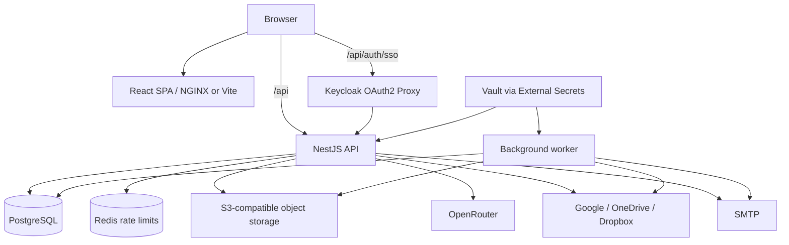
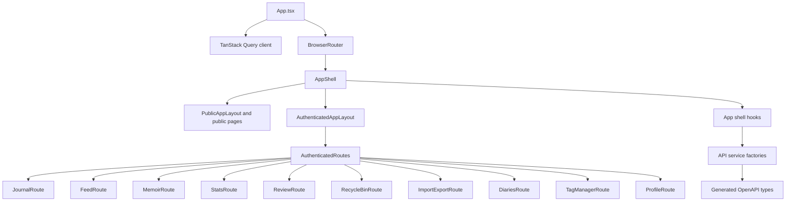

# Architecture Overview and ADR Index

How Thoughty is put together, and the architecture decision records (ADRs) that explain why. Entity-level detail is in the [Data Model](./data-model.md); runtime deployment is in the [Deployment Guide](./deployment.md).

## System Architecture at a Glance

Thoughty is a TypeScript-first modular monolith: one NestJS API and one route-driven React single-page application.

- PostgreSQL holds all journal data; S3-compatible object storage holds attachment files.
- Redis, when configured, shares rate-limit counters between API replicas.
- OpenRouter provides optional AI. SMTP sends account and memoir emails.
- A separate worker process runs the background jobs (see [Background Worker](#background-worker)).
- Users sign in with a local Thoughty account or, in production, with Keycloak single sign-on through the platform's OAuth2 Proxy, which guards only the SSO exchange route. Vault supplies secrets in production.



## Backend Architecture

`AppModule` registers the global JWT and throttling guards, so every request is authenticated (unless its route is marked public), throttled, and DTO-validated before a feature module runs a user-scoped query. The feature modules live in `thoughty-server/src/modules`:

| Module | Responsibility |
|---|---|
| `auth` | SSO exchange, local and Google sign-in, tokens and sessions, email verification, 2FA, password recovery, account deletion |
| `entries` | entry CRUD (title, time, mood, feelings), full-text search, revisions, tags, visibility, favorites, pins, archive, reordering, task list ticks, backlinks, highlights, delete-all |
| `recycle-bin` | deleted entries kept for 30 days: list, restore, delete forever, empty, and the hourly purge |
| `diaries` | diary containers, ordering, default diary, moving entries when a diary is deleted |
| `saved-searches` | named journal filter combinations with their diary scope: list, save, rename, delete, at most 50 per writer |
| `attachments` | upload validation, object storage, audio transcription |
| `ai` | OpenRouter credentials and usage, tag suggestions, inspiration, rephrasing, summaries, chat, semantic search, duplicates, tag organization, writing insights |
| `stats` | statistics, heatmap, mood stats, connections graph, writing-tendency analysis |
| `review` | year in review: totals, rhythm, themes, highlights, moods, and the on-request AI mood arc |
| `io` | import and export formats, TXT format settings, Day One and Journey imports parsed in the browser ([ADR 0020](./adr/0020-browser-side-app-imports-and-streamed-archives.md)), the streamed Markdown folder export |
| `books` | book composition, covers, previews, saved versions |
| `cloud-sync` | provider connections, file browsing, schedules, queued jobs |
| `config` | user preferences and profile, encrypted settings, data export, the feature-flag endpoint (no feature reads flags yet) |
| `feature-requests` | community idea board and votes |
| `social` | public feed, follows, comments, likes, leaderboard, achievements (karma and badges) |
| `account-purge` | permanent deletion of deleted accounts after the grace period |
| `memoir` | guided memoir: question catalogue, program settings, answers as entries, weekly delivery and email |
| `metrics` | Prometheus metrics (the health endpoint is `HealthController` in `AppModule`) |

Cross-cutting runtime code goes in `src/common`, entities and migrations in `src/database`, and operational scripts in `thoughty-server/scripts`.

Modules that outgrow one service split it by responsibility, and source files stay under 500 lines. In `auth`, `AuthService` signs users in (registration, password login and its two-factor step, Google and Keycloak sign-in, which link or create the account and its default diary); `IdentityVerificationService` verifies Google ID tokens and Keycloak access tokens against the providers' keys; `AuthSessionService` issues, rotates, lists and revokes refresh-token sessions; `PasswordService` changes and resets passwords; and `AccountService` reads and deletes the user's own account. In `entries`, the `EntriesService` facade routes reads to `EntriesQueryService` (the list and its search, dates, tag usage, highlights, revisions) and `EntryLookupService` (the first entry of a year or month, an entry by date or id with the page that shows it, backlinks), and writes to `EntriesCommandService` ([ADR 0005](./adr/0005-selective-cqrs-in-entry-domain.md)). The entries DTOs are one file per concern in `entries/dto` (writes, bulk operations, tags, queries, responses), re-exported by `entries.dto.ts`. In `src/common/utils`, `file-converter.util.ts` re-exports the journal file formats, one module each (`file-converter-text`, `-markdown`, `-json`, `-csv`, with the TXT format settings in `-format` and the shared entry shape in `-entry`), and `book-converter.util.ts` builds books and re-exports the book model (`book-model.util.ts`) and its Markdown and HTML renderers (`book-render.util.ts`).

### Background Worker

`thoughty-server/src/cloud-sync-worker.ts` boots `AppModule` as a Nest application context without HTTP and starts four loops that API replicas never run. The worker stays at one replica ([ADR 0006](./adr/0006-database-backed-cloud-sync-worker.md)). Manual uploads, downloads, and "sync now" run inline in the API request, not through the queue.

| Service | Interval | Work |
|---|---|---|
| `CloudSyncWorkerService` | jobs every 5 s, schedules every 60 s | turns due sync schedules (stored in `settings`) into `cloud_sync_jobs` rows, claims them with `FOR UPDATE SKIP LOCKED`, runs the sync, retries, and recovers stale jobs |
| `MemoirDeliveryWorkerService` | every 60 s | moves due `memoir_programs` to their next question and sends the weekly email |
| `RecycleBinPurgeWorkerService` | hourly | hard-deletes entries in the recycle bin for over 30 days and removes their files |
| `AccountPurgeWorkerService` | hourly | permanently deletes accounts deleted more than `ACCOUNT_PURGE_AFTER_DAYS` (default 30) ago: their stored files, then the user row and everything that cascades from it |

## Frontend Architecture

The frontend is one React SPA under `thoughty-web/src`. Its main boundary is the route, not a microfrontend.



- Route files stay thin. Components render; hooks own shared state, URL parameters, and API calls.
- Server state goes through TanStack Query. The entry list keeps the previous page on screen while the next one loads.
- The journal sends its first list request once everything that shapes it is known: the profile config (page size; a failed config request falls back to 10 at once), the default or route diary, and on a permalink the page that holds the entry. Until then the list query is disabled and the journal shows as loading, so no request is sent with defaults and thrown away.
- Query-string parameters are product behavior: diary scope, import/export presets, entry permalinks, and the saved search on screen (`view=<id>`, written beside `diary` when one is applied and dropped as soon as a filter changes).
- API types are generated from the server's OpenAPI document ([ADR 0004](./adr/0004-openapi-as-contract-source.md)). A test fails if the frontend stops calling a documented product endpoint.

## API Error Codes

Every error the API raises has Nest's usual body plus a stable, machine-readable `code`: `{ "statusCode": 401, "message": "Invalid or expired verification code.", "error": "Unauthorized", "code": "AUTH_INVALID_2FA_CODE" }`. The `message` stays English for logs and API users; clients translate by `code`. The OpenAPI document describes the body as `ApiErrorResponse`, with the codes as the `ApiErrorCode` enum.

- **Server.** Services throw `apiError(NotFoundException, 'ENTRY_NOT_FOUND')` from `src/common/errors`, which keeps Nest's exception class (and its status) and fills in the code's default message from `API_ERROR_MESSAGES`; a call site may pass a more specific message (a limit, a provider name) under the same code. `ApiErrorCodeFilter` gives every other HTTP error a generic code from its status: class-validator errors (`message` is then a list), guards, the rate limiter and Multer's size limit. Only an unexpected server failure (500) may come without a code.
- **Web.** `readApiErrorMessage` (`services/api/base.ts`) turns a known code into the translation key `apiError_<CODE>` (`utils/translations.apiErrors.ts`, English and French), which screens pass through `t` as before; an unknown code falls back to the server's message, then to the caller's fallback key. Services built on `requestJson` (`services/api/base.ts`) resolve to `{ data, error }`, with `error` already read this way; `cloudSyncService` is one. The key type comes from the generated `ApiErrorCode`, so a code added on the server fails the web type check until it is translated.
- **Changing codes.** A code never changes meaning once released. Add a new one to `API_ERROR_MESSAGES`, run `npm run api:sync`, translate it, and list it here.

| Area | Code | Default message |
|---|---|---|
| Generic, by status | `VALIDATION_FAILED` | The request is invalid |
|  | `UNAUTHORIZED` | Unauthorized |
|  | `FORBIDDEN` | Forbidden |
|  | `NOT_FOUND` | Not found |
|  | `CONFLICT` | Conflict |
|  | `PAYLOAD_TOO_LARGE` | Payload too large |
|  | `RATE_LIMITED` | Too many requests |
|  | `SERVICE_UNAVAILABLE` | Service unavailable |
|  | `BAD_GATEWAY` | Bad gateway |
|  | `INTERNAL_ERROR` | Internal server error |
| Sign-in, registration and sessions | `AUTH_INVALID_CREDENTIALS` | Invalid email or password |
|  | `AUTH_ACCOUNT_DELETED` | This account has been deleted. Please contact support if you believe this is a mistake. |
|  | `AUTH_EMAIL_TAKEN` | Email already registered |
|  | `AUTH_USERNAME_TAKEN` | Username already taken |
|  | `AUTH_INVALID_REQUEST` | Invalid auth request |
|  | `AUTH_INVALID_TOKEN` | Invalid token payload |
|  | `AUTH_GOOGLE_NOT_CONFIGURED` | Google sign-in is not configured on this server |
|  | `AUTH_GOOGLE_INVALID_CREDENTIAL` | Invalid Google credential |
|  | `AUTH_GOOGLE_EMAIL_UNVERIFIED` | Google account email is missing or unverified |
|  | `AUTH_KEYCLOAK_TOKEN_MISSING` | Keycloak access token is missing |
|  | `AUTH_KEYCLOAK_TOKEN_INVALID` | Invalid Keycloak access token |
|  | `AUTH_KEYCLOAK_IDENTITY_INCOMPLETE` | Keycloak identity is incomplete or unverified |
|  | `AUTH_REFRESH_TOKEN_MISSING` | Refresh token is missing |
|  | `AUTH_REFRESH_TOKEN_INVALID` | Invalid refresh token |
|  | `AUTH_REFRESH_TOKEN_EXPIRED` | Refresh token expired or revoked |
|  | `AUTH_SESSION_NOT_FOUND` | Session not found |
|  | `AUTH_SESSION_IS_CURRENT` | Use logout to end the current session |
|  | `AUTH_CURRENT_REFRESH_TOKEN_REQUIRED` | Current refresh token is required |
|  | `USER_NOT_FOUND` | User not found |
| Password, account deletion and email verification | `AUTH_INVALID_PASSWORD` | Invalid password |
|  | `AUTH_PASSWORD_REQUIRED` | Password is required to delete account |
|  | `AUTH_PASSWORD_NOT_SET` | Cannot change password for OAuth accounts without existing password |
|  | `AUTH_CURRENT_PASSWORD_INCORRECT` | Current password is incorrect |
|  | `AUTH_INVALID_RESET_TOKEN` | Invalid or expired reset token |
|  | `AUTH_INVALID_VERIFICATION_TOKEN` | Invalid or expired verification token |
|  | `EMAIL_DELIVERY_NOT_CONFIGURED` | Email delivery is not configured. |
| Two-factor authentication | `AUTH_2FA_PASSWORD_ACCOUNTS_ONLY` | Email two-factor authentication is available for password accounts only. |
|  | `AUTH_2FA_EMAIL_NOT_VERIFIED` | Verify your email before enabling two-factor authentication. |
|  | `AUTH_2FA_ALREADY_ENABLED` | Two-factor authentication is already enabled. |
|  | `AUTH_2FA_NOT_ENABLED` | Two-factor authentication is not enabled. |
|  | `AUTH_2FA_CODE_NOT_SENT` | Unable to send the verification code. |
|  | `AUTH_2FA_INVALID_CHALLENGE` | Invalid or expired two-factor challenge. |
|  | `AUTH_INVALID_2FA_CODE` | Invalid or expired verification code. |
|  | `AUTH_2FA_CHALLENGE_USED` | Two-factor challenge has already been used. |
|  | `AUTH_2FA_UNAVAILABLE` | Two-factor authentication is unavailable. |
| Entries, tags, revisions and task lists | `ENTRY_NOT_FOUND` | Entry not found |
|  | `ENTRIES_NOT_FOUND` | No matching entries found |
|  | `ENTRY_PIN_LIMIT_REACHED` | Pinned entry limit reached |
|  | `ENTRY_REVISION_NOT_FOUND` | Revision not found |
|  | `ENTRY_TASKS_MARKDOWN_ONLY` | Only Markdown entries have task lists |
|  | `ENTRY_TASK_CHANGED` | That line is no longer a task. Reload the entry and try again. |
|  | `TAG_RENAME_SAME_NAME` | New tag name must be different |
|  | `TAG_NOT_FOUND` | No entries found with that tag |
|  | `RECYCLE_BIN_ENTRIES_NOT_FOUND` | No matching entries in the recycle bin |
| Diaries and settings | `DIARY_NOT_FOUND` | Diary not found |
|  | `DIARY_NAME_TAKEN` | A diary with this name already exists |
|  | `DIARY_DEFAULT_NOT_DELETABLE` | Cannot delete the default diary |
|  | `SETTINGS_RESERVED` | Settings cannot be changed here |
| Saved searches | `SAVED_SEARCH_NOT_FOUND` | Saved search not found |
|  | `SAVED_SEARCH_NAME_TAKEN` | A saved search with this name already exists |
|  | `SAVED_SEARCH_LIMIT_REACHED` | Saved search limit reached |
| Attachments and audio transcription | `ATTACHMENT_NOT_FOUND` | Attachment not found |
|  | `ATTACHMENT_FILE_NOT_FOUND` | File not found |
|  | `ATTACHMENT_FILE_MISSING` | No file provided |
|  | `ATTACHMENT_TYPE_NOT_ALLOWED` | File type is not allowed |
|  | `ATTACHMENT_TOO_LARGE` | File size exceeds the maximum |
|  | `ATTACHMENT_EXPORT_TOO_LARGE` | Attachment exceeds the export size limit |
|  | `ATTACHMENT_NOT_AUDIO` | Only audio attachments can be transcribed |
|  | `TRANSCRIPTION_FAILED` | Audio transcription request failed |
| Import, export and books | `IMPORT_CONTENT_REQUIRED` | File content is required |
|  | `IMPORT_FILE_TOO_LARGE` | File too large |
|  | `IMPORT_TOO_MANY_ENTRIES` | Too many entries |
|  | `APP_IMPORT_IN_PROGRESS` | These entries are already being imported |
|  | `BOOK_COVER_INVALID` | Cover image must be a PNG or JPEG file no larger than 2 MB. |
|  | `BOOK_TOO_LARGE_FOR_VERSION` | Generated book is too large to save as a version. |
|  | `BOOK_VERSION_NOT_FOUND` | Book version not found |
|  | `BOOK_AI_NARRATIVE_KEY_REQUIRED` | AI narrative requires an OpenRouter API key on the server. Disable the AI narrative option to download a plain book. |
|  | `BOOK_AI_FRAMING_KEY_REQUIRED` | AI chapter framing requires an OpenRouter API key on the server. Disable chapter introductions and summaries to generate the book without them. |
| AI features and the OpenRouter key | `AI_KEY_NOT_CONFIGURED` | OpenRouter API key is not configured |
|  | `AI_KEY_REJECTED` | OpenRouter rejected this API key |
|  | `AI_PERSONAL_KEY_REQUIRED` | Add a personal OpenRouter API key to view usage |
|  | `AI_CONTENT_REQUIRED` | Entry content is required |
|  | `AI_TAGGED_ENTRIES_REQUIRED` | Tagged entries are required for inspiration |
|  | `AI_PROVIDER_FAILED` | OpenRouter request failed |
| Cloud sync | `CLOUD_NOT_CONNECTED` | Not connected to this cloud provider |
|  | `CLOUD_CONNECTION_EXPIRED` | Cloud connection expired. Please reconnect. |
|  | `CLOUD_UNKNOWN_PROVIDER` | Unknown provider |
|  | `CLOUD_AUTHORIZATION_REJECTED` | The cloud provider did not accept this sign-in. Please connect again. |
|  | `CLOUD_PROVIDER_FAILED` | The cloud provider could not complete the request |
| Guided memoir | `MEMOIR_UNKNOWN_QUESTION` | Unknown memoir question |
|  | `MEMOIR_NOT_STARTED` | The guided memoir has not been started |
|  | `MEMOIR_ALREADY_STARTED` | The guided memoir is already started |
|  | `MEMOIR_DIARY_REQUIRED` | Choose a diary for your memoir first |
|  | `MEMOIR_ANSWER_EMPTY` | Write an answer or attach a recording |
|  | `MEMOIR_ALREADY_ANSWERED` | This question already has an answer |
| Stats and the year in review | `STATS_INVALID_DATE_RANGE` | The start date must be before or equal to the end date |
|  | `REVIEW_YEAR_EMPTY` | There are no entries to read in this year |
|  | `REVIEW_MOOD_UNAVAILABLE` | The mood of the year could not be read right now |
| Social features and feature requests | `SOCIAL_CANNOT_FOLLOW_SELF` | You cannot follow yourself |
|  | `SOCIAL_CANNOT_LIKE_OWN_ENTRY` | You cannot like your own entry |
|  | `SOCIAL_CANNOT_LIKE_OWN_COMMENT` | You cannot like your own comment |
|  | `COMMENT_NOT_FOUND` | Comment not found |
|  | `FEATURE_REQUEST_NOT_FOUND` | Feature request not found |

## Data Ownership Rules

- `entries` owns entry lifecycle rules; other modules call its services. `diaries` owns the default diary and moving entries off a deleted diary.
- Deleting an entry only sets `deleted_at`; `recycle-bin` owns restoring and purging. Queries that bypass TypeORM's entity filtering (raw SQL, `update`, `delete`) must add `deleted_at IS NULL` themselves.
- `attachments` owns object-storage keys and file validation. Original filenames are never storage keys.
- `config` owns preferences and encrypted integration settings. `cloud-sync` owns job status, locking, retries, and provider sync state.
- `memoir` owns the question catalogue and which entry answers which question. Answers are created through the `entries` service, so entry rules still apply.
- The public feed reads only entries that are both public and moderation-visible ([ADR 0013](./adr/0013-public-social-content-and-moderation.md)). New social features must not reuse private-entry assumptions without extending that ADR.
- Repeated entry-list reads are served from a short-lived per-pod cache (30 s by default, `ENTRIES_CACHE_TTL_SECONDS`) that entry mutations invalidate.

## ADR Process

Write or update an ADR when a change affects:

- runtime topology or deployment ordering
- the persistence model, ownership boundaries, or deletion behavior
- security, privacy, authentication, authorization, or abuse controls
- the API contract or the frontend/backend boundary
- background processing, queues, or sync
- observability, backup, recovery, or production operations
- the product's shape, such as social feeds, real-time messaging, paywalls, or offline sync

Status is `Proposed` for a decision that guides upcoming work, `Accepted` for implemented or committed architecture, and `Superseded` when a newer ADR replaces it.

## Decision Records

| ADR | Status | Decision |
|---|---|---|
| [0001](./adr/0001-documentation-structure.md) | Accepted | Split Documentation Out of Root README |
| [0002](./adr/0002-modular-monolith-and-route-driven-ui.md) | Accepted | Adopt a Modular Monolith with a Route-Driven UI Shell and Feature-Oriented Code Structure |
| [0003](./adr/0003-typescript-first-technology-stack.md) | Accepted | Standardize on a TypeScript-First Full-Stack Platform |
| [0004](./adr/0004-openapi-as-contract-source.md) | Accepted | Use Backend OpenAPI as the Source of Truth for API Contracts |
| [0005](./adr/0005-selective-cqrs-in-entry-domain.md) | Accepted | Apply Selective CQRS in the Entry Domain |
| [0006](./adr/0006-database-backed-cloud-sync-worker.md) | Accepted | Run Scheduled Cloud Sync Through a Separate Worker and Database-Backed Queue |
| [0007](./adr/0007-code-quality-and-verification-gates.md) | Accepted | Keep Code Quality Enforcement Lightweight but Continuous |
| [0008](./adr/0008-security-authentication-and-owasp-baseline.md) | Accepted | Establish a Secure-by-Default Authentication and OWASP Baseline |
| [0009](./adr/0009-rate-limiting-and-abuse-controls.md) | Accepted | Apply Layered Rate Limiting for Baseline Abuse Resistance |
| [0010](./adr/0010-journal-data-model.md) | Accepted | Model the Journal Around Diaries, Dated Entries, Revisions, and Attachments |
| [0011](./adr/0011-attachments-and-object-storage.md) | Accepted | Store Attachments as Metadata in PostgreSQL and Blobs in S3-Compatible Object Storage |
| [0012](./adr/0012-delivery-health-and-operational-model.md) | Accepted | Keep Delivery and Operational Verification Simple, Explicit, and Repository-Owned |
| [0013](./adr/0013-public-social-content-and-moderation.md) | Accepted | Define Public Social Content and Moderation Before Building Feed Features |
| [0014](./adr/0014-real-time-notifications-and-messaging.md) | Proposed | Choose a Real-Time Notifications and Messaging Model Deliberately |
| [0015](./adr/0015-observability-baseline.md) | Accepted | Establish a Privacy-Aware Observability Baseline |
| [0016](./adr/0016-backup-and-disaster-recovery.md) | Accepted | Define Backup and Disaster Recovery for Journal Data |
| [0017](./adr/0017-feature-flags-and-entitlements.md) | Accepted | Separate Feature Flags from User Entitlements |
| [0018](./adr/0018-offline-and-mobile-sync.md) | Proposed | Decide Offline and Mobile Sync Before Building Mobile Apps |
| [0019](./adr/0019-explicit-delivery-jobs.md) | Accepted | Use Explicit Delivery Jobs and Non-Blocking Verification |
| [0020](./adr/0020-browser-side-app-imports-and-streamed-archives.md) | Accepted | Read Other Apps' Exports in the Browser and Stream the Full Export |

## ADR Template

```markdown
# ADR NNNN: Title

- Status: Proposed | Accepted | Superseded
- Date: YYYY-MM-DD

## Context

What problem, constraint, or opportunity requires a decision?

## Decision

What are we choosing?

## Rationale

Why is this choice better than the alternatives for Thoughty right now?

## Consequences

What does this make easier, harder, required, or explicitly deferred?
```
