# Data Model Reference

The practical reference for Thoughty's relational model. [ADR 0010](./adr/0010-journal-data-model.md) explains the decision; this file lists the entities and the rules contributors must preserve. Columns are documented by the entity files in [`thoughty-server/src/database/entities`](../thoughty-server/src/database/entities); the schema itself is defined by the [migrations](../thoughty-server/src/database/migrations).

## Entity Relationship Overview

```mermaid
erDiagram
    User ||--o{ Diary : owns
    User ||--o{ Entry : owns
    User ||--o{ Attachment : owns
    User ||--o{ Setting : has
    User ||--o{ RefreshToken : has
    User ||--o{ CloudSyncJob : queues
    User ||--o{ AiUsageEvent : records
    User ||--o{ BookVersion : saves
    User ||--o{ FeatureRequest : submits
    User ||--o{ FeatureRequestVote : casts
    FeatureRequest ||--o{ FeatureRequestVote : receives
    User ||--o{ UserFollow : follows
    User ||--o{ EntryComment : writes
    User ||--o{ EntryLike : gives
    User ||--o{ CommentLike : gives
    User ||--o| MemoirProgram : runs
    User ||--o{ MemoirAnswer : writes
    User ||--o{ YearReviewMood : keeps
    User ||--o{ SavedSearch : saves
    User ||--o{ LifeEra : names
    User ||--o{ Person : mentions
    User ||--o| OnThisDayEmail : receives
    User ||--o| MonthlyRecapEmail : receives
    User ||--o{ ShareLink : shares
    Person ||--o{ PersonHandle : "is mentioned by"
    Person ||--o{ EntryPerson : "appears in"

    Diary ||--o{ Entry : contains
    Diary ||--o{ BookVersion : scopes
    Diary ||--o{ MemoirProgram : collects
    Diary ||--o{ YearReviewMood : scopes
    Diary ||--o{ SavedSearch : scopes
    Diary ||--o{ OnThisDayEmail : scopes
    Diary ||--o{ MonthlyRecapEmail : scopes

    Entry ||--o{ EntryRevision : snapshots
    Entry ||--o{ Attachment : links
    Entry ||--o| AiChatHistory : has
    Entry ||--o{ EntryComment : receives
    Entry ||--o{ EntryLike : receives
    Entry ||--o| MemoirAnswer : answers
    Entry ||--o{ EntryPerson : mentions
    Entry ||--o{ ShareLink : "is shared by"
    BookVersion ||--o{ ShareLink : "is shared by"
    EntryComment ||--o{ CommentLike : receives
```

Uniqueness rules worth knowing: diary names per user, one setting per key, one AI chat per entry, one vote per idea, one like per user and item, one follow per pair (never yourself), one memoir program per user, and one memoir answer per question and per entry, and saved search and life era names per user whatever their case, and each mention handle names one person per user. Comments hold 1 to 1,000 non-blank characters.

## Ownership and Deletion Rules

Every table except `users` references a user, and those foreign keys cascade. Accounts are first soft-deleted (`users.deleted_at`). The worker hard-deletes the user row after `ACCOUNT_PURGE_AFTER_DAYS` (default 30), after removing the account's files from object storage, and the cascades remove the rest. A new table that references users must cascade too; `account-purge.integration.spec.ts` checks every foreign key to `users`.

| Entity | Deletion behavior |
|---|---|
| `User` | Deleting an account sets `deleted_at` and removes refresh tokens. Deleted users cannot sign in, and their content leaves the feed, follows, comments, likes, and counts. The account and everything it owns or wrote is erased after the grace period. |
| `Diary` | The default diary cannot be deleted. Deleting another first moves its entries, including those in the recycle bin, to the default diary, and drops its writing goal with the row. `entries.diary_id` is `ON DELETE SET NULL` as a safety net (the foreign key `fk_entries_diary`, which migration `1787097600000-entry-diary-foreign-key` added: the initial schema had left the column without one, and entries it found pointing at a missing diary or another writer's moved to their writer's default diary). |
| `Entry` | Deleting moves it to the [recycle bin](#recycle-bin). Purging it hard-deletes the row, which cascades revisions, attachment rows, AI chat, comments, likes, and the memoir answer. |
| `EntryRevision`, `AiChatHistory`, `EntryComment`, `EntryLike`, `CommentLike` | Deleted with their entry (or comment). Comments and likes also go with their author. A comment can be removed by its author or the entry owner. |
| `Attachment` | The row is deleted with its entry or user. Purging an entry, purging an account and deleting an attachment also remove the stored object and, for a video, its poster frame. Any other hard delete leaves the objects behind. |
| `MemoirProgram` | Deleted with the user or when the memoir is stopped. Deleting its diary keeps the program with no diary (`SET NULL`) until another is chosen. |
| `MemoirAnswer` | Deleted with the user or the entry. Kept when the memoir is stopped. While the entry is in the recycle bin the question counts as unanswered; answering it again points the row at the new entry. |
| `BookVersion` | Deleted with the user. A diary's journal versions (`diary:<id>`) go with the diary (`ON DELETE CASCADE`); the all-diaries history (`all`) stays. A saved search's versions (`search:<id>`) are deleted with the saved search, in the same transaction, after its delete confirmation says how many go. Hand-picked versions (`picked`) stay listed and downloadable when their entries are deleted; only a new version from the same picks is refused (`400 BOOK_PICKED_ENTRIES_UNAVAILABLE`) until the missing picks are removed. |
| `YearReviewMood` | Deleted with the user or their diary. |
| `SavedSearch` | Deleted with the user, and with it the book versions saved from it. Deleting its diary keeps the search, its book versions, and widens it to all diaries (`SET NULL`). |
| `LifeEra` | Deleted with the user. Deleting one leaves entries untouched and sets `eraId` to null in the writer's saved searches filtered by it, in the same transaction, so they cover every date. |
| `Person`, `PersonHandle`, `EntryPerson` | Deleted with the user. An entry's links (`entry_people`) are rebuilt from its text on every save and go with the entry when it is purged; they stay while it is in the recycle bin, which only counts leave out. Deleting a person deletes their handles and links, keeps the text, and sets `personId` to null in saved searches filtered by them; merging moves the duplicate's handles and links to the person kept and points those saved searches at them. |
| `ShareLink` | Deleted with the user, its entry or its book version (`ON DELETE CASCADE`), and when revoked. Moving its entry to the recycle bin or sealing it deletes its links at once (trigger `trg_entries_drop_share_links`), so restoring the entry does not bring them back. Expired links are deleted as the writer next makes or lists links. |
| `OnThisDayEmail`, `MonthlyRecapEmail` | Deleted with the user. Deleting its diary widens the email to all diaries (`SET NULL`). Unsubscribing only turns it off and keeps the hour, zone and diary. |
| Everything else | Deleted with the user. Votes also go with their request. |

## Entries

### Journal Coordinates

An entry is identified by `id`, but its journal `date` (chosen by the writer, not taken from `created_at`) and same-day `index` are product-level coordinates too.

- `index` numbers the entries of one day. A new entry takes the next number of its day. Deleting an entry closes the gap; a restored entry goes to the end of its day.
- Permalinks use `id`. Cross-references use `[[2024-01-15]]` and `[[2024-01-15#2]]`, which resolve by date and index.
- `title` (`VARCHAR(200)`, one line) and `time_of_day` (`TIME(0)`, served as `HH:MM`) are optional. Setting a time never renumbers anything, so `[[date#n]]` keeps pointing at the same entry.
- A day is listed by `time_of_day ASC NULLS FIRST, index ASC` (`addSameDayOrder`): untimed entries in their manual order, then timed entries earliest first. The journal, `[[date#n]]` lookups, backlinks, books, PDF/HTML/EPUB documents, and the year in review use this order.
- Drag reordering (`PATCH /api/entries/reorder`) applies to untimed entries. It reuses the indexes the listed entries already hold, so entries left out of the list keep their numbers.
- Text exports (TXT, JSON, Markdown, CSV, the Markdown folder) list a day by `index`. An import numbers a day's entries in file order, so importing into an empty journal restores every number.

### Recycle Bin

Deleting entries (singly, in bulk, or with delete-all) sets `entries.deleted_at`, a TypeORM delete date column. TypeORM leaves these rows out of entity queries and joins. **Raw SQL, `update`, and `delete` calls must add `deleted_at IS NULL` themselves**, as the tag usage, achievements, and public feed queries do. An entry in the bin is visible only through `/api/recycle-bin`.

- Related rows stay in place while the entry is in the bin. Restoring puts it back at the end of its day, in its diary or in the default diary when that diary is gone.
- Entries stay 30 days. The worker purges older ones hourly in batches of 100 with `FOR UPDATE SKIP LOCKED`, then removes their attachment objects after commit. Deleting forever from the bin takes the same path.
- The partial index `idx_entries_user_deleted_at` on `(user_id, deleted_at) WHERE deleted_at IS NOT NULL` serves the bin listing and the purge.

### Imported Entries

Entries imported from Day One or Journey ([ADR 0020](./adr/0020-browser-side-app-imports-and-streamed-archives.md)) keep `import_ref`, the source app and its entry ID (`dayone:<uuid>`, `journey:<id>`). Other entries leave it null.

- An import looks entries up by reference first, so running the same import again returns the existing entries and their attachment names instead of duplicating them.
- The partial unique index `idx_entries_user_import_ref` on `(user_id, import_ref)` skips entries in the recycle bin. Importing again creates a new entry; restoring the old one then clears its reference.
- Imported entries are private Markdown entries, numbered after the entries already on their day. Their media are ordinary attachments.

### Moods and Feelings

- `mood` is a nullable `SMALLINT` from 1 (very low) to 5 (very good), checked by `chk_entries_mood`. `feelings` is `TEXT[] NOT NULL DEFAULT '{}'` and can be set without a mood.
- `normalizeFeelings` stores feelings lowercase and without duplicates: at most 10, each at most 40 characters, with the characters that would break the export formats removed (commas, semicolons, pipes, braces, brackets, backticks, and double quotes).
- Curated feelings are stored by their English key (`calm`), whatever the interface language. Words the writer types are kept as written.
- The partial index `idx_entries_user_mood_date` on `(user_id, mood, date) WHERE mood IS NOT NULL` serves the mood filter (`mood=4,5`, `mood=any`, `mood=none`) and mood stats. Stats (`StatsMoodService`) and the year in review compute from these columns on request.
- Mood and feelings are private: the public feed and share text never include them.

### Task List Ticks

Markdown task items (`- [ ]`, `- [x]`) are plain text in `entries.content`; nothing else stores them.

- `PATCH /api/entries/:id/tasks` (`EntryTaskListService`) sets the box on one 0-based line and changes nothing else. It locks the row (`FOR UPDATE`) so concurrent ticks serialize, and answers `409` when the line is no longer a task. Plain-text entries are refused.
- It saves a revision like any edit, unless the latest revision is under ten minutes old and differs only in ticks (`revisionCoversTicks`), so a run of ticks keeps one revision.

## Tags

There is no tag table. Tags are strings in the `entries.tags` text array, GIN-indexed for containment filters. Per-user tag metadata (color and category, keyed by lowercase tag name) is a JSON value in the `tagMetadata` setting.

- The known tags are the union of tags used by entries and tags in metadata. A tag created in the Tags view exists only as metadata until an entry uses it.
- `GET /api/entries/tags` returns used tags with counts. `PATCH /api/entries/tags/rename` and `DELETE /api/entries/tags?tag=` rewrite every owned entry's array; the client updates the metadata alongside.
- AI tagging, tag organization, and books use the same arrays. A **category** (such as Work) only groups tags in the UI. Tag correlations are computed on demand.
- If tags ever need their own ownership, permissions, or relationships, revisit this model with a new ADR.

## Full-Text Search

`entries.search_vector` is a stored generated `tsvector`, `GENERATED ALWAYS AS (entry_search_vector(title, content, tags)) STORED`. PostgreSQL keeps it current; the application never selects or writes it.

- **Weights and index.** Title and tags weigh `A`, content `B`. The GIN index `idx_entries_user_search_vector` on `(user_id, search_vector)` uses `btree_gin`, so a search reads only the writer's own matches. The `tags` GIN index serves an exact tag-name match alongside, which keeps tags such as `c++` findable.
- **Languages.** Every entry is indexed with both `thoughty_en` and `thoughty_fr`, copies of `english` and `french` that apply `unaccent` before stemming (`ete` finds "été", `walk` finds "walking"). Journals mix both languages and an entry has no language of its own, so a per-user, per-entry, or unstemmed `simple` configuration was rejected. The cost is a vector twice the size, and stop words of one language are indexed by the other.
- **Queries.** `websearch_to_tsquery` parses the search in both configurations, joined with `||`. It supports `"phrases"`, `-exclusions`, and `or`, and never raises a syntax error. A last bare word of two or more characters also matches as a prefix (`word:*`). A search with no words (only symbols or emoji) falls back to an escaped `ILIKE` on title and content plus an exact tag match.
- **Ranking.** Results sort by `ts_rank(search_vector, query, 1)` plus the rank without the prefix term, so whole words come first, then by date. `sort=date` keeps the usual pinned and date order.
- **Highlights.** `ts_headline` marks the non-excluded terms in title and text separately. A marked run is kept only when it matches its term by itself, so a phrase is highlighted only where it appears whole. The runs are returned as `search_matches`, and the web app highlights exactly those.
- **Migrations.** `EntryFullTextSearch1785974400000` installs `unaccent` and `btree_gin` (trusted contrib extensions, kept on rollback). `entry_search_vector` is `IMMUTABLE` with `SET search_path FROM CURRENT`, so it works while `pg_restore` runs with an empty search path. `EntryTitleAndTime1786060800000` replaced it with the three-argument version. Changing the generated column rewrites `entries` (about 17 s for 107,000 entries locally).

### Search Performance on a Large Journal

Measured on PostgreSQL 16 on a development machine with the dev seed's main journal (9,785 entries from 2015 to 2026, 2.3 MB of text) and a ten-fold copy under another account (97,850 entries, 22 MB). First page of 10, median of seven runs through `EntriesQueryService.getEntries`:

| Request | 9,785 entries | 97,850 entries |
|---|---|---|
| No search (baseline) | 13 ms | 119 ms |
| Rare or absent word (`zzzz`) | 12 ms | 103 ms |
| `"long run" -rain` (5.5% of entries match) | 16 ms | 109 ms |
| `walk` (7%) | 22 ms | 164 ms |
| `gratef`, read as a prefix (10%) | 25 ms | 142 ms |
| `coffee or tea` (22%) | 31 ms | 229 ms |
| `ILIKE` match alone, for comparison | 25 to 43 ms | 240 to 380 ms |
| Highlights for a page of 50 entries | 6 to 9 ms | 4 to 7 ms |

The index lookup takes under a millisecond for a rare word. Search cost grows with the number of matches, since each is counted and ranked: roughly 5 to 8 ms per thousand. `sort=date` is 20 to 35% faster on broad searches because it skips ranking. Most of the large baseline is the tag list returned with every page. The vector takes about 650 bytes per entry (2.8 times its text) and the index 15 MB for 107,000 entries. `npm run benchmark` includes an `entries_full_text_search` query for checking a real database.

## Required Columns

Migration `1787184000000-required-columns` made `NOT NULL` the columns the initial schema had left nullable while the entities declare them non-null: the entry flags, `index`, `tags`, `format`, `visibility` and `created_at`, the revision `format`, `visibility` and `created_at`, the diary `icon` (which also got its `'📓'` default), `visibility`, `is_default`, `position` and `created_at`, the user `auth_provider`, `email_verified`, `created_at` and `updated_at`, the `created_at` / `updated_at` of attachments, refresh tokens and settings, and the generated `entries.search_vector`, which is never null. Nulls took the column default; a missing `created_at` took the row's `updated_at` (an entry's date when it had neither), a user's missing `updated_at` its `created_at`. `users.email` stays nullable until the owner decides (Needs Input in `TODO.md`). The spec in [Testing](testing.md#entities-against-the-migrated-schema) keeps the entities and the schema in step.

## Diary Names

A writer's diaries have distinct names, compared ignoring case and surrounding spaces: the unique index `uq_diaries_user_name` on `(user_id, lower(btrim(name)))`, the same comparison the app import uses to put a journal into "the diary of the same name" and the memoir uses to continue in an existing diary. The `Diary` entity names the index with `synchronize: false`, since TypeORM cannot describe an expression index. `POST /api/diaries` and `PUT /api/diaries/:id` let the index decide, so two requests racing for one name cannot both win, and answer `409 DIARY_NAME_TAKEN` on its violation; a diary may change the case of its own name.

Migration `1787011200000-diary-unique-names` resolved the duplicates databases held before the index existed: per writer and name, the oldest diary (by `created_at`, then id) kept its name, and each later one became `Name (2)`, `Name (3)`… with the first number no diary of that writer used, shortened by whole characters to fit the 100-character column. Their entries, settings and books were untouched. Rolling back drops the index and keeps the new names.

## Diary Writing Goals

A diary can carry one optional writing goal in `goal_type` (`entries_per_week` or `words_per_day`) and `goal_target`. The `chk_diaries_goal` constraint keeps them set together or both null, with 1 to 50 entries a week or 10 to 10,000 words a day; `DIARY_GOAL_LIMITS` and the `IsDiaryGoalTarget` validator hold the same bounds for the API, which answers `400 VALIDATION_FAILED` outside them. On `PUT /api/diaries/:id`, leaving `goalType` out keeps the goal and `null` removes it.

Progress is computed on request (`StatsGoalService`, in `GET /api/stats` as `goals`), never stored: one grouped query sums each goal diary's entries and words per day (words as in the other stats, split on whitespace), leaving out the recycle bin and entries dated after `today`, the writer's local day sent by the app (the server's UTC day without it). Days are summed into Monday-to-Sunday weeks for an entries goal. Each goal reports the current period's progress, whether it is met, the current and longest streaks, and the first day of every period that met it, which the activity heatmap marks. Only the writer's own diaries are read: a diary ID of someone else's diary gives no goal.

## Writing Streak

`GET /api/stats/streak` (`StatsStreakService`) measures the journal's daily streak on request, never stored, with the same `diaryId` and `today` query as `GET /api/stats`. One grouped query lists the distinct days with an entry up to `today` (the writer's local day; the server's UTC day without it), and a second reads the latest entry on or before it (by date, then time of day and same-day index), with its title and a plain-text snippet (`plainExcerpt`, 140 characters). Both leave out the recycle bin and read only the writer's own entries, so another writer's diary ID gives no streak. The answer (`WritingStreakResponseDto`) has `currentStreak` (days in a row ending today, or yesterday while today has no entry yet, counted by `currentRun`, the helper the diary goals use), `writtenToday`, `daysSinceLastEntry`, and `lastEntry` (null for an empty journal). The web decides what to show from these: the streak from two days on, the pick-up prompt from three days without an entry. The `streakCard` setting (`'true'`/`'false'`, shown unless `'false'`) turns the card off; the day it was dismissed is kept in the browser's `localStorage` (`thoughty.writingStreakDismissedOn`) and never reaches the server.

## Saved Searches

`saved_searches` keeps named journal views (`SavedSearchesModule`, `/api/saved-searches`): a `name` (`VARCHAR(80)`, not blank), the diary scope `diary_id` (null for all diaries), and the filter bar's state in `filters` (JSONB).

- `filters` holds `search`, `searchMode` (`keyword` or `semantic`), `sort` (`relevance` or `date`), `tags`, `date` (`YYYY-MM-DD` or null), `visibility` (`all`, `public`, `private`), `archiveStatus` (`active`, `archived`, `all`), `favorites`, and `mood` (the entry list's mood filter, or empty). `SavedSearchFiltersDto` validates every field with the same bounds as `GET /api/entries` and refuses unknown ones, so a new filter needs a DTO field (old rows simply lack it) rather than a migration.
- The unique index `uq_saved_searches_user_name` on `(user_id, lower(name))` gives one name per writer whatever its case; a clash answers `409 SAVED_SEARCH_NAME_TAKEN`. Lists are sorted by name, case-insensitively.
- A writer keeps at most 50 (`SAVED_SEARCH_LIMIT`, sent with the list). Saves take a transaction-scoped advisory lock on `(hashtext('saved_searches'), user_id)`, so concurrent saves cannot pass the limit. The diary must be the writer's own.
- Each listed search carries `bookVersionCount`, the book versions saved from it (`scope_key` `search:<id>`), counted in one grouped query; the delete confirmation names that count, since deleting the search deletes those versions.
- Saved searches are private: they are only read by their owner, and they are part of the data download.

## Private Share Links

`share_links` keeps the private share links of entries and book versions (`ShareLinksModule`, [ADR 0024](./adr/0024-private-share-links.md), migration `1787443200000-share-links`): one row per link.

- The target is exactly one of `entry_id` and `book_version_id` (`chk_share_links_target`), each cascading with its row; `idx_share_links_entry` and `idx_share_links_book_version` (partial) find a target's links, and `idx_share_links_user_created` a writer's.
- `token_hash` (`VARCHAR(64)`, lowercase hex, `chk_share_links_token_hash`, unique `uq_share_links_token_hash`) is the SHA-256 of the 256-bit token. The token itself is never stored, and the column is not selected by default.
- `expires_at` (`TIMESTAMPTZ`, required, after `created_at`), `max_views` (null for no limit, else 1 to 1,000), `view_count` and `last_viewed_at`. A view is counted by one conditional `UPDATE` (`view_count < max_views`), so concurrent readers cannot pass the limit.
- `label` (`VARCHAR(80)`, nullable) is the writer's note; `show_mood` and `show_tags` (both false by default, and always false for a book version, `chk_share_links_entry_options`) choose what the reader sees.
- A writer has at most 100 unexpired links (`SHARE_LINK_LIMIT`, sent with the list), counted under a transaction-scoped advisory lock on `(hashtext('share_links'), user_id)`.
- `trg_entries_drop_share_links` (`AFTER UPDATE OF deleted_at, sealed_until ON entries`) runs `share_links_drop_for_hidden_entry()`, which deletes an entry's links when `deleted_at` or `sealed_until` goes from null to a value.
- Links are part of the data download, without their token or hash.

## Life Eras

`life_eras` keeps named periods of the writer's life (`LifeErasModule`, `/api/life-eras`): a `name` (`VARCHAR(50)`, not blank), `start_date` (`DATE`), `end_date` (`DATE`, null while the era is ongoing, never before the start: `chk_life_eras_dates`), and optional `color` (`#RRGGBB` in capitals), `emoji` (16 characters) and `note` (500 characters).

- Eras may overlap. An entry belongs to an era by its date alone, first and last days included; nothing is stored on entries.
- The unique index `uq_life_eras_user_name` on `(user_id, lower(name))` gives one name per writer whatever its case (`409 LIFE_ERA_NAME_TAKEN`); `idx_life_eras_user_start` serves the list, ordered by start date, closed before ongoing on the same start, then by name.
- A writer keeps at most 100 (`LIFE_ERA_LIMIT`, sent with the list). Adding takes a transaction-scoped advisory lock on `(hashtext('life_eras'), user_id)`, so concurrent requests cannot pass the limit. An end before the start is refused with `400 LIFE_ERA_DATES_INVALID`; an update checks the range it leaves.
- The journal filter `eraId` (`EntryFilterQueryDto`, shared by the list, the calendar and saved-search books through `applyEntryListFilters`) adds `EXISTS (SELECT 1 FROM life_eras era WHERE era.id = :eraId AND era.user_id = e.user_id AND e.date BETWEEN start AND end-or-unbounded)`, so another writer's era matches none of your entries. The entry list cache key includes `eraId`, and changing or deleting an era moves the writer's [list version](#journal-list-versions) on.
- Saved searches keep the era as `filters.eraId` (optional: searches saved before eras lack it and are read as `null`). Saving one checks the era is the writer's own (`404 LIFE_ERA_NOT_FOUND`).
- Era books (`chapterMode=eras`) read the writer's eras and place each entry in the shortest era covering its date (an ongoing era lasting until today), ties going to the later start, then the name; `includeUntagged` adds the "Other" chapter for entries outside every era.
- A memoir answer can name an era (`eraId`): the entry is tagged with the era's name besides its chapter tag. The tag is a copy; renaming or deleting the era leaves it.
- Life eras are private, read only by their owner, part of the data download (with their IDs, which saved searches refer to), and erased with the account.

## People

People are the writer's own records of someone they mention with `@handle` in an entry (`PeopleModule`, `/api/people`); they are never platform users and are never linked to accounts.

- **Mention syntax** (`common/utils/entry-mentions.util.ts`, mirrored by the web's `utils/mentions.ts`): `@` then a handle that starts with a letter of any script and goes on with letters, combining marks and digits, joined by single `-` or `_` (`@Marie`, `@Jean-Paul`, `@marie_c`, `@Ольга`), at most 50 characters (a longer run is not a mention). The `@` must not follow a letter, digit, mark or one of `` . @ / \ + - ` ``, and the handle must not be followed by `@` or by `.`, `-` or `_` and a letter or digit, so e-mail addresses, domains, profile URLs and an escaped `\@name` stay text. Fenced code blocks, inline code spans, `[[date]]` references, Markdown links and images, autolinks and bare web addresses are left out, in plain and Markdown entries alike. Handles compare without case, by their NFC form in lower case (`@Marie` = `@marie`, but `@Élodie` ≠ `@Elodie`).
- **Tables** (`People1786665600000`, entities in `person.entity.ts`): `people` holds the `name` shown (`VARCHAR(80)`, not blank), first the handle as first written; `person_handles` maps each handle key to its person, primary key `(user_id, handle)`; `entry_people` links entries and people, primary key `(entry_id, person_id)` with `idx_entry_people_person` for a person's entries. Every foreign key cascades.
- **Linking** (`syncEntryMentions`, through `EntryMentionsService.save`): creating or editing an entry, a file import and a Day One or Journey import save the entry and rebuild its links in one transaction. A handle no one holds adds a person, under a transaction-scoped advisory lock on `(hashtext('people'), user_id)` so two saves at once add one person. A writer keeps at most 1,000 people (`PEOPLE_LIMIT`) and an entry links at most 50 (`ENTRY_MENTION_LIMIT`); past either, mentions stay plain text. Ticking a task only changes a box, so it relinks nothing; restoring a revision is an edit. The migration links the entries written before people existed, recycle bin included, with a frozen copy of these rules and of this function (`migrations/frozen/1786665600000-people-mentions.ts`), so it links the same on every database whenever it runs; `people-migration-mentions.spec.ts` records what the copy reads for a corpus of mentions, e-mail addresses, URLs, code, `[[links]]`, Unicode, escapes and limits, and checks it against the app's parser and linking as they were when the migration was written.
- **Counts** are read, never stored: `GET /api/people` lists each person by name with their handles, `entryCount` (entries outside the recycle bin) and `lastMentionedOn`, so edits, the bin, purges and deletions always show. The journal filter `personId` (`EntryFilterQueryDto`, through `applyEntryListFilters`) adds `EXISTS (SELECT 1 FROM entry_people ep WHERE ep.entry_id = e.id AND ep.person_id = :personId)`; links only join a writer's entries to their own people, so another writer's person matches nothing. The entry list cache key includes `personId`, and merging or deleting a person moves the writer's [list version](#journal-list-versions) on (through the `entry_people` links it removes).
- **Renaming** (`PATCH /api/people/:id`) changes only the name shown: handles and entry text stay as written. **Merging** (`POST /api/people/:id/merge` with `duplicateId`) moves the duplicate's handles and links to the person kept and deletes the duplicate, under the people lock, so `@duplicate` keeps naming the person kept; `400 PERSON_MERGE_SAME` refuses a person into themselves. **Deleting** unlinks every entry and keeps the text; saving an entry that still mentions the handle adds the person again. Changing a handle (with or without rewriting entries) is not offered yet.
- Saved searches keep the person as `filters.personId` (optional, read as `null` in searches saved before people; saving checks the person is the writer's own, `404 PERSON_NOT_FOUND`), so saved-search books can be about one person.
- People are private: read only by their owner, part of the data download (with their handles and the IDs of the entries that mention them, recycle bin included), erased with the account. The public feed and share texts carry the entry text as written, with no person data.

## Journal List Versions

`entry_list_versions` holds one row per writer (`user_id` primary key, cascading with the account): `version`, a number that only grows, and `changed_by`, the transaction that last moved it. A deferred constraint trigger `trg_<table>_entry_list_version` on `entries`, `diaries`, `attachments`, `life_eras` and `entry_people` (every table `GET /api/entries` reads) calls `entry_list_changed()`, which moves the version of each writer whose rows changed (an `entry_people` link finds its writer through the entry) once per transaction, when it commits. A writer whose account goes in the same transaction is skipped. The API's list cache serves a copy only while the writer's version is the one it was read at ([ADR 0022](./adr/0022-versioned-entry-list-cache.md)); a writer without a row reads as version `0`.

## Public Feed Eligibility

`Entry.visibility` (the owner's choice) and `Entry.moderationStatus` (`visible`, `hidden`, `under_review`, `removed`, set by the platform) are independent ([ADR 0013](./adr/0013-public-social-content-and-moderation.md)). An entry is **feed-eligible** when it is `public` and `visible`, not archived, not in the recycle bin, and its author is not deleted. The composite index `idx_entries_public_feed` serves the newest-first feed reads.

- The feed reads entries and users directly and projects only feed-safe author fields.
- The **Following** scope applies the same rules to followed authors. A user can be followed only while they have a feed-eligible entry, so follows cannot probe private accounts.
- Comments and likes can be read or written only while their entry is feed-eligible. Nobody can like their own entry or comment. Content by deleted users is neither listed nor counted.
- Reports and enforcement records do not exist yet. They will be separate entities, not new visibility values.

## Other Domains

- **Diaries.** One diary is the default capture target. `All Diaries` is a view, not a row.
- **Attachments.** Metadata lives in PostgreSQL and blobs in S3-compatible storage ([ADR 0011](./adr/0011-attachments-and-object-storage.md)). `storedFilename` is the generated object key; `originalFilename` is only for display. A file can be uploaded before it is linked to an entry. A video's poster frame is a second object on the same row: `poster_filename` (its key) and `poster_size`, set together or not at all (`chk_attachments_poster_pair`, migration `1787356800000-video-posters`); the API sends the key as `poster_filename`, the data download only `hasPosterFrame`.
- **Settings.** `settings` holds user-scoped key/value configuration. Cloud provider tokens, personal OpenRouter keys, and other integration secrets are encrypted with `CONFIG_ENCRYPTION_SECRET`. Personal OpenRouter keys are left out of configuration responses and data exports. New setting groups should document their keys, value shape, and privacy impact.
- **AI usage.** `ai_usage_events` records credential source (personal or server), model, tokens, and cost, never prompts, completions, or keys. The dashboard shows personal-key usage for the last 30 days.
- **Book versions.** Each saved book is an immutable `BYTEA` file (PDF, EPUB, HTML, or Markdown) with a manifest of chapter titles and entry IDs only. `source` (JSONB) records where its entries came from: `{"kind":"journal","diaryId"}`, `{"kind":"savedSearch","savedSearchId","savedSearchName"}` or `{"kind":"entries","entryIds":[...]}`; versions saved before sources existed default to the journal. `scope_key` gives each diary (`diary:<id>`), all diaries (`all`), each saved search (`search:<id>`) and the hand-picked books (`picked`) its own version sequence; a transaction-scoped advisory lock on the user and scope serializes numbering. `diary_id` is set only for journal books, so deleting a diary deletes its book versions but not those of saved searches or picks. Deleting a saved search deletes its versions in the same transaction, under the same advisory lock, and a version being saved for a saved search deleted meanwhile is refused (`404 SAVED_SEARCH_NOT_FOUND`). The binary is loaded only by the owner's download query.
- **Guided memoir.** `MemoirProgram` stores the collecting diary, `active` or `paused`, the email choice, and the schedule: `delivery_weekday` (0 = Sunday) at 09:00 in the IANA `time_zone`. `current_question_id` is this week's question and `next_delivery_at` drives the worker. The question catalogue is code (`modules/memoir/memoir-questions.ts`), referenced by stable string IDs. Answers are ordinary private entries; `MemoirAnswer` only links question and entry.
- **"On this day" email.** `on_this_day_emails` holds one row per writer who saved the setting (`user_id` is the key; no row means off): `enabled` (default off), `delivery_hour` (0 to 23, `chk_on_this_day_emails_hour`) in the IANA `time_zone`, `diary_id` (null for all diaries), `next_send_at` (the next time that hour comes round, recomputed on every save and every worker pass) and `last_sent_on`, the writer's local date of the last email. The partial index `idx_on_this_day_emails_due` on `next_send_at WHERE enabled` lets the worker find the due rows without scanning; `last_sent_on` is what keeps a local day to one email. Which entries an email holds is not stored: it reads them at send time with the Highlights "On this day" query.
- **Monthly recap email.** `monthly_recap_emails` has the same columns, check (`chk_monthly_recap_emails_hour`) and partial index (`idx_monthly_recap_emails_due`); both entities extend `OptInEmailSetting`. `next_send_at` is the next 1st of the month at the chosen hour in the writer's zone, and `last_sent_on` (the local day of the last recap) keeps a local month to one email. The recap is not stored either: at send time it counts the month just ended (entries, words, writing days, top three tags, the average of recorded moods) and picks one memory of that calendar month in an earlier year (a favorite first, then the most words, then the oldest; archived and empty entries left out), the recycle bin excluded throughout.
- **Time capsules.** `entries.sealed_until` (`TIMESTAMPTZ`) is set while an entry is a sealed capsule and is null otherwise; `chk_entries_sealed_private` keeps such an entry private. `time_capsules` holds one row per capsule (`entry_id` unique, cascading with the entry, `user_id` with the account): the local day `opens_on`, `open_hour` (0 to 23, `chk_time_capsules_hour`), the IANA `time_zone`, the instant `open_at`, `created_at` (when it was sealed), `opened_at`, and while sealed the entry's `sealed_title`, `sealed_content`, `sealed_tags`, `sealed_mood` and `sealed_feelings`, which the entry row does not hold. `chk_time_capsules_sealed_copy` ties the copy to the state: `sealed_content` is set exactly while `opened_at` is null. Opening moves the copy back into the entry (keeping tags given since after the sealed ones), relinks its mentions, clears the copy and sets `opened_at`; the row stays as the record Highlights reads for seven days. `idx_time_capsules_due` (on `open_at` where `opened_at` is null) feeds the worker and `idx_time_capsules_user_opened` Highlights. Purging the entry (recycle bin) or the account deletes the capsule; rolling the migration back moves still-sealed copies back into their entries first.
- **Year in review.** Everything is computed from entries on request except the AI mood arc. `YearReviewMood` keeps the latest reading per scope (diary null for all diaries): one `{month, mood, valence}` item per month in JSONB (valence -2 to 2), a summary, and the number of entries read. Reading again replaces it in one transaction.

## Schema Migrations

The schema is managed by ordered TypeORM migrations in `thoughty-server/src/database/migrations`; `synchronize` is off.

- `npm run migrate` (root) or `npm run db:migrate` (server) applies every pending migration in one transaction (`runPendingMigrations` in `src/database/run-migrations.ts`), with `SET CONSTRAINTS ALL IMMEDIATE` first: the [journal list version](#journal-list-versions) triggers are deferred to the commit, and PostgreSQL refuses to alter or index a table whose changed rows still have trigger events queued, so a backfill followed by `SET NOT NULL` on `entries`, `diaries`, `attachments`, `life_eras` or `entry_people` would fail on any database holding rows. The TypeORM CLI (`migration:run`, `migration:revert`) does not set it: a `down` (or a hand-run script) that changes rows of those tables and then alters them runs `SET CONSTRAINTS ALL IMMEDIATE` itself.
- `InitialSchema1784764800000` is an idempotent baseline. On an existing database it fills in missing baseline objects before being recorded; on a fresh database it creates the whole baseline.
- Each schema change is a new timestamped migration. Never edit a migration that has shipped.
- A migration loads only `typeorm`, Node built-ins (`node:`) and files under `src/database/migrations`, never application code (entities, services, utilities), which later changes would silently change what an old migration does on a fresh database. Logic a migration needs is frozen next to it in `migrations/frozen/` (outside the migrations glob, so TypeORM does not load it as a migration, and never imported by the app). ESLint's `no-restricted-imports` rejects other imports in migration files, and `migrations-isolation.spec.ts` checks every file under the folder, including `require` and dynamic `import()`.
- Generate a candidate with `npm run migration:generate -- src/database/migrations/<name>`, review both `up` and `down`, and test against fresh and upgraded databases. Most migrations have a spec next to the data source in `thoughty-server/src/database`.

## Read Replicas

Read replicas are optional. Set `POSTGRES_READ_REPLICA_HOSTS` (comma-separated) and TypeORM keeps writes on `POSTGRES_HOST` while it may route reads to the replicas. `POSTGRES_READ_REPLICA_PORTS` sets their ports. User, password, and database inherit the primary's values unless `POSTGRES_READ_REPLICA_USER`, `POSTGRES_READ_REPLICA_PASSWORD`, or `POSTGRES_READ_REPLICA_DB` are set.

Enable only replicas that stream from the primary with acceptable lag for journal, stats, search, and feed reads. Migrations and writes always target the primary.
