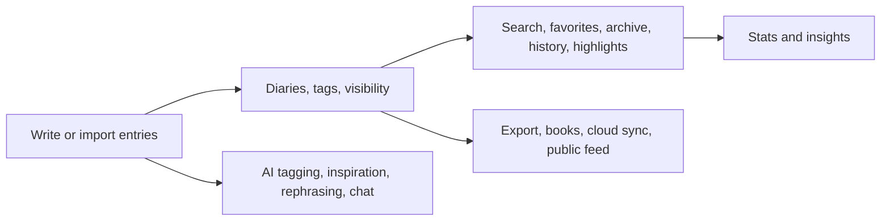

# Features

Thoughty is a privacy-focused journal built around dated entries. Writing, tags, diaries, history, statistics, AI help, and sync all operate on the same entry record rather than living in separate tools. The implemented and planned backlog is tracked in [TODO.md](../TODO.md).

## Writing and Entries

- **Composer.** Plain-text or Markdown entries (with a formatting toolbar, inline help, and live preview) in a box that grows with the content and can also be resized by dragging (the entry editor behaves the same). The date defaults to today and accepts typed dates for backdating. An optional one-line **title** (up to 200 characters) sits above the text, and an optional **time of day** next to the date: empty by default, typed, or set with **Now** (the browser's current time) and removed again with ×. The entry editor offers both too. Under the text, an optional **mood check-in**: five levels from **Very low** to **Very good**, each a labelled radio button with its emoji as decoration only, removed again with **Remove the mood**; and **Feelings**, chosen from twenty curated words (joyful, grateful, calm, hopeful, proud, loved, energized, content, curious, relieved, tired, stressed, anxious, sad, lonely, angry, frustrated, overwhelmed, bored, confused, in English or French) or typed in the writer's own words (Enter or **Add**), up to ten per entry. A typed curated word in either language ("Calme") is recognized as that feeling. Feelings can be recorded without a mood. The entry editor offers the same. Cards show the mood by its label (with the emoji and the feelings) next to the date. Attachments, visibility, and AI actions sit next to Save.
- **Focus mode.** The composer and the entry editor open a full-screen, distraction-free writing view with the focus-mode button next to **MD** or with `Ctrl+Shift+F` (`Cmd+Shift+F` on a Mac): from the editor when the keyboard focus is in it, otherwise for the composer. It shows only the text (Markdown entries as their Markdown source) in the writer's font family, size (a quarter larger), and color, with **typewriter scrolling** that keeps the caret's line near the middle of the screen (scrolling without animation when the system asks for reduced motion), a live word count, and an optional **session goal** in words with a thin progress bar and its count ("120 of 500 words this session"), which counts only the words written since focus mode opened and announces once when the goal is reached. The last goal is offered again next time (kept in the browser). **Esc**, **Done**, or the shortcut again leave it; the text is the composer's or editor's own draft, so nothing is lost, and saving still happens there. Like the other dialogs it keeps the keyboard inside, returns the focus to its button, follows the light and dark themes and high contrast, and keeps the journal's shortcuts from acting behind it. English and French.
- **Markdown task lists.** In Markdown entries, `- [ ]` and `- [x]` items show as checkboxes named after their item. Ticking one in the journal, by mouse or with Space, saves it at once in the entry text without opening the editor; ticks of the same entry are sent one after the other, and a run of ticks keeps one revision (the version from before the first tick) as long as the latest revision is under ten minutes old. If the entry changed elsewhere and the line is no longer a task, the journal says so and shows the saved entry. The formatting toolbar has an **Add a task list** button (`Ctrl+Shift+C`), and the composer and editor offer a short **Markdown help** under the editor, both in English and French. The public feed, highlights, and other read-only views show the boxes as they are, without letting them change; books and document exports keep their text form (`- [ ]`, `- [x]`), and Markdown exports keep the Markdown. Plain-text entries are unaffected.
- **Templates.** Thirteen built-in templates covering daily practice (gratitude, daily reflection, morning intentions, weekly review, life check-in), thinking things through (decision notes, philosophical musing, values reflection), emotions (rant it out, worry check, unsent letter), and more (letter to my future self, dream log), plus user templates saved from the current draft. Choosing one fills the draft, tags, format, and visibility.
- **Several entries per day.** Entries are addressed by date and same-day index. A new entry always takes the next number of its day, and setting, changing, or removing a time never changes an entry's number, so `[[date#n]]` links keep pointing where they did. A day lists its entries without a time first, in their manual order, then the entries with a time, earliest first (ties by number). The time shows next to the date on each card, and the card's `#n` explains that it is the link number. Only entries without a time can be dragged; reordering them swaps the numbers those entries hold among themselves and leaves the timed entries' numbers alone. Deleting an entry still closes the gap in its day's numbers, as before.
- **Cross-references.** Writing `[[2024-01-15]]` or `[[2024-01-15#2]]` links to another entry. Links open the target in context, highlight it, and offer a way back. Each entry lists the entries that reference it (backlinks) when there are any.
- **Entry actions.** Visibility, favorite, pin, listen, chat, rephrase, and edit are one click away; share, summarize, history, archive, and delete live in a **More actions** menu. Sharing uses the browser share sheet (with the entry's title as the shared title and text, when it has one) or copies a stable permalink (`?entry=<id>`).
- **Entry states.** Favorites (with their own journal view), pinned entries (kept on top, up to a configurable limit), archive, and per-entry public/private visibility.
- **Revision history.** Every edit keeps the previous version, including its title, time, mood, and feelings; revisions can be viewed and deleted individually. A run of task list ticks keeps one revision (see Markdown task lists above).
- **Attachments.** Files upload to S3-compatible storage. Images, audio, PDFs, and text files preview inline, with larger previews in a dialog. Audio notes can be transcribed on demand; the transcript is cached on the attachment and can be copied.
- **Bulk mode.** Select many entries to delete, change visibility, archive or unarchive, add tags, move to another diary, or rephrase with AI.
- **Recycle bin** (`/recycle-bin`, opened from the filter bar tools). Deleting an entry, alone, in bulk, or with "delete all entries", moves it to the recycle bin for 30 days instead of removing it. Entries in the bin are left out of everything else: the journal, search, tags, stats, highlights, the year in review, the feed, exports, books, AI features, backlinks, achievements, and memoir progress. Each one shows where it will return, when it was deleted, how many days remain, and how many files it has. Entries can be restored one by one or all at once, at the end of their day and in their original diary (the default diary when that diary was deleted since); restoring keeps their revisions and attachments. Entries can also be deleted forever one by one, or the whole bin emptied, after a confirmation. An hourly background job removes entries that have been in the bin for more than 30 days, with their revisions and their files in object storage.
- **Reading aids.** Each entry shows its word count and estimated reading time. Text-to-speech reads entries aloud with language-aware voice selection, a voice preview, and optional reading of dates.
- **Navigation.** Pagination with a configurable page size and go-to-page box, a year/month jump control, a Back to top link, and keyboard shortcuts: `Ctrl+N` (new entry), `Ctrl+/` (search), `Ctrl+Shift+F` (focus mode), `Esc` (close dialogs), and left/right arrows (pages).

## Diaries

- Separate diaries for different writing streams, each with a name, emoji icon, accent color, and default visibility for new entries.
- An **All Diaries** view for browsing across them, and a configurable default diary for quick capture.
- Reordering by drag or by keyboard in the diary manager.
- Deleting a diary moves its entries, including those in the recycle bin, to the default diary; the default diary itself cannot be deleted.
- The selected diary scopes the journal, stats, AI features, import/export, and books.

## Tags, Search, and Filters

- **Tags are the single way to organize entries.** Concrete subjects and broader themes are both just tags. Existing tags autocomplete in the composer, editor, and filters, and new tags can be typed inline.
- **Tags view (full CRUD).** Create a tag before any entry uses it (it is immediately offered in the pickers); see how many entries use each tag; rename a tag across the whole journal; set a color and an optional category (used for grouping and sorting everywhere tags appear); and delete a tag, which removes it from every entry after confirmation but keeps the entries. New and imported tags get a distinct color automatically.
- **Organize journal tags.** From the Tags view, AI can propose a compact set of tags for the whole journal and assign them to entries; every assignment is reviewed before anything is saved (see [AI](#ai-assistance)).
- **Filter bar.** Three groups: search (keyword or meaning-based, plus tags), filters (date, visibility, archive state, favorites, mood, reset), and tools (Highlights, Find duplicates, and the Recycle bin). All filters combine with each other and with the diary scope. The date picker only offers dates that have entries. The mood filter offers every level, **With a mood**, **Without a mood**, **Good or very good**, and **Low or very low**.
- **Keyword search.** Full-text search over entry titles, entry text, and tag names that finds other forms of a word in English and French (`walk` finds "walking", `marcher` finds "marchait") and ignores accents (`ete` finds "été"). Put an exact phrase in quotes (`"morning run"`), exclude a word or phrase with a leading minus (`-rain`), and write `OR` between alternatives (`sea OR lake`). The last word also matches the longer words it starts, so results appear while a word is still being typed (`journ` finds "journaling"). Results come best match first, with title and tag matches weighing most; **Newest first** switches back to date order. The words and phrases that matched are highlighted in titles and in plain-text and Markdown entries, including their other forms, and a quoted phrase only where the whole phrase appears. The operators are explained under the search box while it is in use, in English and French. A search of only symbols or emoji matches that text literally. The search stays fast on journals that span decades (see [Search Performance](./data-model.md#search-performance-on-a-large-journal)).

## Highlights and Insights

- **Highlights:** a random entry (with its title) to rediscover and an **On This Day** view grouped by how many years ago each entry was written. Results link back into the journal.
- **Stats:** totals and averages (entries, unique tags, years active, entries per year, words and reading time per entry), entries per year and per month, top tags, and top tags per year, all scoped to the selected diary and colored with tag metadata. Long ranges are paged, not truncated.
- **Recorded moods:** from the moods writers chose themselves, without AI: the average mood (as a number out of 5 and its label) and how many entries have one, a line of the average mood per month (paged twelve months at a time, a gap where a month has none, each point described on hover and for screen readers), the average mood per weekday from Monday, and the ten feelings named most, curated ones in the writer's language. Scoped to the selected diary like the other stats; entries in the recycle bin are left out.
- **Activity heatmap:** a calendar of writing frequency; selecting a day opens it in the journal.
- **Connections graph:** the 12 strongest entry-to-entry links (scored by shared tags) and tag co-occurrences in the selected scope, computed locally without AI; selecting an entry opens it.
- **AI insight panels:** mood and tone, recurring subjects, and an on-demand writing-tendency analysis (see [AI](#ai-assistance)).
- **Year in review** (`/review`, linked from Stats): one year of writing, for all diaries or one. It shows entries, words, writing days, the longest streak, favorites, and files, compared with the year before; entries per month and per weekday; top tags and the tags first used that year; and moments to reread (the first and last entries, up to four favorites, and the longest entry), each opening in the journal. When the writer recorded moods that year, the mood arc is drawn from them without AI, labelled **From the moods you recorded, without AI**, with the average mood, the number of entries it comes from, and the feelings named most; no AI is offered then. For a year without recorded moods, AI reads the mood of each month from a sample of entries on request and draws the arc with a short summary, labelled **AI reading of a sample of your entries**, with a hint that recording moods draws the arc without AI; the reading is kept until it is read again. The review is private: **Share a summary** posts only a numbers-first text the writer can edit (top themes only if ticked) as a public entry, and **Print or save as PDF** prints it as an A5 booklet without the controls. In January it opens on the year just finished, and on the latest year with entries when the current one is empty.

## Import, Export, and Books

- **Export** to TXT, JSON, Markdown, and CSV (with time, title, word count, and reading time columns), or to PDF, EPUB, and HTML documents with a title page, table of contents, and one section per month. Every format carries entry titles and times: JSON as `title` and `time` (left out when empty), Markdown as `**Time:**` and `**Title:**` on the metadata line, and the documents with the time after the date and the title as a heading. Moods and feelings go into the text formats: JSON as `mood` and `feelings` (left out when empty), Markdown as `**Mood:** 4/5 | **Feelings:** calm, hopeful` on the metadata line, and CSV as `mood` and `feelings` columns (feelings separated by `;`); the documents and books leave them out. Text formats list a day's entries by number, so importing a file into an empty journal gives every entry its number back; the documents list them in reading order, by time. Exports can be scoped to a diary and can include visibility. Filenames reflect the scope and format.
- **Markdown folder export:** a ZIP with a folder per diary and per year, one Markdown file per entry, named after its date and title (YAML front matter with title, date, time, diary, mood, feelings, tags, visibility, format, favorite, archived; title, time, mood, and feelings only when set) and its attachments in the year's `attachments` folder, linked from the entry, plus a README in the writer's language. Archived entries are included; audio transcripts are quoted under their recording. The folder opens as it is in Markdown editors such as Obsidian.
- **TXT format settings** (date format, prefix and suffix, entry and same-day separators, tag brackets and separator, and where titles go) are saved and reused for import and export. A time follows the date on the header line (`--- 2024-01-15 07:30 ---[...]`). Titles go **on the header line** by default, as `--{title:...}` at its end, so files without titles read and write exactly as before; **First line of the entry** puts the title on the line under the header instead (an empty line when the entry has none), which reads better as plain text. A mood check-in is written as `--{mood:4}--{feelings:calm,hopeful}` after the other header flags and before the title, only when the entry has one, so older files read and write unchanged.
- **Import** accepts TXT, JSON, and Markdown, with their titles, times, moods, and feelings, detects the format automatically, previews parsed entries, flags duplicates with an option to skip them, and reports what was imported or skipped. Imported entries use the target diary's default visibility unless visibility is included. Markdown formatting survives round trips.
- **Import from Day One and Journey:** choose a Day One export (the JSON `.zip`, or its `.json` alone) or a Journey `.zip`. The file is read in the browser, which shows the entries, journals, date range, and photos and recordings it found before anything is sent. Entries arrive as private Markdown entries on the day and at the time they were written (in their own time zone), with their titles (Journey's title; Day One's title, or a heading on the entry's first line, which is taken out of the text), Journey's mood when it is a level from 1 to 5 (Journey's 0 means none, and its computed sentiment is not a mood the writer chose; Day One exports carry no mood), tags, stars as favorites, and photos and recordings as attachments; Journey's HTML becomes Markdown and Day One's needless escapes are dropped. Each journal can go to a diary of the same name (created when missing) or everything to the current diary. Photos over 5 MB are scaled down, HEIC photos are converted where the browser can read them, and videos are left out; the summary lists any file that could not be attached. Importing the same export again skips what is already there, so a stopped import continues where it left off.
- **Danger zone:** move all entries in the current scope to the recycle bin, behind a confirmation.
- The Import/Export page encodes its diary, section, and format choices in the URL.

### Book converter

- Turns a diary or the whole journal into a book in which each tag is a chapter. By default AI weaves each chapter's entries into first-person prose that connects the thoughts and smooths the language without inventing or dropping anything; long chapters are written in sequential parts. Without AI, chapters list the entries chronologically, each under a heading made of its date, time, and title.
- Optional AI chapter introductions and closing summaries, grounded in the source entries.
- Options: title and author, chapter order (alphabetical, entry count, or first date), date range, which tags become chapters, whether multi-tag entries appear in every matching chapter or only the first, an untagged chapter, entry dates, a table of contents, and a **yearbook** mode with one chapter per year or month.
- Covers: four color palettes and an optional PNG or JPEG image (up to 2 MB, validated by file signature, embedded in the output).
- Entry images can be included: PNG and JPEG in every format, GIF and WebP in Markdown, HTML, and EPUB, within a 5 MB per-image and 25 MB total budget.
- Output: PDF (title page, table of contents with page numbers, outline, page footers), EPUB 3, printable HTML, and Markdown. Archived entries are excluded.
- **Preview Chapters** shows the outline (chapters, entry counts, date ranges) without spending AI tokens.
- **Versions:** save the generated book as version 1, then later versions from current entries and settings; history shows added entries and chapters, and every version stays downloadable. Histories are separate per diary and for all diaries.
- Books can be uploaded directly to a connected cloud provider.

## Guided Memoir

A guided program that turns the journal into a life story, opened from **Memoir** in the navigation (`/memoir`).

- **Fifty-two questions in seven chapters,** in life order: childhood, growing up, family, love and friendship, work, places, and lessons. Questions and chapter titles are written in English and French.
- **Start:** choose a new private diary (named by the writer; restarting with the same name continues in it) or an existing one, the weekday for new questions, and whether to receive them by email. Questions arrive at 9:00 in the browser's time zone, and the first question is available right away.
- **This week's question:** answer it, ask for **Another question** (the next unanswered one), or open the answer in the journal. Every question can also be answered at any time, in any order, from the chapter list.
- **Answers** are private Markdown entries in the memoir diary, dated by the writer's local day, opening with the question as a heading and tagged with the chapter title, so the book converter makes one chapter per life chapter. A recording can be made in the browser (up to 15 minutes) or uploaded (up to 5 MB); it is kept as an attachment and, when AI is available, can be turned into editable text first.
- **Weekly email:** when enabled, the background worker emails each new question in the writer's language with a link straight to it. Emails go only to verified addresses; the page explains when email cannot reach the writer.
- **Progress:** questions answered, words written, estimated printed pages (250 words a page), chapters started, and per-chapter progress, with **Turn my memoir into a book** opening the book converter on the memoir diary.
- **Settings:** change the diary, weekday, or email choice, pause and resume weekly questions, or stop the memoir. Stopping keeps every answer in the journal, and they count again if the memoir is restarted. The program and answer links are part of the personal data download.

## Cloud Sync

- Google Drive, OneDrive, and Dropbox connect independently through OAuth popups; their tokens are stored encrypted and refreshed automatically.
- Upload an export (reusing the export scope, format, and visibility options), browse provider files, import journal files from the cloud, and download synced files.
- Scheduled sync per provider every 6 hours, 12 hours, day, or week, skipping uploads when nothing changed, plus a manual **Sync Now**.

## Social

- **Feed:** a paginated, infinitely scrolling timeline of other users' public entries (with their titles and times, never their moods), a **Following** tab limited to the authors you follow, and a **My public entries** tab that previews exactly what others can see of your journal. Private, archived, moderated, and deleted-account content never appears.
- **Follows:** follow or unfollow an author from any of their feed entries. The **Following** tab lists the people you follow (with a quick unfollow) and shows how many people follow you. Follows are included in the personal data download.
- **Comments:** every feed entry has a comment thread showing its count. Signed-in users can comment (up to 1,000 characters of plain text) on any entry in the feed, delete their own comments, and remove any comment left on their own public entries after a confirmation. Comments are included in the personal data download.
- **Likes:** like or unlike any entry or comment in the feed written by someone else; your own entries and comments show their like count. Likes are included in the personal data download.
- **Leaderboard:** opened from the Feed header (`/feed?view=leaderboard`), it ranks the ten most active writers (public entries published), the most liked entries, and the most commented entries for this week, this month, this year, or all time. Only content the feed can show counts, and authors' own comments on their entries are ignored.
- **Achievements:** a private Profile section shows your karma (likes and comments other people gave your public entries and comments, plus followers), your activity numbers, and ten badges with progress toward the ones not yet earned: first public thought, 25 public entries, 100 entries, 7- and 30-day writing streaks, 10 and 100 likes, 10 comments received, 10 comments written, and 10 followers. Everything is computed live from your data, so badges follow deletions and moderation.
- **Feature requests:** a public board of ideas ranked by votes. Anyone can browse; signed-in users can submit ideas and vote once per idea (authors vote for their own idea automatically).

## AI Assistance

AI runs through OpenRouter. A deployment can provide a shared key, and each user can add a personal key in Profile, which then takes precedence for all their AI requests; removing it falls back to the shared key. Personal keys are write-only (only a short suffix is shown), and Profile shows a 30-day usage dashboard with tokens, requests, and costs, plus the key's spend, limit, and remaining balance from OpenRouter. Users pick a default model and optional per-task models (tags, writing fixes, entry chat, tone analysis, summaries, Get Inspired, book weaving). What each feature sends to the provider is listed in [Security](./security.md#ai-privacy).

- **Auto Tag:** suggests tags for the draft covering both concrete subjects and the broader themes behind them, added alongside the tags already chosen. When the **Automatic Tag Limit** is above 0, entries are also tagged this way automatically on save.
- **Get Inspired:** asks one deep, reflective question based on your most-used tags and the tags of your recent entries in the current diary. Ask for another question, or choose **Write about this** to add it to the draft.
- **Rephrase:** rewrites the draft or an existing entry in one of three modes: grammar and form only, light style polish, or complete rewrite.
- **Summaries:** summarize a long entry, optionally emphasizing or leaving out chosen details; results can be regenerated and copied.
- **Entry chat:** discuss an entry with AI. The conversation is saved per entry on the server and can be exported as a text transcript.
- **Meaning search:** find entries by idea rather than keywords among the 100 newest in scope; the top 20 matches still combine with every other filter.
- **Find duplicates:** reviews the 40 newest entries in scope for pairs sharing both a subject and a conclusion. Results are review-only; removing an entry goes through the normal delete confirmation.
- **Organize journal tags:** proposes at most 12 tags and up to three per entry for the 300 newest entries; you review every assignment and choose whether to add them or replace existing tags.
- **Insights:** mood, tone, and recurring subjects across the 40 newest entries in scope, and an on-demand writing-tendency analysis over any date range that sends only aggregate metrics, not text. Results describe writing patterns and are explicitly non-clinical.
- **Audio transcription:** transcribe an attached audio note.

## Accounts and Preferences

- Sign-in: in production through the shared Keycloak single sign-on; locally with email or username and password, or Google (linked to an existing account with the same email).
- Security: email verification, optional email two-factor authentication, password change and reset, active session management (sign out one or all other sessions), and account deletion with confirmation.
- Profile: full name, display name, bio, birthday, gender, and an avatar editor with crop, zoom, and repositioning; a verified badge for confirmed accounts.
- Data: download all your data as JSON.
- Subscription: plan selection, payment method label, and billing history.
- Appearance: light or dark theme, high contrast, font family, size, and color with a live preview, entries per page, and pinned-entry limit.
- Languages: English and French.
- Runtime feature flags can be served by an external provider and change behavior without a redeploy.

## Accessibility and Experience

- Skip links, a single main landmark, and focus moved to the content after every route change.
- Every public and signed-in page is scanned with Axe against WCAG 2.0, 2.1, and 2.2 A/AA in both themes as part of the end-to-end suite.
- Keyboard access to all interactive elements, including diary reordering and entry reordering.
- Responsive layout: the same features on desktop and phone, with controls that wrap rather than scroll off-screen.
- Destructive actions ask for confirmation, long operations show progress, and API errors are turned into readable messages.
- Signed-out visitors get a landing page with feature highlights and screenshots, plus About, Blog, Privacy, Terms, Contact, and Feedback pages.

## Future Direction: Life ERP

Thoughty may grow into a personal ERP while keeping its privacy, portability, and entry-centered design: a document vault, life metrics and habits, finances, health, relationships, productivity, dashboards that correlate them with the journal, and importers for existing spreadsheets. The concrete backlog is in [TODO.md](../TODO.md#life-erp).
