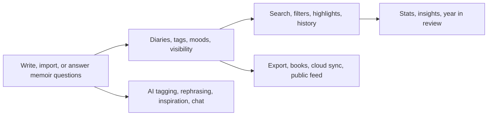

# Features

Thoughty is a privacy-focused journal built around dated entries. Writing, tags, diaries, search, stats, AI help, books, and sync all work on the same entry record. The implemented and planned backlog is in [TODO.md](../TODO.md).

## Writing and Entries

- **Composer.** Write in plain text or Markdown, with a formatting toolbar, inline help, and live preview. The box grows with the text and can be resized. The date defaults to today and can be changed to backdate an entry.
- **Optional details.** Each entry can have a one-line title (up to 200 characters), a time of day, a mood from 1 (very low) to 5 (very good), and up to ten feeling words, picked from a curated list or typed.
- **Templates.** Thirteen built-in templates (gratitude, daily reflection, weekly review, decision notes, worry check, dream log, and others), plus your own templates saved from a draft.
- **Focus mode.** A full-screen, distraction-free editor (`Ctrl+Shift+F`) with typewriter scrolling, a live word count, and an optional word goal for the session.
- **Task lists.** In Markdown entries, `- [ ]` and `- [x]` items show as checkboxes you can tick from the journal without opening the editor.
- **Several entries per day.** Entries are numbered within their day. Untimed entries come first in the order you set by dragging, then timed entries by time. Adding or changing a time never renumbers an entry, so links stay valid.
- **Cross-references.** `[[2024-01-15]]` or `[[2024-01-15#2]]` links to another entry. Each entry lists the entries that link to it (backlinks).
- **Entry actions.** Edit, favorite, pin, change visibility, listen, chat, rephrase, summarize, view history, archive, share, and delete. Sharing uses the browser share sheet or copies a permalink.
- **Entry states.** Public or private visibility, favorites, archive, and pinned entries kept at the top (up to a limit you set).
- **Revision history.** Every edit keeps the previous version, which you can view or delete.
- **Attachments.** Images, audio, PDFs, and text files up to 5 MB each, stored in S3-compatible storage and previewed inline. Audio notes can be transcribed with AI.
- **Bulk mode.** Select many entries to delete, archive, change visibility, add tags, move to another diary, or rephrase with AI.
- **Recycle bin.** Deleted entries stay in the recycle bin for 30 days, hidden from everything else. Restore them to their diary with their revisions and files, or delete them forever. After 30 days they are removed for good.
- **Reading aids.** Word count and reading time on each entry, and text-to-speech with a choice of voice.
- **Navigation.** Pagination with a configurable page size, a year and month jump control, and keyboard shortcuts:
  - `Ctrl+N` new entry
  - `Ctrl+/` focus search
  - `Ctrl+Shift+F` focus mode
  - `Esc` close dialogs
  - Left and right arrows change page

## Diaries

- Separate diaries for different writing streams, each with a name, emoji, color, and default visibility.
- An **All Diaries** view, and a default diary for quick capture.
- The selected diary scopes the journal, stats, AI features, import and export, and books.
- Deleting a diary moves its entries to the default diary. The default diary cannot be deleted.

## Tags, Search, and Filters

- **Tags** are the one way to organize entries, for both concrete subjects and broad themes. They autocomplete when writing and filtering, and new ones can be typed inline. An entry needs at least one tag unless automatic tagging is on.
- **Tags page.** Create, rename (across the whole journal), recolor, categorize, and delete tags, with an entry count for each. AI can also propose a compact tag set for the whole journal, which you review before it is applied (see [AI Assistance](#ai-assistance)).
- **Filters.** Search, tags, date, visibility, archive state, favorites, and mood all combine with each other and with the diary scope. The date picker only offers dates that have entries.
- **Keyword search.** Full-text search over titles, text, and tags in English and French. It matches other forms of a word, ignores accents, and supports `"exact phrases"`, `-exclusions`, and `OR`. Results come best match first (or newest first) with the matches highlighted. Search stays fast on very large journals (see [Search Performance](./data-model.md#search-performance-on-a-large-journal)).
- **Meaning search.** Find entries by idea instead of keywords, using AI.

## Highlights and Insights

- **Highlights.** A random entry to rediscover, and **On This Day** entries from past years.
- **Stats.** Totals and averages, entries per year and month, top tags overall and per year, and an activity heatmap. Everything follows the selected diary.
- **Moods.** Average mood over time and by weekday, and the feelings you name most, computed from the moods you recorded, without AI.
- **Connections graph.** The strongest links between entries and between tags, based on shared tags and computed without AI.
- **AI insights.** Mood, tone, and recurring subjects, and a writing-tendency analysis (see [AI Assistance](#ai-assistance)).
- **Year in review** (`/review`). One year of writing compared with the year before: entries, words, writing days, longest streak, top and new tags, and moments worth rereading. The mood arc comes from your recorded moods, or from an AI reading of sample entries if you ask for it. The review is private. You can post an editable summary as a public entry or print it as a booklet.

## Import, Export, and Books

- **Export** to TXT, JSON, Markdown, or CSV, or to PDF, EPUB, or HTML documents grouped by month. Exports can be scoped to a diary and can include visibility.
- **Markdown folder export.** A ZIP with one Markdown file per entry, organized by diary and year, with front matter and attachments. It opens as is in editors such as Obsidian.
- **Import** TXT, JSON, or Markdown files up to 5 MB. The format is detected automatically, and a preview flags duplicates before anything is saved. The TXT layout (date format, separators, tag brackets) is configurable and reused for export.
- **Day One and Journey.** Import their exports with titles, tags, favorites, Journey moods, and photos and recordings as attachments. Each journal can go into a diary of the same name. Videos are left out, and photos over 5 MB are scaled down. Importing the same file again skips entries already there.
- **Danger zone.** Move every entry in the current scope to the recycle bin, after a confirmation.

### Book converter

- Turns a diary or the whole journal into a book, with one chapter per tag, or one per year or month in yearbook mode.
- With AI, each chapter's entries are woven into flowing first-person prose. **Strict** mode adds nothing that is not in the entries. **Creative** mode may add light transitions and texture but never invents major events. Without AI, chapters list the entries in date order.
- Optional AI chapter introductions and summaries.
- Options include chapter order, date range, which tags become chapters, an untagged chapter, entry dates, and a table of contents.
- Covers use a color theme and an optional PNG or JPEG image up to 2 MB. Entry images can be embedded (up to 5 MB each and 25 MB per book).
- Output as PDF, EPUB, HTML, or Markdown. Archived entries are left out.
- **Preview Chapters** shows the outline without using AI.
- **Versions.** Save the book, then save later versions from newer entries. Every version stays downloadable.
- Books can be uploaded straight to a connected cloud provider.

## Guided Memoir

A program that turns the journal into a life story, at `/memoir`.

- Fifty-two questions in seven life chapters (childhood, growing up, family, love and friendship, work, places, and lessons), in English and French.
- One new question a week on the weekday you choose, at 9:00 local time, optionally by email (verified addresses only). You can answer any question at any time.
- Answers are private Markdown entries in a memoir diary, tagged by chapter, so the book converter makes one chapter per life chapter.
- Answer by text or by voice: record in the browser (up to 15 minutes) or upload a recording (up to 5 MB). With AI, a recording can be transcribed into editable text.
- Progress shows questions answered, words, estimated pages, and chapters started, with a shortcut to turn the memoir into a book.
- Pause, change settings, or stop at any time. Stopping keeps every answer.

## Cloud Sync

- Connect Google Drive, OneDrive, and Dropbox.
- Upload an export, browse and download provider files, and import journal files from the cloud.
- Scheduled sync every 6 hours, 12 hours, day, or week (skipped when nothing changed), plus a manual **Sync Now**.

## Social

- **Feed.** Other users' public entries with infinite scroll, a tab for authors you follow, and a preview of your own public entries. Private, archived, moderated, and deleted content never appears, and moods are never shown.
- **Follows, comments, and likes.** Follow authors, comment on public entries (up to 1,000 characters), and like entries and comments. You can remove comments on your own entries.
- **Leaderboard.** The ten most active writers and the most liked and most commented entries, for the week, month, year, or all time.
- **Achievements.** A private Profile section with your karma and ten badges, such as writing streaks and likes received.
- **Feature requests.** A public board of ideas. Signed-in users can submit ideas and vote.

## AI Assistance

All AI features are optional and run through OpenRouter. A deployment can provide a shared key, or you can add your own key in Profile, which then takes precedence. Profile shows a 30-day usage dashboard with tokens and costs. You can pick a default model and a different model per task. What each feature sends to the provider is listed in [Security](./security.md#ai-privacy).

- **Auto Tag.** Suggests subject and theme tags for a draft. With an automatic tag limit above 0, entries are also tagged on save.
- **Get Inspired.** Asks one reflective question based on your tags. Only tag names and counts are sent, never entry text.
- **Rephrase.** Rewrites a draft or entry: grammar only, light polish, or full rewrite.
- **Summaries.** Summarizes a long entry, optionally focusing on or leaving out details you name.
- **Entry chat.** Discuss an entry with AI. Chats are saved and can be exported as text.
- **Meaning search.** Searches the 100 newest entries in scope by idea and returns the top 20.
- **Find duplicates.** Looks for entries that repeat the same subject and conclusion among the 40 newest in scope.
- **Organize journal tags.** Proposes up to 12 tags for the 300 newest entries, up to three each. You review every change before it is saved.
- **Insights.** Mood, tone, and subjects of the 40 newest entries in scope, and a writing-tendency analysis that sends only aggregate numbers. Results are not clinical.
- **Audio transcription.** Turns an audio attachment into text.
- **Books and the year in review.** Chapter weaving, introductions, and the optional mood reading.

## Accounts and Preferences

- **Sign-in.** In production, through the shared Keycloak single sign-on. Locally, with email or username and password, or with Google.
- **Security.** Email verification, optional two-factor codes by email, password change and reset, active session management, and account deletion.
- **Profile.** Name, display name, bio, birthday, gender, and an avatar with crop and zoom. Confirmed accounts get a verified badge.
- **Data.** Download all your data as JSON.
- **Subscription.** A placeholder page. The plan is a saved setting with no payment behind it, and the billing history and payment method are sample data until a payment provider is connected.
- **Appearance.** Light or dark theme, high contrast, font family, size, and color, entries per page, and the pinned-entry limit.
- **Languages.** English and French.

## Accessibility and Experience

- Skip links, clear landmarks, and focus moved to the content on every page change.
- Every page is scanned with Axe against WCAG 2.2 A and AA in both themes as part of the end-to-end tests, and the journal also with high contrast.
- Every control works with the keyboard, including diary and entry reordering.
- The same features on desktop and phone, with controls that wrap instead of scrolling off-screen.
- Destructive actions ask for confirmation, and long operations show progress.
- Signed-out visitors see a landing page plus About, Blog, Privacy, Terms, Contact, and Feedback pages.

## Future Direction: Life ERP

Thoughty may grow into a personal ERP while keeping its privacy and entry-centered design: life metrics and habits, finances, health, relationships, productivity, and dashboards that relate them to the journal. The backlog is in [TODO.md](../TODO.md#life-erp).
