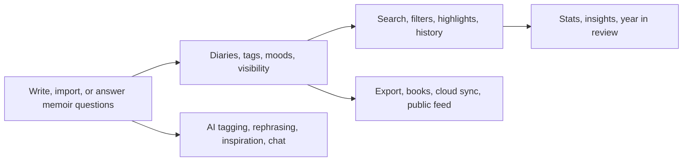

# Features

Thoughty is a privacy-focused journal built around dated entries. Writing, tags, diaries, search, stats, AI help, books, and sync all work on the same entry record. The implemented and planned backlog is in [TODO.md](../TODO.md).

## Writing and Entries

- **Composer.** Write in plain text or Markdown, with a formatting toolbar, inline help, and live preview. The box grows with the text and can be resized. The date defaults to today and can be changed to backdate an entry.
- **Optional details.** Each entry can have a one-line title (up to 200 characters), a time of day, a mood from 1 (very low) to 5 (very good), and up to ten feeling words, picked from a curated list or typed.
- **Templates.** Thirteen built-in templates (gratitude, daily reflection, weekly review, decision notes, worry check, dream log, and others), plus your own templates saved from a draft: **Save template** asks for a name in a small dialog (a blank name is refused) and keeps the draft's text, tags, visibility and format. If the template cannot be saved, the dialog stays open with the name and says so, so you can try again.
- **Focus mode.** A full-screen, distraction-free editor (`Ctrl+Shift+F`) with typewriter scrolling, a live word count, and an optional word goal for the session. Typing `@` suggests people as in the composer (same keys and screen reader announcements), in a list just under the caret's line that follows it as the text scrolls; while the list is open, `Esc` closes the list and a second `Esc` leaves focus mode.
- **Task lists.** In Markdown entries, `- [ ]` and `- [x]` items show as checkboxes you can tick from the journal without opening the editor.
- **Several entries per day.** Entries are numbered within their day. Untimed entries come first in the order you set by dragging, then timed entries by time. Adding or changing a time never renumbers an entry, so links stay valid.
- **Cross-references.** `[[2024-01-15]]` or `[[2024-01-15#2]]` links to another entry. Each entry lists the entries that link to it (backlinks).
- **Entry actions.** Edit, favorite, pin, change visibility, listen, chat, rephrase, summarize, view history, archive, share, and delete. Sharing uses the browser share sheet or copies a permalink. Opening a permalink (`/journal?entry=<id>`) clears the journal filters and opens the page that holds the entry at your page size, or shows a notice when the entry no longer exists.
- **Share as image.** **More actions › Share as image** turns an entry into a picture for posting outside the app. The card is drawn in the browser on a canvas, with no server call and no outside service: the quote (the whole entry with its Markdown removed, the text you had selected in it, or any excerpt you trim it to), the localized date, the title if you keep it, and an optional "— Thoughty" mark with the logo. Pick Light, Dark (the default follows your theme), or the violet gradient of the logo, and a square (1080 × 1080) or portrait (1080 × 1350) size; the PNG is drawn at twice the card's layout size, so it stays sharp on high-density screens. The largest font size that fits is chosen, and text that still does not fit ends with an ellipsis; long words are broken and emoji are never cut. **Download PNG** always works; **Copy image** and **Share…** (the device's share sheet with the file) appear only where the browser supports them. A private entry can be exported too, with a reminder that anyone who sees the image can read it. The preview carries alt text with the card's words and date, and the dialog works from the keyboard. Your own public entries in the feed have the same button.
- **Entry states.** Public or private visibility, favorites, archive, and pinned entries kept at the top (up to a limit you set).
- **Revision history.** Every edit keeps the previous version, which you can view or delete.
- **Attachments.** Images, audio, PDFs, and text files up to 5 MB each, stored in S3-compatible storage and previewed inline. A file of another type or over the limit is not attached, and the form says which file and why next to the attach button. Audio notes can be transcribed with AI.
- **Bulk mode.** Select many entries to delete, archive, change visibility, add tags, move to another diary, or rephrase with AI. A bulk rephrase that leaves some entries unchanged or fails on some ends with a notice that counts each. A failed save, delete, or bulk action shows a notice in the profile language.
- **Time capsules.** **Seal as a time capsule** under the composer seals a new entry until a chosen day (from tomorrow up to 50 years ahead, a year from today by default) and hour (9:00 by default) on the writer's own clock, in the browser's time zone; the **Letter to my future self** template ticks it with a date a year ahead. Until it opens, the entry keeps only its date, time, diary and flags: its title, text, tags, mood, feelings and files are hidden everywhere (the journal shows a placeholder card with the opening date and time, the calendar a lock, the recycle bin the opening time), search, filters, Highlights, On this day, the monthly recap, stats text features, people, AI features and books leave it out, it has no history, and it stays private and cannot be edited. **Open early** on the card opens it at once after a confirmation, without email. On the day, at that hour, the worker opens it and emails it once to the writer's verified address (in the app language, with when it was sealed and written, its title, at most its first 200 characters and its permalink; there is nothing to unsubscribe from, since the writer scheduled this one email), and Highlights shows it first for seven days, opened early or not. A capsule in the recycle bin stays sealed and opens once restored. Data exports (TXT, JSON, Markdown, CSV, the Markdown folder, cloud sync, the data download) keep its text, and all but TXT, which has no field for it, mark it sealed (`sealedUntil` in JSON and the data download, a `sealed_until` CSV column and Markdown folder front matter key, **Sealed until:** in Markdown); importing such a file brings the entry back open. The PDF, EPUB and HTML reading copies leave it out, like books.
- **Recycle bin.** Deleted entries stay in the recycle bin for 30 days, hidden from everything else. Restore them to their diary with their revisions and files, or delete them forever. After 30 days they are removed for good.
- **Reading aids.** Word count and reading time on each entry, and text-to-speech with a choice of voice.
- **Navigation.** Pagination with a configurable page size, a year and month jump control, and keyboard shortcuts:
  - `Ctrl+N` new entry
  - `Ctrl+/` focus search
  - `Ctrl+Shift+F` focus mode
  - `Esc` close dialogs
  - Left and right arrows change page

## Diaries

- Separate diaries for different writing streams, each with a name, emoji, color, and default visibility.
- An **All Diaries** view, and a default diary for quick capture.
- The selected diary scopes the journal, stats, AI features, import and export, and books.
- Deleting a diary asks first in a dialog that names it, then moves its entries to the default diary. Confirmation dialogs (diaries, tags, entries, comments, the recycle bin, stopping the memoir) take focus on Cancel, keep the keyboard inside, close with `Esc`, and return focus to the button that opened them. The default diary cannot be deleted.

## Tags, Search, and Filters

- **Tags** are the one way to organize entries, for both concrete subjects and broad themes. They autocomplete when writing and filtering, and new ones can be typed inline. An entry needs at least one tag unless automatic tagging is on.
- **Tags page.** Create, rename (across the whole journal), recolor, categorize, and delete tags, with an entry count for each. AI can also propose a compact tag set for the whole journal, which you review before it is applied (see [AI Assistance](#ai-assistance)).
- **Filters.** Search, tags, date, visibility, archive state, favorites, mood, life era, and person all combine with each other and with the diary scope. The date picker only offers dates that have entries.
- **Life eras.** Name the periods of your life ("University", "The Paris years") in **Profile › Life eras**: a name, a start date, an optional end date (none while the era is still going on), and an optional emoji, colour, and note, up to 100 per account. Eras may overlap. Once you have eras, the filter bar offers a **Life era** menu that narrows the journal (list and calendar) to the entries dated from the era's first to its last day, combined with every other filter; its gear button opens the eras in the profile (`/profile#life-eras`). The calendar names the era it is narrowed to, with its dates, and offers to jump to its first month when the month shown is outside it. Saved searches keep the era (searches saved before eras cover every date); deleting an era widens the saved searches filtered by it to every date, and its entries stay as they are. Books can have one chapter per era, and memoir answers can be placed in an era (see below). Life eras are included in the data download.
- **People.** Mention someone with `@` and their name in an entry (`@Marie`, `@Jean-Paul`, any alphabet, any case: `@marie` is the same person). Typing `@` in the composer, the entry editor (plain or Markdown) or focus mode lists your people whose handle or name starts with what follows, the most mentioned first: Up and Down choose, Enter or Tab writes the mention, Escape closes the list, and a screen reader hears how many people are offered. Saving an entry adds anyone new it mentions, imports included; e-mail addresses, web addresses, code, `[[date]]` references and Markdown links are never mentions, and `\@name` keeps one as text. In your journal a mention is a link to the **person view**: the journal in all diaries narrowed to the entries that mention them (archived ones included), headed by their name, count and handles, with a way back to all entries. The address names the person (`/journal?diary=all&person=12`), so the view can be bookmarked; the filter bar's **Person** menu narrows the journal the same way, combined with every other filter and in the calendar too, and saved searches and books from them can be about a person. The **People** page (`/people`, in the navigation) lists everyone with their handles, how many entries mention them (leaving out the recycle bin) and when they were last mentioned, finds a person by name or handle, renames the name shown (your entries keep the text you wrote), merges a duplicate into a person (its handles then mention the person kept), and deletes a person (entries keep the text and stop linking to them; saving one that still mentions them adds them again). People are private notes, never linked to anyone's account: in the public feed and share texts a mention is just the text you wrote. Up to 1,000 people per account; people are included in the data download.
- **Keyword search.** Full-text search over titles, text, and tags in English and French. It matches other forms of a word, ignores accents, and supports `"exact phrases"`, `-exclusions`, and `OR`. Results come best match first (or newest first) with the matches highlighted. Search stays fast on very large journals (see [Search Performance](./data-model.md#search-performance-on-a-large-journal)).
- **Meaning search.** Find entries by idea instead of keywords, using AI.
- **Saved searches.** Save any combination of search, filters (life era and person included), and diary under a name (for example favorites tagged "family" in the Personal diary), then show it again in one click from **Saved searches** in the filter bar. Searches can be renamed or deleted (after a confirmation), up to 50 per account. Deleting a search also deletes the book versions saved from it, and the confirmation says how many go so they can be downloaded first. The journal address names the search on screen (`/journal?diary=2&view=4`), so it can be bookmarked or opened on another device, and drops it as soon as a filter changes; a link to a search that was deleted says so. A saved meaning search runs again when it is shown. Saved searches are included in the data download.
- **Calendar view.** A **List / Calendar** switch above the journal shows the entries as a month grid instead of the list. Weeks start on Monday, month and weekday names follow the app language, and today is marked. Each day names up to three entries (title, else the first words, with the time and a mood emoji when set) and counts the rest (`+2`); on a phone the days show dots instead. The grid follows the diary scope and every filter (search, meaning search, tags, visibility, archive state, favorites, mood, life era, person); the date filter picks the month and marks its day. Move between months and years with the buttons, a year menu, or **Today**. With the keyboard, the grid is one tab stop: arrow keys move by day and week, Home and End go to the start or end of the week, Page Up and Page Down change the month (with Shift, the year). Clicking a day, or Enter on it, shows that day in the list (as the date filter, keeping the other filters); clicking an entry opens it in the list through its permalink. The journal address keeps the layout and month (`/journal?diary=2&layout=calendar&month=2026-10`), so a month can be bookmarked; Back returns from the list to the calendar. Entries in the recycle bin never appear.

## Highlights and Insights

- **Highlights.** A random entry to rediscover, and **On This Day** entries from past years, after the time capsules opened in the last seven days, which come first in an indigo frame with the day each was sealed (and whether it was opened early). Sealed capsules never appear.
- **On this day by email.** Off unless turned on in **Profile › On this day by email**. Once on, on each day that has entries from earlier years on the same month and day (the same ones Highlights shows, from all diaries or the one chosen, up to 10, recycle bin left out), one email arrives at the chosen local hour (8:00 by default) in the chosen time zone (the browser's by default). Days without past entries send nothing, and a day never gets two emails, even when the hour is moved later after one arrived. On a daylight-saving change, in every time zone, an hour the clocks skip arrives an hour later (02:00 at 03:00) and an hour they live twice arrives once, at its first occurrence. Each entry shows how long ago it was written and its date, its title (or "Untitled entry") and at most its first 200 characters as plain text, with a link that opens it in the journal (`/journal?entry=<id>`); private entries are included, since the email goes only to the writer's own verified address. It is written in the app language (English or French), as HTML with a plain-text alternative, and says why it arrives. Its **Stop these emails** link turns it off in one click without signing in (`/unsubscribe?token=…`), and mail apps can do the same from the email's one-click unsubscribe header. The profile says when the next email can arrive, and warns when email cannot reach the writer yet (an unverified address, or a server without email). Deleting the chosen diary widens the email to all diaries. Each change is saved at once. The setting is part of the data download and is erased with the account.
- **Monthly recap by email.** The low-cost sibling of the year in review, off unless turned on in **Profile › Monthly recap by email** (right below the "On this day" email, with the same hour, time zone and diary choices). Once on, one email arrives on the 1st of each month at the chosen local hour about the month just ended in the writer's time zone: its entries, words and days with writing, its three most used tags, and the average of the moods recorded that month (from the moods the writer chose, without AI, only when some were), then one memory from the same calendar month in an earlier year (a favorite first, then the entry with the most words; archived and empty entries left out) with how long ago it was written, its title, at most its first 200 characters as plain text and a link to open it, and a link to that year's review (`/review?year=…`, with the diary when one is chosen). A month with no entries and no past memory sends nothing; a month without writing but with a memory sends the memory. A month never gets two recaps, even when the hour or zone changes after one arrived. Daylight-saving changes are handled as for the "On this day" email. It is written in the app language (English or French), as HTML with a plain-text alternative, goes only to a verified address of a live account, and leaves the recycle bin out. Its **Stop these emails** link (`/unsubscribe?token=…`, the same page as the "On this day" email's, which says which email it turned off) and the one-click header turn it off without signing in, leaving the other email as it was. The setting is part of the data download and is erased with the account.
- **Stats.** Totals and averages, entries per year and month, top tags overall and per year, and an activity heatmap whose days give their entry count and date in the interface language. Its weeks run from Monday. Everything follows the selected diary. Each bar chart is an image named by its title and described by its values ("2025: 2 entries; 2026: 3 entries"), and **Show as table** swaps it for a table of the same values. The heatmap is one keyboard stop (an ARIA grid): the arrows move by a day (up and down) or a week (left and right), Home and End go to the week's Monday and Sunday (with Ctrl, the map's first and last day), Page Up and Page Down by a month (with Shift, a year), and Enter, Space or a click opens the day in the journal; the active day is ringed and named under the map. Keeping the days out of the tab order keeps the year compact while the grid is the large target.
- **Writing goals.** Each diary can have one optional goal, set in **Manage Diaries** when creating or editing it: a number of entries per week (1 to 50, weeks from Monday to Sunday) or of words per day (10 to 10,000). The diary list names each goal ("Goal: 3 entries a week"). Stats for a diary show this week's or today's progress with a bar ("2 of 3 entries this week"), whether the goal is met, the current streak of weeks or days that met it (a week or day still in progress does not break it), and the best streak. The activity heatmap marks the days that met a daily goal with a ring and a dot, and the weeks that met a weekly goal with a check under their column; each day's name says so too ("2 entries on Jan 15, 2024, weekly goal met"), and the legend explains the mark. Days are the writer's own: the app sends its local date, and entries dated later are left out. With **All diaries**, Stats lists each diary's goal and progress side by side, or explains that goals are set per diary. Deleting a diary removes its goal; its entries then count towards the default diary's goal. Goals are part of the data download.
- **Writing streak card.** A small card above the composer counts the days in a row with at least one entry ("3 days in a row"), from two days on, in the diary shown (or all of them), up to the writer's local day; a today still unwritten keeps the run going ("Today's page is open whenever you feel like writing"). After three days or more without an entry it offers to **Pick up where you left off** instead: the date, title and first words of the last entry, with **Write now** (puts the cursor in the composer) and **Reread it** (opens the entry through its permalink). The copy stays warm: no warnings, no red, and a streak that ended is never counted or mentioned. **Hide until tomorrow** (×) dismisses it for the day on that browser; **Profile › Appearance › Writing streak card** turns it off. Entries in the recycle bin and entries dated after today never count. The card is a labelled region, and its icons are decorative beside the text.
- **Moods.** Average mood over time and by weekday, and the feelings you name most, computed from the moods you recorded, without AI.
- **Connections graph.** The strongest links between entries and between tags, based on shared tags and computed without AI.
- **AI insights.** Mood, tone, and recurring subjects, and a writing-tendency analysis (see [AI Assistance](#ai-assistance)).
- **Year in review** (`/review`). One year of writing compared with the year before: entries, words, writing days, longest streak, top and new tags, and moments worth rereading. The mood arc comes from your recorded moods, or from an AI reading of sample entries if you ask for it. The review is private. You can post an editable summary as a public entry or print it as a booklet.

## Import, Export, and Books

- **Export** to TXT, JSON, Markdown, or CSV, or to PDF, EPUB, or HTML documents grouped by month. Exports can be scoped to a diary and can include visibility. A refused export says why in the reader's language (for example, the diary is gone) instead of downloading nothing.
- **Markdown folder export.** A ZIP with one Markdown file per entry, organized by diary and year, with front matter and attachments. It opens as is in editors such as Obsidian.
- **Import** TXT, JSON, or Markdown files up to 5 MB. The format is detected automatically, and a preview flags duplicates before anything is saved. When the API turns a file down (too large, too many entries for one import, or the diary is gone), the preview or the import says why in the reader's language instead of a generic failure, and the preview stays so the import can be tried again. The TXT layout (date format, separators, tag brackets) is configurable and reused for export; a refused save of it shows the API's reason.
- **Day One and Journey.** Import their exports with titles, tags, favorites, Journey moods, and photos and recordings as attachments. Each journal can go into a diary of the same name. Videos are left out, and photos over 5 MB are scaled down. Importing the same file again skips entries already there.
- **Danger zone.** Move every entry in the current scope to the recycle bin, after a confirmation. A refusal shows the API's reason rather than a generic failure.

### Book converter

- **Entries from** the journal (a diary or the whole journal), a saved search, or hand-picked entries. A saved search selects the entries its filters find when the book is made, scoped to its diary; meaning searches cannot be used, since their matches need AI and change from one run to the next. Hand-picked entries come from the journal: select entries and choose **Make a book**, which opens the converter with them (up to 500, archived ones included). The converter lists the picks, marks any that went to the recycle bin, and lets the writer remove them or clear the list; to add more, pick them in the journal again.
- One chapter per tag, per year or month (yearbook mode), per life era, or a single chapter titled after the book, whatever the source. Era chapters follow the eras' dates; an entry in overlapping eras goes to the shortest of them (an ongoing era counts until today), and entries outside every era go to a last "Other" chapter, which can be left out.
- With AI, each chapter's entries are woven into flowing first-person prose. **Strict** mode adds nothing that is not in the entries. **Creative** mode may add light transitions and texture but never invents major events. Without AI, chapters list the entries in date order.
- Optional AI chapter introductions and summaries.
- Options include chapter order, date range, which tags become chapters, an untagged chapter, entry dates, and a table of contents.
- Covers use a color theme and an optional PNG or JPEG image up to 2 MB. Entry images can be embedded (up to 5 MB each and 25 MB per book).
- Output as PDF, EPUB, HTML, or Markdown. Journal books leave archived entries out; a saved search follows its own archive filter.
- **Preview Chapters** shows the outline without using AI.
- **Versions.** Save the book, then save later versions from newer entries. Every version stays downloadable and records its source, until its diary or saved search is deleted, which takes that history with it; hand-picked versions stay when their entries are deleted. Each diary (and all diaries) and each saved search keeps its own history, so a new version of a saved-search book takes what the search finds now; hand-picked books share one history, and **Use these entries** on a version loads its picks back into the converter for the next version.
- Books can be uploaded straight to a connected cloud provider.

## Guided Memoir

A program that turns the journal into a life story, at `/memoir`.

- Fifty-two questions in seven life chapters (childhood, growing up, family, love and friendship, work, places, and lessons), in English and French.
- One new question a week on the weekday you choose, at 9:00 local time, optionally by email (verified addresses only). You can answer any question at any time.
- Answers are private Markdown entries in a memoir diary, tagged by chapter, so the book converter makes one chapter per life chapter.
- **Life eras.** The answer form says which of your life eras the answer's date (today, in the memoir's time zone) falls in, and lets you pick the era the memory itself belongs to: the answer is then also tagged with the era's name, so the tag filter finds it (the era filter follows entry dates, and answers are dated the day they are written).
- Answer by text or by voice: record in the browser (up to 15 minutes) or upload a recording (up to 5 MB). With AI, a recording can be transcribed into editable text.
- Progress shows questions answered, words, estimated pages, and chapters started, with a shortcut to turn the memoir into a book.
- Pause, change settings, or stop at any time. Stopping keeps every answer.

## Cloud Sync

- Connect Google Drive, OneDrive, and Dropbox.
- Upload an export, browse and download provider files, and import journal files from the cloud.
- Scheduled sync every 6 hours, 12 hours, day, or week (skipped when nothing changed), plus a manual **Sync Now**.
- A refused connection, upload, file list, download or import, schedule change, or sync says why in the reader's language, such as « La connexion à ce service cloud a expiré. Veuillez le reconnecter. » when the provider's access ran out, and falls back to a generic failure message when the API gives no reason.
- When the provider itself fails, the API answers with a code rather than a bare server error: a sign-in code the provider turns down reads as « Le service cloud n’a pas accepté cette connexion. Veuillez vous reconnecter. », a revoked or expired access token as the expired connection above, and a provider that is down, slow, or refuses for another reason as a 502 « Le service cloud n’a pas pu traiter cette demande. Veuillez réessayer plus tard. ». Only a refused refresh token disconnects the account; a provider outage or a server credential problem during a refresh leaves it connected.

## Social

- **Feed.** Other users' public entries with infinite scroll, a tab for authors you follow, and a preview of your own public entries. Private, archived, moderated, and deleted content never appears, and moods are never shown.
- **Listening to the feed.** Each feed entry has the Journal's listen button: read that entry aloud, or read on from it through the following entries, loading the next pages as the infinite scroll does until the feed ends. It uses your chosen voice and the read-dates setting from Profile, reads the title with the text, and picks an English or French voice from the language each entry appears to be written in. Reading stops when you press stop, switch feed tabs, or leave the feed. The button and its menu work from the keyboard (Enter to open, arrow keys, Escape to close) and tell screen readers whose entry they read and whether it is playing.
- **Follows, comments, and likes.** Follow authors, comment on public entries (up to 1,000 characters), and like entries and comments. You can remove comments on your own entries.
- **Leaderboard.** The ten most active writers and the most liked and most commented entries, for the week, month, year, or all time.
- **Achievements.** A private Profile section with your karma and ten badges, such as writing streaks and likes received.
- **Feature requests.** A public board of ideas. Signed-in users can submit ideas and vote.

## AI Assistance

All AI features are optional and run through OpenRouter. A deployment can provide a shared key, or you can add your own key in Profile, which then takes precedence. Profile shows a 30-day usage dashboard with tokens and costs. You can pick a default model and a different model per task. What each feature sends to the provider is listed in [Security](./security.md#ai-privacy).

- **Auto Tag.** Suggests subject and theme tags for a draft. With an automatic tag limit above 0, entries are also tagged on save.
- **Get Inspired.** Asks one reflective question based on your tags. Only tag names and counts are sent, never entry text.
- **Rephrase.** Rewrites a draft or entry: grammar only, light polish, or full rewrite.
- **Summaries.** Summarizes a long entry, optionally focusing on or leaving out details you name.
- **Entry chat.** Discuss an entry with AI. Chats are saved and can be exported as text, written in the profile language.
- **Meaning search.** Searches the 100 newest entries in scope by idea and returns the top 20.
- **Find duplicates.** Looks for entries that repeat the same subject and conclusion among the 40 newest in scope.
- **Organize journal tags.** Proposes up to 12 tags for the 300 newest entries, up to three each. You review every change before it is saved.
- **Insights.** Mood, tone, and subjects of the 40 newest entries in scope, and a writing-tendency analysis that sends only aggregate numbers. Results are not clinical.
- **Audio transcription.** Turns an audio attachment into text.
- **Books and the year in review.** Chapter weaving, introductions, and the optional mood reading.

## Accounts and Preferences

- **Sign-in.** Register and sign in with an email or username and password, or choose **Continue with Keycloak** for the shared single sign-on in production. A Keycloak sign-in with the same verified email links to the existing account, which keeps its password. Google sign-in is available when configured.
- **Security.** Email verification, optional two-factor codes by email, password change and reset, active session management, and account deletion. A deleted account is signed out at once and erased with everything in it within 30 days.
- **Profile.** Name, display name, bio, birthday, gender, and an avatar with crop and zoom. Confirmed accounts get a verified badge.
- **Data.** Download all your data as JSON.
- **Subscription.** A placeholder page. The plan is a saved setting with no payment behind it, and the billing history and payment method are sample data until a payment provider is connected.
- **Appearance.** Light or dark theme, high contrast, font family, size, and color, entries per page, the pinned-entry limit, and whether the journal shows the writing streak card.
- **Saving settings.** A change shows at once. If it cannot be saved (the API refuses it or cannot be reached), the previous settings come back and a notice says so; the profile and tag pages then show no "saved" message. A new tag's color, which the app saves on its own, is tried once and saved again when the tags or the settings next change.
- **Languages.** English and French.

## Accessibility and Experience

- Skip links, clear landmarks, and focus moved to the content on every page change.
- Every page is scanned with Axe against WCAG 2.2 A and AA in both themes as part of the end-to-end tests, and the journal also with high contrast.
- Every control works with the keyboard, including diary and entry reordering.
- Every modal dialog (confirmations, the AI chat, attachment previews, the entry summary, the profile picture editor, the journal retag review, duplicate review, the template name, highlights, and Focus mode) takes focus when it opens, keeps Tab inside (also when leaving a previewed PDF or text file), closes with `Esc` wherever focus is, and returns focus to the control that opened it. When one dialog opens over another, `Esc` closes only the top one.
- The same features on desktop and phone, with controls that wrap instead of scrolling off-screen.
- Destructive actions ask for confirmation, and long operations show progress.
- Every visitor, signed in or not, lands on the presentation page at `/`. It presents the journal, the guided memoir, books, the look back (stats, moods, year in review), privacy and AI, imports, and the other features in English and French, with **Start your journal**, **Sign Up**, and **Sign In** when signed out and **Open your journal** when signed in. About, Blog, Privacy, Terms, Contact, and Feedback pages are public too and share its colors.

## Future Direction: Life ERP

Thoughty may grow into a personal ERP while keeping its privacy and entry-centered design: life metrics and habits, finances, health, relationships, productivity, and dashboards that relate them to the journal. The backlog is in [TODO.md](../TODO.md#life-erp).
