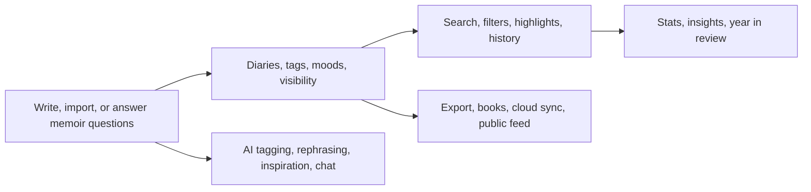

# Features

Thoughty is a privacy-focused journal built around dated entries. Writing, tags, diaries, search, stats, AI help, books, and sync all work on the same entry record. The implemented and planned backlog is in [TODO.md](../TODO.md).

## Writing and Entries

- **Composer.** Write in plain text or Markdown, with a formatting toolbar, inline help, and live preview. The Markdown editor loads the first time it is switched on; until then a plain field takes its place, and what is typed there goes on in the editor, with the focus and caret where they were. The box grows with the text and can be resized. The date defaults to today and can be changed to backdate an entry.
- **Optional details.** Each entry can have a one-line title (up to 200 characters), a time of day, a mood from 1 (very low) to 5 (very good), and up to ten feeling words, picked from a curated list or typed.
- **Templates.** Thirteen built-in templates (gratitude, daily reflection, weekly review, decision notes, worry check, dream log, and others), named and written in the interface language (English or French) wherever they appear: the composer's template menu, **Manage Diaries** and the welcome page. A template's text goes into the composer in the language of the moment it is applied, and is then the writer's own: entries, drafts and saved templates are never rewritten. An untouched diary template in the composer follows a language change; tags stay the same in both languages (`gratitude`, `reflection`, …), so entries keep sharing them. You can also save your own templates from a draft, and they stay exactly as written: **Save template** asks for a name in a small dialog (a blank name is refused, and the name stops at 100 characters, which the dialog says once it gets there) and keeps the draft's text, tags, visibility and format. If the template cannot be saved, the dialog stays open with the name and says so, so you can try again. Each diary can name a **Default template** in **Manage Diaries** (when creating or editing it; the diary list says "Template: Gratitude journal"): picking that diary starts an empty composer from it (with **All diaries**, the default diary's, where a new entry goes), with a quiet line saying so ("Started from this diary's template, Gratitude journal."), and so does the next entry once one is saved. The template never replaces the writer's words: it goes only into an empty composer, makes way for another diary's template (or none) only while untouched, never comes back into a composer the writer emptied, and waits while a draft saved on another device is offered. An untouched template is not saved as a draft or warned about on leaving, and **Use as a starting point** or **Write a reply** replace it without asking. A custom template deleted since is ignored and shows as "Deleted template" in the diary until another is picked.
- **Draft autosave across devices.** The composer saves the new entry you are writing as you type: two seconds after you stop, at once when you leave the composer, switch tabs or close the page, and at most once every three seconds. A small status by **Save** says **Saving…**, **Draft saved**, **Offline — saved on this device** or, when the server refuses for now, that it is kept on this device and syncs when it can (announced politely, no counts). Each change is also kept in this browser at once, so a reload or a lost connection loses nothing, and what waited is sent as soon as the connection is back. Open Thoughty on another device and an empty composer offers **Continue your draft from <time>?** with the start of its title or text (blurred by the privacy blur), **Continue** or **Discard**; on the device that saved it last, the draft simply comes back. The draft is the text, title, tags, format, mood and feelings; the date, time, visibility, time capsule and files to upload stay with the device. A device that falls behind never overwrites newer text: when another device saved first, it says **This draft was changed on another device at <time>** and lets you **Use that version** or **Keep this version**, and when the draft was published or discarded elsewhere it offers **Keep writing it** or **Clear it**. Publishing the entry, or emptying the composer, discards the draft everywhere. Saving empties the composer of the entry it saved only: what you write or attach after pressing **Save**, while the entry is still being saved (uploads can take a while), stays in the composer and becomes the next draft, and pressing **Save** again before the first save ends does not save the entry twice. Closing or reloading the page while text is not saved yet, in the composer or in the entry editor, asks first (the browser's own question). Signing out removes the copy kept in the browser; the server keeps the draft for the next sign-in. One draft per account, not per diary: the entry goes to the diary open when you publish. English and French.
- **Writing offline.** Thoughty opens without a connection once it has been visited online on that browser (installed or not; production builds only): a service worker keeps the app itself, never your entries or anything else from the API, and online the app always loads fresh, so a new version arrives on the next visit. When it opens and Thoughty cannot be reached (no connection, or the server down), the writer last signed in on that browser gets the journal in their language, theme and type settings, with a notice under the menu, **You’re offline. You can keep writing: your draft stays on this device and is saved once Thoughty can be reached again.** (also shown whenever the browser loses its connection). The composer brings back the draft kept on the device and keeps every change there; entries, diaries and the rest wait for the connection, and **Save** needs it. As soon as Thoughty answers again the session is checked and goes on, the draft is sent (with the usual choice if another device changed it meanwhile) and everything is read again; if the session ended meanwhile (signed out elsewhere, or expired), the sign-in page comes back and the draft stays on the device for the next sign-in. Signing out offline signs out at once, and the next load tells the server before anything else. Text, photos and files shared to the installed app offline go into the composer the same way. English and French.
- **Prompt cards.** **Draw a card** in the composer, beside Get Inspired, deals a short hand-written question from a deck of sixty: twelve each on gratitude, decisions, people, places and small joys, drawn from all themes or from the one picked in the card's panel. It needs no AI key and sends nothing anywhere but the record of which cards were drawn. No card comes back until every card of its deck (the theme, or the whole deck) has been drawn; the panel says how many are left, and when a used-up deck is shuffled again the card just drawn is never the first one back. The cards drawn are kept as a profile setting (`promptCardsDrawn`), so the deck carries on after a reload and on another device. **Draw a card** stays disabled until the settings have loaded, so no card is drawn against an empty history and saved over the cards already drawn; offline, or when the settings could not be read, cards are still dealt but not saved, and the stored history is left as it was. **Write about this** puts the question in the entry as Get Inspired does: on its own in an empty draft, else after a blank line. The panel is a labelled dialog that opens with focus on **Write about this**, the card is a figure named by its theme ("Places card"), a new card is announced, and Escape closes it with focus back on **Draw a card**. The French deck has its own questions, written in French rather than translated.
- **Start from an entry.** **More actions › Use as a starting point** on an entry fills the composer with a fresh draft of it, for recurring things like a weekly plan or a packing list: its text with every task list item unticked (`- [x]` becomes `- [ ]`, since the point is a fresh checklist), its tags and its format. The draft takes the default visibility of a new entry, never the source entry's, and leaves behind its title, time, mood, feelings, date and attachments; an inline picture (``) becomes its alt text, and one without alt text is dropped, since the pictures stay with the source entry. A sealed time capsule has no such action, its text being hidden. The page scrolls to the composer and focus moves to its text. When the composer already holds a draft (text, title, tags, time, mood, feelings or a time capsule), an alert dialog asks first (**Replace draft** or Cancel, Cancel focused, `Esc` cancels and focus goes back to the menu button); files already added to the draft stay. The new entry goes to the diary the composer writes to, like any other, and the source entry is never changed. English and French.
- **Reply to your past self.** **Write a reply** (the curved-arrow button beside **Edit** on an entry card) fills the composer with a short quote of the entry and a `[[date#n]]` link to it, then an empty line to write on, the caret there. The quote is the first sentence of the entry's first paragraph, or its first 200 or so characters cut on a word with an ellipsis, taken from the entry's text with Markdown syntax, task boxes, pictures (their alt text) and entry links dropped, so the reply links to this entry only. A Markdown entry is quoted as a blockquote with the link on its own line below (`> …` then `— [[2024-03-04#2]]`, since a link inside the blockquote would split it); a plain entry in the writer's quotation marks (“…” in English, « … » in French), the link after it. The reply is in the entry's format and goes on today, the writer's day; it takes no tags, title, time, mood or feelings, and takes the default visibility, except that a reply to a private entry is always private, so a public default never publishes its words. The action is offered on entries dated before today: an entry of today is still being written rather than looked back on (and **Edit** is beside it), and a future-dated one is not the past. A sealed time capsule has no such action, its text being hidden, and its text is never quoted. No new data is kept: the reply is an ordinary entry whose link the backlinks already find, so once it is saved the old entry's backlinks list it at once, and the reply's link opens the old entry. The page scrolls to the composer, and a draft already there is replaced only after the same **Replace draft** dialog as **Use as a starting point**, which says what a reply writes. The button is named by the entry's date, and its number on a day of several ("Write a reply to entry 2 of March 4, 2024"), never by its words, so it gives nothing away under the privacy blur, which also blurs the quote in the composer. English and French.
- **Quick capture.** The lightning button in the navigation, or `Ctrl+Shift+Space` (`Cmd+Shift+Space` on a Mac) from anywhere in the signed-in app, also while typing, opens a short note over the page you are on: a box three lines tall that grows with the text up to about ten lines, then scrolls inside. **Enter** starts a new line, and **Save** or `Ctrl+Enter` (`Cmd+Enter` on a Mac, `aria-keyshortcuts` on the field) saves the note, its line breaks kept, as a private plain entry, untagged (unless automatic tagging is on), for your own today in your default diary, through the same save as the composer, and you stay where you were: focus goes back to where it was and a polite toast says "Saved as a private entry for today." with a **View entry** link to it (`/journal?entry=<id>`). If the save fails the box stays open with the reason and your text, ready to try again; closing it with `Esc`, **Cancel** or a click outside keeps the unsaved text for the next time. **Open in full** carries the text, every line of it, to the journal's composer, after any draft already there (a blank line apart), and puts the caret at its end, for a thought that needs a title, tags or more room. A small caption under the box says "Enter adds a line · Ctrl+Enter saves" (« Entrée ajoute une ligne · Ctrl+Entrée enregistre »), and describes the field for screen readers, after the error when there is one. The box is a labelled modal dialog (focus starts in its field, Tab stays inside, `Esc` closes it and returns focus); it does not open over focus mode or another dialog, and its letters blur with the privacy blur. `Ctrl+Shift+N`, the first idea, is kept by the browsers (Chrome and Edge open a private window, Firefox reopens a closed one) before the page sees it. English and French.
- **Share to Thoughty.** Once Thoughty is installed from the browser (**Add to Home screen** or **Install app**, on browsers that support web share targets, such as Chrome on Android; Safari on iPhone does not), it is offered in the phone's share sheet. Sharing a page, a link or some text from another app opens the journal's composer with it: the text, then the link on a line of its own unless the text already holds it, and the shared title as the entry's title (alone, the title is the text). The entry is dated today, in plain text, with no tags, and private whatever the default visibility. A draft already in the composer, or one that comes back from this or another device, is replaced only after **Replace your draft?** is confirmed; a diary's untouched default template simply makes way. Signed out, the shared text waits in that browser tab (session storage, never sent to the server) until the writer signs in, then goes into the composer once; nothing is kept after that. **Photos and files** can be shared too (pictures, PDFs, audio, video and plain text, the attachment types the composer takes, with or without text): they join the composer as attachments of that entry, uploaded on **Save** like files picked with the paperclip; a file of another type, or over the size limit (5 MB, 50 MB for a video), is named in a notice and left out. Files shared alone join a draft already being written, without replacing it or asking; with nothing in the composer they start the same private entry for today. Signed out, the files wait in that tab's memory through the sign-in; a reload on the way (a sign-in through Google or Keycloak, say) loses them, and the composer says **The files you shared to Thoughty could not be received. Please share them again.** while keeping the shared text. Offline, the share still opens the composer with the text and files; **Save** waits for the connection as usual (the files are not kept on the device, so they need the tab left open). The manifest's `share_target` posts a multipart form to `/share-target`, which the service worker receives in the browser: it sends the page on to `/share-target?title=&text=&url=`, which the page replaces with `/journal` before the app starts, and hands the files straight to the page, keeping nothing (see [Security](./security.md#data-protection)). Without a worker (a browser that never opened Thoughty since its data was cleared), the post reaches the web server, which drops it unread and the journal says **Thoughty could not receive what you shared. Open Thoughty once, then share it again.** The web NGINX leaves the share target's address out of its access log and referrers.
- **Focus mode.** A full-screen, distraction-free editor (`Ctrl+Shift+F`) with typewriter scrolling, a live word count, and an optional word goal for the session. A **timed sprint** of 5, 10 or 15 minutes (or Off), chosen next to the word goal, starts when chosen and counts down quietly as mm:ss beside the word count, with a thin ring that empties (no ring when the system asks for reduced motion). The browser remembers the last length, so focus mode starts a sprint of that length when it opens; Off forgets it. Screen readers get a timer that is not read out every second, plus one polite announcement at halfway and one at the end. The sprint follows the wall clock rather than pausing in a hidden tab, so a backgrounded tab still ends on time (the countdown catches up as soon as the tab is shown). At the end there is no sound and no notification: a calm note in focus mode, "Time's up — keep going or stop here", shows the words written during the sprint, with **Keep going** (dismisses the note and writes on without a sprint, caret back in the text) and **Stop here** (leaves focus mode; the draft stays in the composer or editor). Typing `@` suggests people as in the composer (same keys and screen reader announcements), in a list just under the caret's line that moves with it in every frame as the text scrolls, smooth typewriter scrolling included; while the list is open, `Esc` closes the list and a second `Esc` leaves focus mode.
- **Live dictation.** The microphone button beside focus mode's in the composer and the entry editor, and in focus mode's bar, writes what you say at the cursor (replacing any selected text), in the plain field and the Markdown editor alike. It uses the browser's own speech recognition (the Web Speech API), so it needs no AI key and sends nothing to Thoughty's server, and it shows only in browsers that have it (Chrome, Edge and Safari; not Firefox). Speech is recognized in the app language (`en-US` or `fr-FR`). The first time, a one-line note says that the browser may send the audio to its maker's speech service (Chrome sends it to Google), with **Start dictating** and **Cancel**; it is not shown again in that browser. Dictation runs only after a press and never starts by itself: the button is a toggle (`aria-pressed`), pressing it again or `Esc` stops it (in focus mode `Esc` stops dictation first, then leaves), and the browser may end it after a silence. Start and stop are announced to screen readers, the words still being recognized show quietly under the field (blurred by the privacy blur) until they are final, and a refused microphone, a missing one, silence or an unreachable speech service each say so. Only one field listens at a time; opening focus mode stops the composer's. No keyboard shortcut. English and French.
- **Task lists.** In Markdown entries, `- [ ]` and `- [x]` items show as checkboxes you can tick from the journal without opening the editor.
- **Open tasks.** **Journaling › Tasks** in the menu (`/tasks?diary=…`) lists every task still to do across your Markdown entries, newest entries first and top to bottom in each, following the diary tabs like Stats: each entry's tasks under its date and title, with a link that opens the entry (`/journal?entry=<id>`). Any list marker counts (`- [ ]`, `* [ ]`, `+ [ ]`, `1. [ ]`), nested or in a quote; lines in fenced or indented code blocks, HTML blocks or plain-text entries are not tasks, exactly as the journal renders them. Each task is a real checkbox named by its words (Markdown marks left out) and described by its entry's date; ticking it, by click or Space, ticks it in its entry through the same save as the journal (same revision history, and the journal list reads it afresh) and keeps it shown as done, with focus on it, until the page is left, so a slip can be unticked at once. The task is named by its line and its text, so when the entry changed since the list loaded (another device moved the line, say), the tick is refused with a clear message and the list is read again instead of ticking the wrong line. Archived entries count, since their tasks are still to do; sealed time capsules and the recycle bin never do. Fifty tasks a page, with page numbers; **Next** starts right after the last task shown, so ticking tasks on a page skips none on the next, and that page stays the same when reloaded or reached again with Back; the task words blur with the privacy blur, and quiet mode hides the count of open tasks. An empty list says how to add a task. English and French.
- **Several entries per day.** Entries are numbered within their day. Untimed entries come first in the order you set by dragging, then timed entries by time. Adding or changing a time never renumbers an entry, so links stay valid.
- **Cross-references.** `[[2024-01-15]]` or `[[2024-01-15#2]]` links to another entry. Each entry lists the entries that link to it (backlinks), and the list is read again whenever an entry is saved, edited, deleted or restored, so a new link shows on the entry it points at without a reload.
- **Entry actions.** Edit, favorite, pin, change visibility, listen, chat, rephrase, summarize, view history, archive, share, and delete. Sharing uses the browser share sheet or copies a permalink. Opening a permalink (`/journal?entry=<id>`) clears the journal filters and opens the list around the entry (the entries just before and after it, more loading either way as you scroll), or shows a notice when the entry no longer exists.
- **Share as image.** **More actions › Share as image** turns an entry into a picture for posting outside the app. The card is drawn in the browser on a canvas, with no server call and no outside service: the quote (the whole entry with its Markdown removed, the text you had selected in it, or any excerpt you trim it to), the localized date, the title if you keep it, and an optional "— Thoughty" mark with the logo. Pick Light, Dark (the default follows your theme), or the violet gradient of the logo, and a square (1080 × 1080) or portrait (1080 × 1350) size; the PNG is drawn at twice the card's layout size, so it stays sharp on high-density screens. The largest font size that fits is chosen, and text that still does not fit ends with an ellipsis; long words are broken and emoji are never cut. **Download PNG** always works; **Copy image** and **Share…** (the device's share sheet with the file) appear only where the browser supports them. A private entry can be exported too, with a reminder that anyone who sees the image can read it. The preview carries alt text with the card's words and date, and the dialog works from the keyboard. Your own public entries in the feed have the same button.
- **Private share links.** **More actions › Share privately…** makes a link (`https://<host>/s/<token>`) that lets one person read the entry without an account and without the entry going public in the feed. Choose when it expires (in 1, 7 or 30 days, or at the end of a day up to a year ahead), an optional view limit (each opening counts), a note to tell your links apart (only you see it), and whether the reader sees the mood and the tags (both hidden by default). The link is shown once, to copy; the dialog then lists the entry's active links with their expiry and views, each with **Revoke**, which stops it at once. The reader's page shows only the date, title, text (Markdown as in the journal, people and entry links as plain text) and the entry's own pictures, videos, recordings and files, in their browser's language (English or French) and light or dark theme, with nothing else of the app. A link stops working, with the same "This link is not available" whatever the reason, when it expires, uses its views or is revoked, and for good when the entry goes to the recycle bin or is sealed as a time capsule (a sealed entry cannot be shared). You can have up to 100 active links. See [Security](./security.md#private-share-links).
- **Print an entry or a day.** **More actions › Print** on an entry, or the printer button beside a day's heading in the list (**Print this day**, the entries of that day the list shows), opens a small dialog that asks whether to also print the mood and feelings and the tags (offered only when the entries have them, both ticked by default), then opens the browser's print dialog, from which a PDF can also be saved. Everything happens in the browser, with no server call beyond loading the pictures: a print view is laid beside the app with the localized day, then each entry's time, title and text (Markdown as in the journal, task list items as plain ticked or empty boxes, people mentions and entry links as plain text), its pictures where the text places them and the others below it, a video as its poster frame and any other file (a recording, a PDF) as a short "Attached: name" line. Pictures and poster frames are fetched with your session before printing, and the print dialog opens only once all of them have loaded. While printing, a print stylesheet hides the app around the view, keeps pictures and paragraphs from breaking across pages, starts each day on a new page and uses your entry font and line and letter spacing, black on white whatever the theme. A sealed time capsule is never printed (it has no such action, and **Print this day** leaves it out). When the print dialog closes, printed or not, the view is removed and focus goes back to where it was. A plain browser print (Ctrl+P) of the journal, or of any page other than the year in review, prints the page as it is on screen, entries included, at the browser's own paper size; the clean print view is only for **Print**. Every print rule in the app is scoped to the view that prints (a class on `<html>` while it is shown, and a named `@page`), and `src/printStyles.test.js` fails for a whole-page print rule (`body`, `html`, `:root`, `*`) or an unnamed `@page`. The dialog works from the keyboard (focus starts on **Print**, `Esc` cancels) and announces "Preparing the pages…" while the pictures load. English and French.
- **Entry states.** Public or private visibility, favorites, archive, and pinned entries kept at the top (up to a limit you set).
- **Revision history.** Every edit keeps the previous version, which you can view or delete.
- **Attachments.** Images, audio, PDFs, and text files up to 5 MB each, and videos up to 50 MB, stored in S3-compatible storage and previewed inline. A PDF the browser cannot show (damaged, or locked with a password) does not take the focus from the field you are writing in as its preview loads: Chromium's viewer takes it, and it goes straight back. A file of another type or over its limit is not attached, and the form says which file and why next to the attach button. Audio notes can be transcribed with AI.
- **Video attachments.** MP4, WebM and QuickTime (`.mov`) videos up to 50 MB each; the API recognizes a video by its first bytes, not by the type the browser declares, and stores the type they show. When a video is attached, the browser draws its poster frame: it decodes the file in a hidden `<video>`, takes the frame a second in (a tenth of the way through a shorter clip), draws it on a canvas at most 960 pixels wide and uploads it as a small JPEG linked to the video (`POST /api/attachments/{id}/poster`); the server never decodes video. When the browser cannot decode the file (an HEVC movie outside Safari, say) the video keeps no poster and shows a video icon. Under an entry, and in the entry editor, a video is its poster with a play button (**Play the video …**); only pressing it fetches the video, with the session, and plays it in place with the browser's own controls, a captions track as for audio, and a download link. QuickTime is accepted because phones record it: Safari plays it, Chrome and Edge play QuickTime files holding H.264, and a browser that cannot play one says so and offers the download. Videos are not placed inside the text: **Insert in text** offers pictures only, and a reference to a video shows its name, with the player below the entry. English and French.
- **Inline images.** A Markdown entry can show one of its pictures inside its text instead of below it. **Insert in text** on a picture's card under the editor, or the toolbar button **Insert one of the attached pictures**, opens a dialog that asks which picture (when the card did not say) and a description for people who cannot see it (alt text, optional for a decorative picture), then writes `` where the cursor was and puts the cursor after it, unless the writer has already moved on (focus and the page then stay where they went); 42 is the attachment's ID, never its storage key. A picture just picked waits in the text under its file name (`attachment:pier.png`) and is uploaded before the entry is saved, which then names it by ID. In the journal the picture shows where the text places it, at most the text's width, loaded with the session like the other previews and only once it comes near the screen; it is a button named after its description that opens the preview dialog, and it is not shown again below the entry. A picture since deleted leaves a "Picture no longer available" placeholder with its description; a file that is not a picture shows its name; a web address shows its description, since the page's security policy blocks outside images. The public feed and highlights show the description only (attachments are private, and the feed API sends the description in place of the reference). When an entry is saved, a reference stays when its attachment is on that entry, is the writer's own upload not on any entry yet (it then joins the entry), or was already in the saved text; any other reference (another entry's picture, another writer's, an ID that never existed) becomes its description, so pasting text never makes a save fail. Plain-text entries keep such text as written. The Markdown guide under the editor lists the syntax. English and French.
- **Bulk mode.** Select many entries to delete, archive, change visibility, add tags, move to another diary (one entry also moves from its own menu or editor, see Diaries), or rephrase with AI. A bulk rephrase that leaves some entries unchanged or fails on some ends with a notice that counts each. A failed save, delete, or bulk action shows a notice in the profile language.
- **Time capsules.** **Seal as a time capsule** under the composer seals a new entry until a chosen day (from tomorrow up to 50 years ahead, a year from today by default) and hour (9:00 by default) on the writer's own clock, in the browser's time zone; the **Letter to my future self** template ticks it with a date a year ahead. Until it opens, the entry keeps only its date, time, diary and flags: its title, text, tags, mood, feelings and files are hidden everywhere (the journal shows a placeholder card with the opening date and time, the calendar a lock, the recycle bin the opening time), search, filters, Highlights, On this day, the monthly recap, stats text features, people, AI features and books leave it out, it has no history, and it stays private and cannot be edited. **Open early** on the card opens it at once after a confirmation, without email. On the day, at that hour, the worker opens it and emails it once to the writer's verified address (in the app language, with when it was sealed and written, its title, at most its first 200 characters and its permalink; there is nothing to unsubscribe from, since the writer scheduled this one email), and Highlights shows it first for seven days, opened early or not. A capsule in the recycle bin stays sealed and opens once restored. Data exports (TXT, JSON, Markdown, CSV, the Markdown folder, cloud sync, the data download) keep its text, and all but TXT, which has no field for it, mark it sealed (`sealedUntil` in JSON and the data download, a `sealed_until` CSV column and Markdown folder front matter key, **Sealed until:** in Markdown); importing such a file brings the entry back open. The PDF, EPUB and HTML reading copies leave it out, like books.
- **Recycle bin.** Deleted entries stay in the recycle bin for 30 days, hidden from everything else. Restore them to their diary with their revisions and files, or delete them forever. After 30 days they are removed for good.
- **Undo after delete.** Deleting an entry, alone or in bulk (from the journal or the duplicate review), shows a toast "Entry moved to the recycle bin" (or "3 entries moved to the recycle bin") with **Undo** for 10 seconds. Undo restores exactly those entries, each where it was in its day (the entries after it move down one place, `POST /api/recycle-bin/restore` with `inPlace`), and says how many came back; if they can no longer be restored (the bin was emptied meanwhile), it shows the API's reason. The toast is a polite status message for screen readers, waits while the pointer is over it or focus is in it and then counts its 10 seconds again from the start, and closes with `Esc`. Someone on the keyboard is taken straight to **Undo**, since the entry or bulk bar they were on is gone, and focus returns to the page when the toast closes. Without Undo the entries simply stay in the recycle bin for 30 days. **Delete all entries** (Import & Export › Danger zone) offers no Undo: it already asks twice, its message points to the recycle bin, and **Restore all** there brings everything back.
- **Reading aids.** Word count and reading time on each entry, and text-to-speech with a choice of voice.
- **Privacy blur.** For when someone walks by: the eye button beside the profile in the menu (**Blur entry text**), or `Ctrl+Shift+E` (`Cmd+Shift+E` on a Mac) from anywhere in the signed-in app, also while typing and in focus mode, blurs every entry text on screen at once, and pressing it again shows it. Titles, dates, tags and the rest of the page stay readable. It covers the journal list and search results (entry text, revisions, backlinks), Highlights (random thought, On this day, reread reminders, opened time capsules, the weekly reflection), the words used most in Stats, calendar names taken from an entry's text (not titles), the writing streak's last entry, Year in review highlights, the Feed and its leaderboards, the recycle bin, duplicate review, the book's picked entries and its page preview, the AI chat and entry summary, the memoir's follow-up questions, the share-as-image card and its text, and the writing fields (the composer, quick capture, the entry editor, focus mode and memoir answers, where only the letters blur so the field stays visible). It starts off on each visit, stays on while moving between views, is screen-only (printing is never blurred), and fades only when the system allows motion. The button is a toggle (`aria-pressed`), and a polite status says "Entry text blurred" or "Entry text shown". Screen readers still read the text. English and French.
- **Quiet mode.** For writers who find numbers stressful: **Profile › Appearance › Quiet mode** (off by default, saved with the other settings as `quietMode`, so it follows the writer to every device) hides the numbers that measure how much you write, and keeps everything else. Hidden while it is on: the writing streak's days in a row (the card still offers to **Pick up where you left off** after a break), each entry's word count and reading time, focus mode's live word count, session word goal and the words written in a sprint (the sprint's countdown stays, being a timer), the Achievements section (karma and badges), the Stats summary numbers, writing goal progress, activity heatmap, entries per year and month, top tag counts and tags by year, how many entries have a mood, how often each feeling was named, how many entries each tag beside the moods is on and how many times each of the words used most is used (the tags and words themselves, the average mood, mood over time, insights, writing tendencies and connections stay), the counts of **When you write** (its bars stay, said in words), the longest entry, busiest day and longest streak among the **Personal records** (the earliest and latest hour and the first entry stay), the year in review's year in numbers, busiest month and weekday bars and tag counts (themes by name, moments to reread, the mood arc and **Print or save as PDF** stay; **Share a summary**, a summary in numbers, goes), the memoir's answered count, words, pages and chapter meters (the card keeps **Turn my memoir into a book**), and in the feed the like counts (liking still works), the comment count on **Comments**, the following and follower counts, and the leaderboard (its link goes, and `/feed?view=leaderboard` shows the feed). Stats and the year in review say so in a short note that points back to the setting, so a shorter page never looks broken. Numbers that help you find your way stay: dates, page numbers, search and feed result counts, the calendar's `+N`, the entry link number, backlinks, how many entries mention a person or use a tag (to manage them), limits such as saved searches or eras out of their maximum, the entry count on a book's closing page (the book's own description), character and upload limits, and the goals you set in **Manage Diaries**. The monthly recap and year in review emails follow it too: in quiet mode they tell the month or the year as its top tags by name and its mood in words, without entries, words, days or counts. English and French.
- **PIN lock.** Lock a whole diary (the lock button beside it in **Manage Diaries**) or a single entry (**Lock with PIN** in its **More actions** menu) behind one 4-digit PIN for the account, set in **Profile › Privacy › PIN lock** (typed twice; locking without one asks for it first). Locking asks to confirm, saying it "Hides these entries behind your PIN on this account. It is not encryption." and that public entries become private and their share links stop opening while locked (the links are kept and open again once the lock is lifted). An entry is locked when it or its diary is; an entry locked with its diary says **Locked with its diary** in its menu. It works with the privacy blur: a locked entry shows as a placeholder card (its date, title and diary, a lock, and blurred bars drawn where the text would be, never the words, which the server does not send) with **Unblur with PIN**, and lifting the blur (the eye button or `Ctrl+Shift+E`) while anything is locked asks for the PIN too, in a small dialog (one hidden 4-digit field, focus in it, Tab kept inside, `Esc` cancels). The PIN unblurs all locked content of the account at once, until 15 minutes pass without activity (no key, click, touch or wheel, and no request), the blur goes back on (which locks at once, on the server too), the tab is closed or reloaded, or you sign out. A wrong PIN says how many tries are left before a pause; the fifth wrong one in a row blocks tries for a minute, doubling with each further wrong one (up to a day), and the dialog says until when. Until unlocked, locked entries stay out of search and every filter that reads their words, Highlights and On this day, the reader, random and comfort reads, open tasks, tags, Stats and their AI readings, the year in review, books and exports, AI features, people counts, and every email and cloud sync (which never include them, unlocked or not); the calendar names them by their title or as locked, and the recycle bin shows them locked. The data download keeps everything and asks for the PIN first while anything is locked. Change the PIN with the current one; a forgotten PIN is reset with the account password (and the emailed code when two-factor authentication is on, or for an account without a password); removing it removes every lock. English and French.
- **Main menu.** The bar at the top of every signed-in page holds the brand, four groups of pages and, on the right, quick capture, the privacy blur, the profile (picture, name and verified badge) and log out. The brand (logo and name) is a button back to the journal, named "Thoughty, go to journal" (« Thoughty, aller au journal ») for screen readers, with a faint hover and a focus ring. Each group is a button that shows its pages in a panel below it: **Journaling** (« Écriture »: Journal, Memoir, Tasks), **Social** (Feed, People), **Insights** (« Analyses »: Stats, Year in review) and **Data** (« Données »: Manage Diaries, Tags, Import/Export, Recycle bin). **Year in review** opens on the diary being read (`/review?diary=2`, or all diaries); it is the review's only way in, the Stats page no longer carries an invitation to it. The group holding the page you are on is highlighted and the page itself is marked as current (`aria-current="page"`). A panel closes when you pick a page, press `Esc` (focus goes back to its button), click outside it, Tab out of it or open another group. It is a disclosure (a button with `aria-expanded` and `aria-controls` over a list of buttons), not an ARIA menu, so Tab moves through the open panel's pages; the panel fades in only when the system allows motion. The menu stays on one row from 1100px wide (a long profile name ends in an ellipsis, the full name on hover), puts the groups on a second row below that, and on a phone shows the groups two by two, opens a panel across the whole menu, and keeps only the profile picture (the name stays for screen readers). Nothing overlaps or leaves the menu at any width from 320px up, in English or French.
- **Infinite scroll.** The journal has no pages: it shows 20 entries and loads the next 20 as you near the end of the list, for as long as there are more (**No more entries to load.** at the end once there were more than 20). Every filter, the search order and the diary apply to each batch, and a batch starts right after the last entry shown, so entries written or deleted meanwhile never show twice or go missing. Jumping to an entry (a permalink, a cross-reference, **Back** to where you came from, On this day and the random entry in Highlights, the year and month jump, **Random entry**) opens the list around it, scrolls it to the middle and highlights it; the newer entries above it load as you scroll up, and the screen stays on what it showed while they are added. The journal keeps up to 200 entries at a time: scrolling on lets go of the batches at the other end, read again when you scroll back, so a journal of thousands of entries scrolls as quickly as a short one. **Load more entries** under the list and **Show newer entries** above it load the same batches from the keyboard, for screen readers and in browsers without `IntersectionObserver`; while a batch loads its button says **Loading more entries…** and stays focused, and when the last batch takes it away focus moves to the first entry it brought. The list is a feed (`role="feed"`, busy while a batch loads): each entry is an article with its place among all the matching entries (`aria-posinset` and `aria-setsize`), each day's heading opens its first entry, and a polite status says how many entries came and how many of how many are shown. Jumping moves focus to the entry when the link that was used went away with the old list, and every scroll the journal starts itself is instant when the system asks for less motion. **Select** then **Select all** selects the entries loaded so far: while more match, it reads **Select the 20 loaded entries (340 match)**, since the bulk actions (rephrasing and making a book among them) work on the entries loaded.
- **Navigation.** A year and month jump control above the list (the first entry of that year or month among the current filters, the day filter set aside), and keyboard shortcuts:
  - `Ctrl+N` new entry
  - `Ctrl+/` focus search
  - `Ctrl+Shift+F` focus mode
  - `Ctrl+Shift+E` privacy blur (from any view)
  - `Ctrl+Shift+Space` quick capture (from any view)
  - `Esc` close dialogs
  - Left and right arrows (and Page Down and Page Up inside the list) move to the next and previous entry, loading the next batch at either end; they are left alone while typing and in widgets that use them (dialogs, menus, the calendar)

## Diaries

- Separate diaries for different writing streams, each with a name, emoji, color, and default visibility. Each diary has its own name, whatever its case or surrounding spaces: creating or renaming one to a name already used (`travel` beside `Travel`) is refused with "A diary with this name already exists." and the typed name stays to change.
- An **All Diaries** view, and a default diary for quick capture.
- The selected diary scopes the journal, stats, AI features, import and export, and books.
- **AI per diary.** Each diary has an **AI** choice in **Manage Diaries**, when creating or editing it: **On** (the default), **Off**, **Ask each time** or **My own model only**. With it off the card says "AI off: no AI feature reads this diary", and no AI feature reads its entries, their tags or their recordings: the composer offers no **Auto Tag**, **Rephrase** or **Get Inspired** while writing in it (and the server refuses a Rephrase or Auto Tag sent for it, say from a page that had not yet seen the diary turned off: the page then says "AI is off in this diary", reloads the diaries and drops its AI buttons; bulk **Rephrase** counts such entries unchanged), and entries saved there are not auto-tagged; its entries have no **Discuss with AI**, **Rephrase** or **Summarize**, and their recordings no **Transcribe**; bulk **Rephrase** leaves them unchanged; Stats readings, **Discuss these entries**, meaning search, duplicates, tag organizing, the weekly reflection and the year's mood arc leave them out. While such a diary is the one shown, the journal offers no **Discuss**, **Find duplicates** or **Meaning** search (a meaning search goes back to keywords), and the weekly reflection in Highlights, the tone, mood and subject readings and **Writing Tendencies** of Stats, and the year's mood arc of a review of that diary say "AI is off for this diary: no AI feature reads its entries." in place of their AI reading or button; the book converter offers no AI prose, chapter introductions or weaving for a book of that diary. With all diaries shown, the actions stay, and where they say what they read (the meaning search count, the duplicate scan, Discuss's "Read N entries", the weekly reflection and mood arc privacy notes, the Stats readings and writing tendencies, the tag organizing plan) they add "Diaries with AI off, asking each time or on your own model are left out." when the writer has one; with the memoir in such a diary, its answers get no follow-up questions or transcription (the server refuses a recording transcribed for it too); and a book holding them is built without AI prose or chapter introductions (asking for them says to turn them off or leave that diary out). With **Ask each time** the card says "AI asks first: each request shows what it sends": the composer's **Rephrase** and **Auto Tag**, and an entry's **Rephrase** and **Summarize**, first open "Send this to the AI?", which shows exactly the text that would be sent (with the tags it already has for Auto Tag, and the Emphasize and Leave out guidance for a summary) and where it goes (OpenRouter, for the model chosen for that task in the AI settings, else the writer's model, else the one Thoughty uses by default), and sends nothing unless **Send** is pressed (**Cancel** or Escape send nothing, and a cancelled summary shows no failure). An entry's **Discuss with AI** asks before each message, showing the entry and the whole conversation that goes with it (the earlier messages and the new one, last), for the entry chat model; a cancelled message goes back to the message field. **Transcribe** on an entry's recording names the recording (its file name, and its length when the recording says it) and says it goes to OpenRouter, for the speech-to-text model Thoughty uses. With the memoir in such a diary, each round of follow-up questions shows the answer, the question and the questions already offered, for the prompt model, and **Turn the recording into text** names the recording before uploading or sending it (a cancelled transcription uploads nothing). Everything that reads many entries at once, with no single text to show, leaves such a diary out as it does one with AI off (the journal-wide actions, Get Inspired, bulk Rephrase, auto-tagging on save, and AI prose in a book), and its notices say "This diary asks before each AI request, so the AI features that read many entries at once leave it out.". A book of all diaries while some diaries have AI off or ask each time starts without AI prose or chapter introductions; the writer may turn them on for a book that holds none of their entries. With **My own model only** the card says "Your own model only: Thoughty’s AI never reads this diary", and the diary's AI goes to a model server the writer runs on their own device (Ollama, LM Studio, llama.cpp's server, or any OpenAI-compatible server), called by the browser directly, so its text never reaches Thoughty's server or OpenRouter: the composer's **Rephrase** and **Auto Tag**, and an entry's **Rephrase** and **Summarize**, are sent there without a consent dialog (the writer's own server is no third party). Everything else is left out as with AI off: no **Get Inspired**, **Discuss with AI**, **Transcribe** (local servers have no speech to text), memoir follow-ups or transcription, no auto-tagging on save, no AI prose in a book, bulk **Rephrase** leaves its entries unchanged, and the journal-wide actions leave it out, their notices saying "This diary uses only your own AI model, so Thoughty’s AI features that read many entries at once leave it out.". The server itself is set up under **Profile › AI Configuration › Your own model**: its **Server address** (an `http` or `https` address on this device, `localhost` or `127.0.0.1`, such as `http://localhost:11434/v1`; another address is refused with a note on forwarding a port to this device), the **Model** name, and an optional **API key**; they stay in this browser (per writer; the key is forgotten at sign-out), so each device is set up on its own. **Test connection** asks the server for its models from the page and says "Connected: <model> is ready on your server.", or what is wrong: the server answered but does not allow the site (set `OLLAMA_ORIGINS` to the site's address for Ollama, turn on CORS in LM Studio; the address to allow is shown), it cannot be reached (is it running, and did the browser allow the site to reach apps on this device), the key was refused, the model is missing (with the models the server has), or no OpenAI-compatible API answers there (the address usually ends in `/v1`). The same messages explain a failed Rephrase, Auto Tag or Summarize, and one tried before the server is set up says where to set it up. An entry moved to another diary follows that diary's choice. English and French.
- **Move one entry to another diary.** **Move to diary…** in an entry's **More actions** opens a small dialog that names the diary the entry is in and lists the writer's other diaries (icon, color and name) as radio buttons: focus starts on the first, the arrow keys pick one, **Move** (or `Enter`) moves it, `Esc` or Cancel closes it, and focus goes back to the menu button. **Move** with no diary picked says to pick one first; a move the API refuses keeps the dialog open with "The entry could not be moved." The editor has the same choice as a **Diary** field beside the date and time, starting on the entry's diary; on **Save** the changes are saved first, then the entry moves, and a refused move says the changes are saved but the entry stayed. Both use the same request as the bulk **Move to diary** (`POST /api/entries/bulk`, action `move`, with the one entry), so a move changes only the entry's diary: its visibility (the new diary's default visibility only applies to new entries), text, history, attachments, links and private share links stay, and it now counts towards the new diary's stats, writing goal, calendar, books and exports. A toast says where it went ("Entry moved to Travel."); when the journal shows a single diary, the entry leaves it and the toast adds "It no longer shows in this diary." With **All Diaries** the card stays, with its new diary. Writers with a single diary see neither the menu item nor the field; sealed time capsules have no menu, and can still be moved in bulk. English and French.
- Deleting a diary asks first in a dialog that names it, then moves its entries to the default diary. Confirmation dialogs (diaries, tags, entries, comments, the recycle bin, stopping the memoir) take focus on Cancel, keep the keyboard inside, close with `Esc`, and return focus to the button that opened them. The default diary cannot be deleted.

## Tags, Search, and Filters

- **Tags** are the one way to organize entries, for both concrete subjects and broad themes. They autocomplete when writing and filtering, and new ones can be typed inline. An entry needs at least one tag unless automatic tagging is on.
- **Tags page.** **Data › Tags** in the menu. Create, rename (across the whole journal), recolor, categorize, and delete tags, with an entry count for each. AI can also propose a compact tag set for the whole journal, which you review before it is applied (see [AI Assistance](#ai-assistance)).
- **Filters.** Search, tags, date, visibility, archive state, favorites, mood, life era, and person all combine with each other and with the diary scope. The date picker only offers dates that have entries.
- **Life eras.** Name the periods of your life ("University", "The Paris years") in **Profile › Life eras**: a name, a start date, an optional end date (none while the era is still going on), and an optional emoji, colour, and note, up to 100 per account. Eras may overlap. Once you have eras, the filter bar offers a **Life era** menu that narrows the journal (list and calendar) to the entries dated from the era's first to its last day, combined with every other filter; its gear button opens the eras in the profile (`/profile#life-eras`). The calendar names the era it is narrowed to, with its dates, and offers to jump to its first month when the month shown is outside it. Saved searches keep the era (searches saved before eras cover every date); deleting an era widens the saved searches filtered by it to every date, and its entries stay as they are. Books can have one chapter per era, and memoir answers can be placed in an era (see below). Life eras are included in the data download.
- **People.** Mention someone with `@` and their name in an entry (`@Marie`, `@Jean-Paul`, any alphabet, any case: `@marie` is the same person). Typing `@` in the composer, the entry editor (plain or Markdown) or focus mode lists your people whose handle or name starts with what follows, the most mentioned first: Up and Down choose, Enter or Tab writes the mention, Escape closes the list, and a screen reader hears how many people are offered. The list works too in the plain field that stands in for the Markdown editor while it loads the first time, and stays open as the editor takes over, the caret where it was. Saving an entry adds anyone new it mentions, imports included; e-mail addresses, web addresses, code, `[[date]]` references and Markdown links are never mentions, and `\@name` keeps one as text. In your journal a mention is a link to the **person view**: the journal in all diaries narrowed to the entries that mention them (archived ones included), headed by their name, count and handles, with a way back to all entries. The address names the person (`/journal?diary=all&person=12`), so the view can be bookmarked; the filter bar's **Person** menu narrows the journal the same way, combined with every other filter and in the calendar too, and saved searches and books from them can be about a person. The **People** page (`/people`, **Social › People** in the menu) lists everyone with their handles, how many entries mention them (leaving out the recycle bin) and when they were last mentioned, finds a person by name or handle, renames the name shown (your entries keep the text you wrote), sets their birthday or anniversary and a reach-out reminder with the last contact (below), keeps your **Notes** on them (how you met, what they like, a gift idea; up to 2,000 characters, with a running count, blurred by the privacy blur like entry text), puts them in **Groups** of your own (Friends, Family, Colleagues…: up to 10 per person, names of up to 40 characters; the field suggests your other groups, Enter or **Add** adds one, a name typed and not added yet is added on save, and a group is spelled once ignoring case, so `friends` joins an existing `Friends`), narrows the list to one group with the **Group** menu (each with how many people are in it), shows the groups, reminder, last contact and notes under the name, merges a duplicate into a person (its handles then mention the person kept, the person kept joins its groups, and its notes are added after the person's; notes a merge makes longer than 2,000 characters and groups past 10 are kept, and the editor asks to shorten them once you change them), and deletes a person (entries keep the text and stop linking to them; saving one that still mentions them adds them again). The graph button on a person's row (**Mentions of Marie over time**) opens how often your entries mention them: a bar for each of the last 12 months, drawn against the busiest, with an emoji of the average mood of that month's entries above it and each month read out to screen readers ("March 2026: 2 entries, average mood 3.0 out of 5 (Okay)"), how many entries that makes, and a table of every year since the first mention, newest first, with its entries and average mood (or **No mood**); choosing a group in the **Group** menu shows the same for anyone in it above the list, an entry naming several of them counted once. They count every diary up to your day, leaving out the recycle bin, sealed time capsules and locked entries until you unlock them; English and French. People are private notes, never linked to anyone's account: in the public feed and share texts a mention is just the text you wrote. Up to 1,000 people per account; people, with their notes and groups, are included in the data download.
- **Keyword search.** Full-text search over titles, text, and tags in English and French. It matches other forms of a word, ignores accents, and supports `"exact phrases"`, `-exclusions`, and `OR`. Results come best match first (or newest first) with the matches highlighted. Search stays fast on very large journals (see [Search Performance](./data-model.md#search-performance-on-a-large-journal)).
- **Meaning search.** Find entries by idea instead of keywords, using AI.
- **Saved searches.** Save any combination of search, filters (life era and person included), and diary under a name (for example favorites tagged "family" in the Personal diary), then show it again in one click from **Saved searches** in the filter bar. Searches can be renamed or deleted (after a confirmation), up to 50 per account. Deleting a search also deletes the book versions saved from it, and the confirmation says how many go so they can be downloaded first. The journal address names the search on screen (`/journal?diary=2&view=4`), so it can be bookmarked or opened on another device, and drops it as soon as a filter changes; a link to a search that was deleted says so. A saved meaning search runs again when it is shown. Saved searches are included in the data download.
- **Calendar view.** A **List / Calendar** switch above the journal shows the entries as a month grid instead of the list. Weeks start on Monday, month and weekday names follow the app language, and today is marked. Each day names up to three entries (title, else the first words, with the time and a mood emoji when set) and counts the rest (`+2`); on a phone the days show dots instead. The grid follows the diary scope and every filter (search, meaning search, tags, visibility, archive state, favorites, mood, life era, person); the date filter picks the month and marks its day. Move between months and years with the buttons, a year menu, or **Today**. With the keyboard, the grid is one tab stop: arrow keys move by day and week, Home and End go to the start or end of the week, Page Up and Page Down change the month (with Shift, the year). Clicking a day, or Enter on it, shows that day in the list (as the date filter, keeping the other filters); clicking an entry opens it in the list through its permalink. The journal address keeps the layout and month (`/journal?diary=2&layout=calendar&month=2026-10`), so a month can be bookmarked; Back returns from the list to the calendar. Entries in the recycle bin never appear.
- **Random entry.** **Random entry** in the filter bar's tools opens an entry picked at random, each equally likely, among the entries the journal shows with the current filters, diary and search (a tag, a life era, a person, a mood, a meaning search: whatever is set), not only from the whole journal. The list opens around it (the entries just before and after it, more loading either way) and highlights it, and the filters, the search and the diary stay as they were (unlike a permalink, which opens its entry among all entries); from the calendar it switches to the list. The button then reads **Another one**, which never lands on the entry just shown unless it is the only match, and becomes **Random entry** again when the filters change. Sealed time capsules and entries in the recycle bin are never picked. When the filtered list is empty the button is dimmed and says there is nothing to pick from; a screen reader hears that reason and the date of each entry opened.

## Highlights and Insights

- **Read like a book.** For evenings when you want to reread rather than manage: **Read** in the filter bar's tools opens a quiet reader on the entries the journal shows with the current filters, diary, search and date (a tag, a life era, a person, a mood, a meaning search: whatever is set), and **Read this month** in the calendar's heading reads the month shown under the same filters. Entries run oldest to newest, like a book, from the first one, whatever the list's own order (pins, best match first). The reader shows only the day (and time), the title and the text, rendered as in the journal (Markdown, mentions, task lists as boxes that cannot change, the entry's own pictures where it places them and its other files below), with no edit controls, tags or counts, in the writer's chosen font or else a book serif, larger and with more space between the lines than the list (or the writer's own line and letter spacing when set), on a page of comfortable width. **Previous** and **Next**, or the left and right arrow keys, turn the page (the next and previous entries are read ahead, so the page turns at once); `Esc` or **Close** leaves it and gives focus back to the button that opened it. The address keeps the entry and what is being read (`/journal?diary=all&read=42&readIn=tags%3Dwalks`), so a reload or a bookmark opens the same entry among the same entries, even though the journal behind starts with its usual filters. Sealed time capsules are left out of the reading altogether, never shown or counted, and a link to one says the entry is not among those read and offers to start from the first. The privacy blur blurs the text, a screen reader hears each entry turned to ("Entry 3 of 12, October 5, 2026"; in quiet mode only the day) and when there is no page further, the entry fades in only when the system allows motion, and printing while reading prints the entry being read, black on white. The button is dimmed and says why when nothing matches.
- **Highlights.** A random entry to rediscover, and **On This Day** entries from past years, after the sections that come first: the time capsules opened in the last seven days, in an indigo frame with the day each was sealed (and whether it was opened early), then the **birthdays and anniversaries** of the day (below), then the people due a **reach-out** (below), then the entries the writer asked to reread (below), then **Your week**, the weekly reflection (below), when AI is available. The birthdays come before the reminders because they last only the day, while a reminder waits until it is marked done. Sealed capsules never appear. On This Day, the date it names, the birthdays, the reach-outs and the reminders due go by the writer's own day on their clock, so a writer in Kiritimati sees 1 November's memories while it is still 31 October in UTC.
- **Your week.** A weekly reflection with AI, only when you ask: in Highlights, after the entries to reread and before the random entry, an amber card names the past seven days on your own clock (today and the six days before, "November 15, 2026 to November 21, 2026") and offers **Reflect on my week**. It reads up to 21 of those days' entries, spread across them, 1,000 characters each as plain text, in the diary chosen or all of them, and answers with one to four themes that came back (**What came back**), at most two short sentences on how the week went, and **A question for the week ahead**, in the language of the entries. A locked entry is never sent, even while unlocked, since the reflection stays on show; archived entries, the recycle bin and sealed time capsules are left out too. The reflection is kept (one per diary choice) and shown again each time Highlights opens during the seven days after it was asked, until **Reflect again** replaces it; an older one is no longer shown, and an entry locked or changed later stays in it until you ask again. A week without entries says so and sends nothing. No diagnosis or advice: an answer whose summary or question uses a clinical label is discarded and the card says the week could not be read. The card only appears while AI is on and available (a shared or personal key); its themes, summary and question take the privacy blur. It is in the data download (`weeklyReflections`) and goes with the account or the diary. English and French.
- **Birthdays and anniversaries.** On the **People** page, **Edit** on a person keeps their **Important dates**: a **Birthday** and any number of **Anniversaries** (a wedding, the day you met, a loss), up to ten. **Add a date** adds one (the birthday while there is none, an anniversary after it; a person has one birthday, so **Birthday** is offered on one date only) and moves the focus to it; each date has its kind, **What it marks** (optional, up to 40 characters, such as "Wedding"), the month and day, and the year when you know it (four digits; a dated day cannot be in the future, and 29 February only in a leap year), and a button that removes it, moving the focus to **Add a date**. The editor checks each date before saving and focuses the first one that cannot be. The row lists them through the year: "Birthday: March 14, 1992 · Anniversary (Wedding): June 2, 2012". On each of those days every year, Highlights shows the person in a rose frame, once for each of their dates that day: their name, which opens their person view, what the day marks and what you wrote it marks, their age or the years since (left out in quiet mode, and when the year is not known), how many entries mention them, and the most recent of those entries, which opens it in the journal. People belong to you rather than to a diary, so the count and the entry read every diary, like the person view; the recycle bin and sealed time capsules never count. A date on 29 February shows on 28 February in years without a 29th. The count stays in quiet mode, like the People page's, since it is the size of the person view it leads to. Removing a date takes it out of Highlights; merging keeps the person's own dates and adds the duplicate's others, leaving out a second birthday and a date they share (the same kind, day and label, ignoring case); dates a merge joined past ten stay until you change them, and saving a change then asks to keep at most ten. English and French; the dates are in the data download.
- **Reach-out reminders.** On the **People** page, **Edit** on a person also sets **Reach out**: **Remind me after** 2 weeks, 1 month, 2, 3 or 6 months, or a year (**Never** by default), and the **Last contact**, the last day you saw, called or wrote to them (optional, not after today). The row then says "Reach out after 1 month without contact · Last contact: Nov 3, 2026". Once that long has passed since the later of the last contact and the newest entry that mentions them (a mention counts as being in touch), or at once when neither is on record, Highlights lists them under **Time to reach out**, after the birthdays and anniversaries, in a sky-blue frame: their name, which opens their person view, the reminder, how long since you were last in touch ("Last in touch 52 days ago", or "No contact with Zoe and no entry about them on record yet.") and the dates on record. **Contacted today** records your day as the last contact and takes them off the list until the reminder comes around again; writing an entry that mentions them does the same. Like birthdays, people belong to you rather than to a diary, so the newest mention reads every diary, never the recycle bin or a sealed time capsule; up to 10 people are listed, nothing on record first, then the longest out of touch. Merging keeps the person's own reminder (or takes the duplicate's) and the later last contact. English and French; the reminder and last contact are in the data download.
- **Remind me to reread.** **Remind me to reread…** in an entry's **More actions** opens a small dialog that asks for the day: **In a week**, **In a month** or **In a year** (the same day, or that month's last day), or any day in the date field, from tomorrow up to 50 years ahead on the writer's own clock. An entry has one reminder; asking again replaces it. The card then shows "Reread on <day>" with a button that removes it. From that day, Highlights shows the entry under **You asked to reread this** (in a teal frame, after the opened capsules, with the day asked for), longest waiting first, up to 10, in the diary chosen or all of them, and keeps it there until **Done rereading**: a reminder never lapses on its own, so a writer who opens Highlights a month later still finds it. The browser sends its own day (`today`), so a reminder is due on the writer's day, not the server's. Sealed time capsules cannot get one; an entry in the recycle bin keeps its reminder hidden and gets it back when restored, and loses it when deleted for good or with the account. The data download carries it (`rereadOn`); the file exports do not. English and French.
- **On this day by email.** Off unless turned on in **Profile › On this day by email**. Once on, on each day that has entries from earlier years on the same month and day (the same ones Highlights shows, from all diaries or the one chosen, up to 10, recycle bin left out), one email arrives at the chosen local hour (8:00 by default) in the chosen time zone (the browser's by default). Days without past entries send nothing, and a day never gets two emails, even when the hour is moved later after one arrived. On a daylight-saving change, in every time zone, an hour the clocks skip arrives an hour later (02:00 at 03:00) and an hour they live twice arrives once, at its first occurrence. Each entry shows how long ago it was written and its date, its title (or "Untitled entry") and at most its first 200 characters as plain text, with a link that opens it in the journal (`/journal?entry=<id>`); private entries are included, since the email goes only to the writer's own verified address. It is written in the app language (English or French), as HTML with a plain-text alternative, and says why it arrives. Its **Stop these emails** link turns it off in one click without signing in (`/unsubscribe?token=…`), and mail apps can do the same from the email's one-click unsubscribe header. The profile says when the next email can arrive, and warns when email cannot reach the writer yet (an unverified address, or a server without email). Deleting the chosen diary widens the email to all diaries. Each change is saved at once. The setting is part of the data download and is erased with the account.
- **Monthly recap by email.** The low-cost sibling of the year in review, off unless turned on in **Profile › Monthly recap by email** (right below the "On this day" email, with the same hour, time zone and diary choices). Once on, one email arrives on the 1st of each month at the chosen local hour about the month just ended in the writer's time zone: its entries, words and days with writing, its three most used tags, and the average of the moods recorded that month (from the moods the writer chose, without AI, only when some were), then one memory from the same calendar month in an earlier year (a favorite first, then the entry with the most words; archived and empty entries left out) with how long ago it was written, its title, at most its first 200 characters as plain text and a link to open it, and a link to that year's review (`/review?year=…`, with the diary when one is chosen). A month with no entries and no past memory sends nothing; a month without writing but with a memory sends the memory. A month never gets two recaps, even when the hour or zone changes after one arrived. Daylight-saving changes are handled as for the "On this day" email. It is written in the app language (English or French), as HTML with a plain-text alternative, goes only to a verified address of a live account, and leaves the recycle bin out. With quiet mode on, the month is told without numbers (its top tags by name and its mood in words, under "Your month"). Its **Stop these emails** link (`/unsubscribe?token=…`, the same page as the "On this day" email's, which says which email it turned off) and the one-click header turn it off without signing in, leaving the other email as it was. The setting is part of the data download and is erased with the account.
- **Year in review by email.** The year's sibling of the monthly recap, off unless turned on in **Profile › Year in review by email** (right below the monthly recap, with the same hour, time zone and diary choices; 9:00 AM until another hour is picked). Once on, one email arrives on January 1 at the chosen local hour about the year just ended in the writer's time zone: its entries, words and days with writing, its longest streak (days in a row with an entry) and busiest month (the earliest of equally busy ones) with its entry count, its five most used tags, and the average of the moods recorded that year (from the moods the writer chose, without AI, only when some were), then a link to that year's review (`/review?year=…`, with the diary when one is chosen). It holds no text from any entry: no title, no excerpt. A year with no entries sends nothing, and a year never gets two emails, even when the hour or zone changes after one arrived; daylight-saving changes are handled as for the "On this day" email. It is written in the app language (English or French), as HTML with a plain-text alternative, goes only to a verified address of a live account, and leaves out the recycle bin and locked entries (it goes out with no PIN unlock). With quiet mode on, the year is told without numbers (its top tags by name and its mood in words, under "Your year"). Its **Stop these emails** link (the shared `/unsubscribe?token=…` page, which says which email it turned off) and the one-click header turn it off without signing in, leaving the other emails as they were. The setting is part of the data download and is erased with the account.
- **Writing reminder by email.** A nudge to write, off unless turned on in **Profile › Writing reminder by email** (right below the year in review email, with the same hour, time zone and diary choices; 8:00 PM until another hour is picked). Once on, a short email arrives every day at the chosen local hour unless the writer already has an entry dated that day on their clock, in the chosen diary or, for all diaries, in any of them (entries in the recycle bin do not count). It says the writer has not written today, gives the streak an entry today would carry on ("You have written 4 days in a row", counted as the writing streak card counts it; left out when there is none and in quiet mode), links to the journal on the chosen diary (`/journal?diary=…`), where the composer starts from that diary's default template, and points to **Draw a card** for a question to start from. It holds nothing from the journal: no title, no text. A day never gets two reminders, even when the hour changes after one arrived; daylight-saving changes are handled as for the "On this day" email. It is written in the app language (English or French), as HTML with a plain-text alternative, and goes only to a verified address of a live account. Its **Stop these emails** link (the shared `/unsubscribe?token=…` page, which says which email it turned off) and the one-click header turn it off without signing in, leaving the other emails as they were. The setting is part of the data download and is erased with the account. A diary can also have its own hour: **Writing reminder** in **Manage Diaries** (when editing the diary; "As in Profile" until an hour is picked, and the diary list then says "Writing reminder at 7:00 AM") sends the same email at that hour on each day without an entry in that diary, opening the composer on it, whether or not the Profile reminder is on, with a footer that points to **Manage Diaries** instead of the profile. It replaces the Profile reminder for that diary: a Profile reminder set to that diary sends nothing while the diary has its own hour, and one set to all diaries still comes at its own hour on a day without any entry. A diary's hour uses the Profile reminder's time zone (the browser's until that reminder is first saved) and follows it when it changes, so one zone holds for every reminder. Picking an hour when no email can reach the writer yet says so under the field. The diary is saved first and its hour after it; **Save** reads **Saving…** and takes no second click until both are done, and the editor stays open, saying what failed, when either is refused. Each diary gets at most one of its reminders a day, even after a change of hour; deleting the diary removes its hour, and **Stop these emails** in any writing reminder turns off the Profile reminder and every diary's hour together (the unsubscribe page says so). The diaries' hours are in the data download with each diary (`writingReminder`). Web push and app notifications are not built yet.
- **Stats.** Totals and averages, entries per year and month, top tags overall and per year, and an activity heatmap drawn like a contribution graph: a year of small rounded tiles with a gap between them, shaded from Less to More, with month names along the top and Mon, Wed and Fri down the side in the interface language. Its key sits under the map as on GitHub, the writing goal's mark on the left and the Less to More shades on the right, so a day's details, shown above the day, never cover it. Hovering a day, moving to it with the keyboard or tapping it pops its tile out (no animation when the system asks for less motion) and shows its details beside it, kept inside the window near its edges: the long date ("Thursday, March 5, 2026"), its entries ("3 entries", "1 entry", "No entries"), the words written that day ("1,240 words", counted as the other word stats count them, split on whitespace, and left out on a day without any) and, when the diary has a writing goal, whether that day's (or week's) goal was met, missed, or not met yet for the day or week still running. The details follow whichever input moved last: the mouse when it moves over a day, the keyboard when it moves the active day or reaches the map, so a day the page scrolls under a resting mouse (as the keyboard brings the active day into view) never takes them from the keyboard's day; moving the mouse brings them back to the day under it. Screen readers hear the same details as the day's name. On a touch screen a first tap shows the details and a second opens the day. On a narrow screen the year scrolls inside its card, starting on the latest weeks, while the weekday names stay in place beside it, and the page never scrolls sideways. Under the summary numbers the cards run: writing goal, journal activity by day, entries per year and per month, when you write, top tags and top tags by year, recorded moods, tags and moods, personal records, connections, words you use most, and last the AI readings (tone and mood, subjects discussed, writing tendencies). Its weeks run from Monday. Everything follows the selected diary. Each bar chart is an image named by its title and described by its values ("2025: 2 entries; 2026: 3 entries"), and **Show as table** swaps it for a table of the same values. The heatmap is one keyboard stop (an ARIA grid): the arrows move by a day (up and down) or a week (left and right), Home and End go to the week's Monday and Sunday (with Ctrl, the map's first and last day), Page Up and Page Down by a month (with Shift, a year), and Enter, Space or a click opens the day in the journal; the active day is ringed and its details show beside it. Keeping the days out of the tab order keeps the year compact while the grid is the large target.
- **When you write.** A card in Stats shows the hours of the day and the days of the week you write most: 24 hour bars and seven weekday bars, each drawn against the busiest one, with a sentence naming them ("You write most often around 9 PM, and on Tuesday."). An entry with a time of day counts at that time, on the weekday of its date; one without counts when it was created, read in the browser's time zone, which the card names. It follows the selected diary and leaves out the recycle bin. The hour bars are an image described by the hours that have entries ("9 PM: 6 entries"), the weekday bars say theirs to screen readers, and **Show as table** swaps both for two tables. Before any entry it invites the writer to write a few first. Entries imported without a time (from a TXT, JSON or Markdown file, or an app such as Day One) are left out, since their creation time is the moment of the import, and a note under the bars says how many ("12 imported entries have no time of day, so they are left out…"; in quiet mode without the number); imported entries with a time count at it. In quiet mode the bars and the sentence stay, since they show when you write rather than how much, and every count becomes a word ("most often", "often", "now and then", "not yet"), in the image description and the tables too. English and French.
- **Personal records.** A playful card in Stats lists your records, each a tile with its own colour and a link back: the **longest entry** (its words), the **busiest day** (its entries), the **longest streak** (days in a row with an entry, and when), the **earliest hour** and **latest hour** you wrote, and **where it all began**, your first entry. An entry's link shows its day and number (`March 3, 2024 · #2`, as a backlink `[[2024-03-03#2]]` names it) and opens it through its permalink (`/journal?entry=<id>`), as the year in review does; the busiest day opens the journal on that day, and the streak on its first day. The hours read an entry's time of day when it has one, and otherwise when it was created, in the browser's time zone, as **When you write** does; equal records go to the first written. The records follow the selected diary and leave out the recycle bin and an entry without words (a sealed time capsule) for the longest entry. Each link is named by its record and what it shows ("Longest entry March 3, 2024 · #2"). Before any entry the card says the first one starts the records. In quiet mode it keeps only the earliest and latest hour and the first entry, which say when rather than how much. English and French.
- **Words you use most.** A card in Stats ranks the ten words you used most this month, each with how many times you used it ("4 times"), from two uses on, most used first, then in alphabetical order. The month is the writer's own (the day the app sends as `today`), from its first day up to today, so entries dated later wait for their day. Common English and French words are left out (pronouns, articles, prepositions, auxiliaries and everyday fillers such as `really`, `today`, `aussi` or `aujourd'hui`), and so are Markdown syntax, code, links between entries (`[[2026-11-01#2]]`), web and e-mail addresses, @mentions, numbers and words of one letter; a link keeps its text. Words are shown in lower case with their accents, without French elisions (`l’été` counts as `été`, with either apostrophe) or the English possessive (`writer’s` counts as `writer`); words joined by a hyphen count apart. It reads entry texts, not titles, follows the selected diary and leaves out the recycle bin, sealed time capsules and other writers (`topWords` of `GET /api/stats`). Each word is a button that opens the journal searched for it; the search has no month filter, so it shows the word's entries from every month. The words are entry text, so the privacy blur hides them. Before a word comes back twice the card says the words will show there. In quiet mode the words keep their order and lose their counts. English and French.
- **Writing goals.** Each diary can have one optional goal, set in **Manage Diaries** when creating or editing it: a number of entries per week (1 to 50, weeks from Monday to Sunday) or of words per day (10 to 10,000). The diary list names each goal ("Goal: 3 entries a week"). Stats for a diary show this week's or today's progress with a bar ("2 of 3 entries this week"), whether the goal is met, the current streak of weeks or days that met it (a week or day still in progress does not break it), and the best streak. The activity heatmap marks the days that met a daily goal with a ring and a dot, and the weeks that met a weekly goal with a check under their column; each day's details and name say so too ("Monday, January 15, 2024. 2 entries. Weekly goal met"), and the legend explains the mark. Days are the writer's own: the app sends its local date, and entries dated later are left out. With **All diaries**, Stats lists each diary's goal and progress side by side, or explains that goals are set per diary. Deleting a diary removes its goal; its entries then count towards the default diary's goal. Goals are part of the data download.
- **A kinder low day.** Right after you save an entry from the composer with a **Very low** mood (1 of 5), a calm card below the composer offers, if you'd like, to reread up to three of your own entries that you marked as favorites or tagged `gratitude` (also `grateful` or the French `reconnaissance`, in any case), picked at random: "A few pages you once held close" ("Quelques pages qui vous sont chères"), each with its day, title and first words. It never appears for another mood, after an edit, or when there is nothing to offer (no empty card), and never offers the entry just written, a sealed time capsule or an entry in the recycle bin. Choosing one opens it in the reader, which turns through the entries offered only; **Not now** (or `Esc`) puts the card away. It is offered at most once a day for each writer on a browser, the writer's own day: "Not now" asks for nothing longer, since the next hard day is when it may help, and **Profile › Appearance › Gentle rereads on hard days** turns it off for good (on by default, `comfortReads`). The card never takes focus and is announced politely; its excerpts take the privacy blur, its days and titles do not. No advice and no counts. English and French.
- **Support in a crisis.** When the words of an entry you save from the composer (its title or text), or of the entry you discuss with the AI and what you write in that chat, suggest you may be thinking of suicide or self-harm, a calm card offers crisis lines: "You don't have to face this alone" ("De l'aide est là pour vous"), with the emergency number 112 (Europe, or your local one), France's 3114 (national suicide prevention line), Samaritans 116 123 (UK and Ireland), 988 (United States and Canada, call or text) and findahelpline.com for anywhere else, each number a link that calls it, and a note that Thoughty and its AI are no replacement for a doctor, a therapist or a crisis line. It appears below the composer after such a save and again after the next one, and at the end of the chat while the dialog is open on that entry; **Close** (or `Esc` inside the card, which leaves the chat open) hides it. It never takes focus, is announced politely, and adds no setting, count or advice. The check (`thoughty-web/src/utils/crisisSignals.ts`) runs in the browser on English and French phrases a person says of themselves ("I want to die", "me faire du mal", "self-harm", "suicide"...), never on the AI's replies, and sends nothing anywhere; edits, quick capture and imports are not checked. The same lines are always on the support page (`/contact`, **In a crisis**). English and French.
- **Writing streak card.** A small card above the composer counts the days in a row with at least one entry ("3 days in a row"), from two days on, in the diary shown (or all of them), up to the writer's local day; a today still unwritten keeps the run going ("Today's page is open whenever you feel like writing"). After three days or more without an entry it offers to **Pick up where you left off** instead: the date, title and first words of the last entry, with **Write now** (puts the cursor in the composer) and **Reread it** (opens the entry through its permalink). The copy stays warm: no warnings, no red, and a streak that ended is never counted or mentioned. **Hide until tomorrow** (×) dismisses it for the day on that browser; **Profile › Appearance › Writing streak card** turns it off. Entries in the recycle bin and entries dated after today never count. The card is a labelled region, and its icons are decorative beside the text.
- **Moods.** Average mood over time and by weekday, and the feelings you name most, computed from the moods you recorded, without AI.
- **Tags and moods.** Below the moods, a card in Stats lists the tags on most entries with a good mood and on most with a low one, as two short lists of up to five tags each with how many entries they are on ("garden · 3 entries"). Good means a mood of 4 or 5 (**Good or very good**) and low a mood of 1 or 2 (**Low or very low**), the same ranges as the journal's mood filter; 3 (okay) and entries without a mood are in neither. Each entry counts by its own mood, so a day with a good entry and a low one adds to both lists. Each list ranks by entries, then by name, on its own: a tag used on both kinds of entry appears in both, each with its own count, since hiding it from either would misstate what was written. A tag on a single entry is left out, as one entry says little. The card follows the selected diary and leaves out the recycle bin, sealed time capsules and other writers, like the rest of Stats (`moods.goodMoodTags` and `moods.lowMoodTags` of `GET /api/stats`). Each tag is a button that opens the journal filtered to that tag (any date filter is cleared). The card is hidden until a mood is recorded and says gently that tags will show once one comes back on a few such entries; a list without a tag says so on its own. The wording names the moods without judging them or giving advice. In quiet mode the tags keep their order and lose their counts. English and French.
- **Connections graph.** The strongest links between entries and between tags, based on shared tags and computed without AI.
- **AI insights.** Mood, tone, and recurring subjects, and a writing-tendency analysis (see [AI Assistance](#ai-assistance)).
- **Year in review** (`/review`). One year of writing compared with the year before: entries, words, writing days, longest streak, top and new tags, and moments worth rereading. The mood arc comes from your recorded moods, or from an AI reading of sample entries if you ask for it. The review is private. You can post an editable summary as a public entry or print it as a booklet (**Print as a booklet**, or the browser's own Print while the review is open): A5 pages on white, without the filters, the share box or the app around it. Its print rules apply only while the review page is shown (it marks `<html>` with `year-review-active` and uses a named `@page year-review`), so printing any other page is not affected.

## Import, Export, and Books

- **Export** to TXT, JSON, Markdown, or CSV, or to PDF, EPUB, or HTML documents grouped by month. Export files, the Markdown folder, books, the data download and cloud uploads are named and dated after the writer's own day. Exports can be scoped to a diary and can include visibility. A refused export says why in the reader's language (for example, the diary is gone) instead of downloading nothing. TXT, JSON, Markdown and CSV keep inline image references as written (`attachment:<id>`); the PDF, EPUB and HTML documents embed each placed JPEG, PNG, GIF or WebP picture where the text places it (the PDF draws JPEG and PNG and prints the description of the others), within the books' image budget of 5 MB each and 25 MB in all, and print the description of any picture they cannot embed. A video is printed as its poster frame, captioned with the video's name like a picture, never the video itself; a video without a poster frame is left out. Documents show no other attachments.
- **Markdown folder export.** A ZIP with one Markdown file per entry, organized by diary and year, with front matter and attachments, videos included (not their poster frames). Videos go in until they reach 2 GB in all, in date order; the README lists by day and name the videos that did not fit, to download from the app. Inline images point at their file in the year's `attachments` folder by a relative path (``), and only the files the text does not place are listed under it; a picture that is gone keeps its description. It opens as is in editors such as Obsidian.
- **Import** TXT, JSON, or Markdown files up to 5 MB. A file carries no attachments, so an inline image in an imported Markdown entry keeps its description. The format is detected automatically, and a preview flags duplicates before anything is saved. When the API turns a file down (too large, too many entries for one import, or the diary is gone), the preview or the import says why in the reader's language instead of a generic failure, and the preview stays so the import can be tried again. The TXT layout (date format, separators, tag brackets) is configurable and reused for export; a refused save of it shows the API's reason.
- **Day One and Journey.** Import their exports with titles, tags, favorites, Journey moods, and photos, recordings and videos as attachments. A Day One photo placed in the text (`dayone-moment://…`) stays an inline image at the same place: the entry names its file until the file is stored, then its attachment (a photo that cannot be imported, and every recording or video, is removed from the text as before, the file attached below). Journey keeps no photos in its text and lists its videos with its photos. Each journal can go into a diary of the same name. Photos over 5 MB are scaled down. Videos (MP4, MOV, M4V, WebM) go one at a time to the upload route, each followed by the poster frame the browser draws from it; a video over 50 MB, or one the API refuses for its content, is not imported and the summary lists it by name with the reason. Importing the same file again skips entries and files already there.
- **Daily notes (Obsidian, Logseq).** **From another app** › **Daily notes (Obsidian, Logseq)** imports a ZIP of Markdown notes named by their day: Obsidian's `2024-03-14.md` or Logseq's `2024_03_14.md` (its `journals` folder), at any depth, so the whole vault or graph can be zipped as it is. Each note becomes one private Markdown entry on that day, in the diary chosen for the page, numbered after the entries already there. Its tags come from YAML front matter (`tags: [a, b]`, `tags: a, b` or a `- a` list), Logseq's `tags::` property and the text's `#tags`, `#nested/tags` and `#[[two words]]` (not headings, numbers such as `#1`, links or code); the front matter, `tags::` lines, Logseq's own `id::` and `collapsed::` properties and empty bullets are left out of the text (a property or bullet counts only as a whole line of its own, never text right before or after inline code), and Logseq's outline stays a Markdown list. `[[2024-03-13]]` and `[[2024_03_13]]` become Thoughty links to that day (`[[2024-03-13]]`, the cross-reference format without `#n`, which opens the day's first entry); other wikilinks and embedded notes become their text (the alias when there is one). Pictures the note embeds (`![[pier.png]]`, found by name anywhere in the archive, or ``, relative to the note and then to the archive's top) stay inline where they were, the way Day One photos do, with their alt text read once (its Markdown escapes, such as `\[`, are not escaped again); recordings, videos and PDFs it embeds are attached below; a missing file or one of another type keeps its description, and a picture on the web stays a web picture. Other Markdown files are never dated by guess: the preview counts the notes left out (not named by a day or named by one that does not exist, such as `2023-02-29.md`; empty; over 5 MB; or unsafe: a link, a path that could leave the archive, or a name that is not UTF-8), and the result repeats the total. Hidden folders (`.obsidian`, `.trash`) are ignored. A note longer than an entry continues in follow-up entries on the same day, as for Day One. Importing the same ZIP again skips the notes already imported (`daily-notes:<path>`) and their files. English and French.
- **Google Keep.** **From another app** › **Google Keep** imports the ZIP Google Takeout makes of Keep (or a ZIP of its `Keep` folder). Each note is read from its JSON file (`Takeout/Keep/<name>.json`; the `.html` twin and `Labels.txt` are not read; when the archive has a `Keep` folder, JSON files elsewhere, such as other Google products', are ignored) and becomes one private Markdown entry in the diary chosen for the page, on the day and at the time it was created (`createdTimestampUsec`, microseconds, or the last edit when there is none) in the browser's time zone, the writer's day as everywhere in the app. Its title becomes the entry's title, its labels its tags (spaces kept), its text stays as written and its checklist becomes a Markdown task list (`- [ ] Milk`, `- [x] Bread`, after the text when a note has both), so the items show in **Open tasks**. Its pictures are placed inline at the top of the text, as Keep shows them, without a description (Keep keeps none), and its recordings in a format Thoughty stores are attached below; a file the note names that is missing, or of a type Thoughty cannot keep (Keep's `.3gp` voice notes), is counted with the files left out. A picture Takeout names `.jpeg` in the note but stores as `.jpg` is found by its name without the extension, in the note's folder only. An archived note is imported archived, and a pinned one pinned while the writer's pinned-entry limit leaves room (in import order, oldest first; the others are imported unpinned). The colour is not kept. Notes in Keep's bin are left out and counted in the preview and the result, with notes that have no time, nothing in them, are over 5 MB, are unsafe (as for daily notes) or cannot be read. Google documents no schema for Takeout, so each field is read defensively: one that is missing or of another type counts as absent. A Takeout split into several ZIPs is imported one ZIP at a time; a picture stored in another part than its note counts as missing. Importing the same Takeout again skips the notes already imported (`keep:<name>`) and their files. English and French.
- **Calendar (.ics).** **Import** › **Calendar** takes a calendar file (`.ics`, up to 5 MB) exported from Google Calendar, Apple Calendar or Outlook, and says how many events it imported and how many repeating events it could not read and left out; cancelled events are skipped. **Repeating events** (`RRULE`, `RDATE`, `EXDATE`) show on each day they fall on, at their time that day, with a **Repeats** mark (a circular arrow, its name read out): daily, weekly, monthly and yearly rules with an interval, a count or an end (`UNTIL`), on given weekdays ("Tuesdays and Thursdays", "the last Friday of the month", "the fourth Thursday of November"), days of the month ("the 15th", "the last day") or months, and `BYSETPOS` ("the last weekday of the month"); a 29 February birthday shows in leap years only. A timed event repeats at its wall-clock time in its own zone, so a 19:00 class in Paris stays at 19:00 across daylight-saving changes. A changed occurrence (`RECURRENCE-ID`, a class moved to Tuesday) shows on its new day instead, and a cancelled one not at all. An event that lasts several days and repeats is listed once on a day it covers. Rules that repeat within a day (`HOURLY`, `BYHOUR`…) or by week number or year day are the ones left out, as are events with more than one rule or more than 1,000 extra or removed occurrences. Importing the same file again updates its events by their `UID`; events of other files stay. The panel says how many events are kept and when a calendar was last imported, and **Remove imported events** removes them all after a confirmation. In the journal, the composer then lists **On your calendar** the events of the day it writes for (all-day events first, then by start, in the browser's time zone, the hours shown as "7:30 – 10:00 PM"), and changes with the composer's date; a day without events shows nothing. **Write about it** beside an event adds "Dinner with Lina: how was it?" to the entry, on its own or after a blank line. The journal list shows the same **On your calendar** under each day's date, for the days of the entries it shows: the first three events, with **Show 2 more events** for the rest (and **Show fewer events**), without **Write about it**; pinned entries and best-match search results, which are not grouped by day, show none. The events of every day loaded come in one request, made again as more entries load, and only once a calendar is imported. Titles and places are blurred by privacy blur. Times with an IANA zone (`TZID=Europe/Paris`) are read in it; floating times, and zones named another way (Outlook's "Romance Standard Time"), in the browser's zone at import. A writer keeps at most 10,000 events. English and French; the events are in the data download.
- **Danger zone.** Move every entry in the current scope to the recycle bin, after a confirmation. A refusal shows the API's reason rather than a generic failure.

### Book converter

- **Entries from** the journal (a diary or the whole journal), a saved search, or hand-picked entries. A saved search selects the entries its filters find when the book is made, scoped to its diary; meaning searches cannot be used, since their matches need AI and change from one run to the next. Hand-picked entries come from the journal: select entries and choose **Make a book**, which opens the converter with them (up to 500, archived ones included). The converter lists the picks, marks any that went to the recycle bin, and lets the writer remove them or clear the list; to add more, pick them in the journal again. **A book about someone**: on a person view, **Make a book** (named **Make a book about Marie** for a screen reader) builds the book from every entry that mentions them, in every diary and archived ones included, through a saved search of exactly that view: the writer's own one is reused, otherwise one is saved named after the person (**Book about Marie** when that name is taken; refused, with the reason, when the saved searches are full), so the book keeps its own version history and a later version adds what was written since. The converter opens on it with the person's name as the title, chapters by year (month is one choice away) and a suggested dedication **For Marie**, all of them the writer's to change or clear, and says what the book is built from. Like every book, it is written in the writer's language, leaves out sealed time capsules and the recycle bin, and can end with its closing page. The action shows once the person has entries. English and French.
- One chapter per tag, per year or month (yearbook mode), per life era, or a single chapter titled after the book, whatever the source. Era chapters follow the eras' dates; an entry in overlapping eras goes to the shortest of them (an ongoing era counts until today), and entries outside every era go to a last "Other" chapter ("Autres" in French), which can be left out.
- With AI, each chapter's entries are woven into flowing first-person prose. **Strict** mode adds nothing that is not in the entries. **Creative** mode may add light transitions and texture but never invents major events. Without AI, chapters list the entries in date order.
- Optional AI chapter introductions and summaries.
- Options include chapter order, date range, which tags become chapters, an untagged chapter, entry dates, and a table of contents.
- **Dedication and epigraph.** Under **Book pages**, an optional dedication (up to 300 characters) and epigraph (a quotation and who said it, up to 500) each get a page of their own after the title page, in every format, in the order title page, dedication, epigraph, table of contents. Line breaks are kept; the API trims each text, keeps at most one blank line between paragraphs, and refuses a longer one with `400 BOOK_DEDICATION_TOO_LONG` or `BOOK_EPIGRAPH_TOO_LONG`, which the converter says in the reader's language (the fields stop at the limits anyway). The PDF prints the dedication centred and the epigraph in a narrower column, both in italics a third of the way down, without a page number; HTML gives each its own printed page, EPUB its own document in the reading order and the navigation, and Markdown prints them in italics between rules, every punctuation mark escaped so the text never becomes markup. Every format escapes them, like the rest of the book.
- **Closing page.** **End with an “About this book” page** (off by default, `closingPage=true`) ends the book, in every format, with a page that gives the dates of its first and last entries, how many entries it holds (each once, however many chapters it is in) and the day it was made, the writer's own day (`today`), so a printed copy carries its own context. Like the rest of the book's own words, it is in the writer's language ("About this book", "Entries from January 10, 2024 to October 30, 2026", "42 entries", "Made with Thoughty on November 1, 2026"; in French "À propos de ce livre", "Entrées du 10 janvier 2024 au 30 octobre 2026", "42 entrées", "Fait avec Thoughty le 1 novembre 2026"). It is the last PDF page (numbered, named `about` so the preview finds it), a printed page of its own in HTML, the last EPUB document (a colophon, in the navigation) and a last section after a rule in Markdown. Quiet mode keeps its entry count: it describes the book, as its dates do, rather than measuring how much the writer writes.
- **Interior themes.** Under **Interior** (« Intérieur »), three themes set the type, margins, chapter openings and photos of the pages (`interiorTheme`): **Standard** (the default and the book as it always was: Helvetica in the PDF, 1-inch margins, each chapter opening at the top left of its page, photos as wide as the text), **Elegant** (« Élégant »: Times, wider margins, each chapter opening a quarter of the way down its page with its number in capitals and its title centered above a short rule, photos at 70% of the text width, centered) and **Large print** (« Gros caractères »: Helvetica at 15 points with more space between lines, text aligned left rather than justified, narrower margins, taller photos), each card showing a sample of its type and saying what it changes. They are PDFKit's standard fonts, so nothing is embedded or downloaded. **Preview Book** shows the PDF in the chosen theme page by page, and changing the theme generates the preview again. The HTML and EPUB take the theme's type, line spacing and photo width through a few style rules added after their own (the HTML also centers its chapter headings under a rule in Elegant); with Standard they keep their own look, and Markdown has no layout of its own. Saved versions keep the file as generated, in its theme.
- Covers use a color theme and an optional PNG or JPEG image up to 2 MB. Entry images can be embedded (up to 5 MB each and 25 MB per book), a video by its poster frame with its name as caption, never the video: a picture a Markdown entry places in its text is embedded where it stands, with its description as caption, and the others follow the entry as before. Without embedded images, or past the budget, a placed picture leaves its description. AI weaving and chapter introductions read the description, never the reference.
- Output as PDF, EPUB, HTML, or Markdown. Journal books leave archived entries out; a saved search follows its own archive filter.
- **In the writer's language.** Every word the book writes itself, around the writer's own entries, follows the profile's language, English or French (any other value reads as English), the way the opt-in emails do: the server reads the `language` setting, so the request carries no language of its own. That covers the default title ("My Book of Thoughts", "Mon livre de pensées"), the title page's "by" ("par"), the table of contents, "Chapter 2: Travel" ("Chapitre 2 : Travel"), month chapters ("May 2024", "Mai 2024"), the untagged chapter ("Untagged Thoughts", "Pensées sans tag") and the one outside every era ("Other", "Autres"), the AI introduction and summary headings, the dedication and epigraph labels in the EPUB navigation, the closing page and every date, written out with its month name by the language's own rules (`Intl`: "May 1, 2024 at 9:30 PM", "1 mai 2024 à 21:30"), with French plurals (0 and 1 are singular). The HTML declares its `lang`, the EPUB its `dc:language` and the `lang` of each document, and the PDF its `/Lang`. The preview's chapter outline uses the same titles. The PDF, EPUB and HTML exports of the journal follow the same language (their default title is "My Journal", "Mon journal").
- **Preview Chapters** shows the outline without using AI.
- **Preview Book** generates the book with the current settings (without saving a version) and shows it page by page in the app: the PDF exactly as it downloads, with the same pages and printed page numbers, whatever format is chosen. The reader turns pages with **Previous page** and **Next page**, says **Page x of y**, jumps to the title page, the dedication, the epigraph, the table of contents, a chapter or the closing page from **Go to** (the book's own contents, with each chapter's page; the PDF names its own pages, so the list knows which page each is on), zooms from 50% to 300% or back to **Fit page**, and works from the keyboard (left and right arrows or Page Up and Page Down turn pages, Home and End go to the first and last page, plus and minus zoom, 0 fits the page); screen readers get each page's text. **Download PDF** saves the PDF shown, and Escape or **Close** returns to the converter. On a phone the reader fills the screen. With AI weaving or AI chapter introductions on, the converter warns that the preview writes the book with AI and spends tokens; the last PDF generated is kept while the converter is open, so downloading it from the preview, previewing it again, or **Download Book** in PDF with the same settings and cover reuses it instead of generating (and spending tokens) again. Any other format is generated when it is downloaded.
- **Versions.** Save the book, then save later versions from newer entries. Every version stays downloadable and records its source, until its diary or saved search is deleted, which takes that history with it; hand-picked versions stay when their entries are deleted. Each diary (and all diaries) and each saved search keeps its own history, so a new version of a saved-search book takes what the search finds now; hand-picked books share one history, and **Use these entries** on a version loads its picks back into the converter for the next version.
- **Share a version privately.** Each saved version has a lock button that opens the same **Share privately** dialog as entries: anyone with its link can download that version's file, without an account, until the link expires, uses its views (each download counts) or is revoked. Deleting the version ends its links.
- Books can be uploaded straight to a connected cloud provider.

## Guided Memoir

A program that turns the journal into a life story, at `/memoir`.

- Fifty-two questions in seven life chapters (childhood, growing up, family, love and friendship, work, places, and lessons), in English and French.
- **Themes to add** (« Thèmes à ajouter »): five themed chapters of seven questions each that a writer adds by choice, when starting the memoir or later in its settings: Parenthood, Careers, Migration, War and history, and Faith and beliefs (« Être parent », « Parcours professionnel », « Migration », « Guerre et histoire », « Foi et convictions »). None is on by default, since not every life has them. A chosen theme sits at its place in the life story (Parenthood after love, Careers after work, Migration, War and history and Faith after places, all before the lessons), joins the weekly queue there, its chapter appears in the list, the count of questions and in the start form's total, and its answers are tagged with its title like any chapter. Leaving a theme out takes its chapter off the list and the queue: when this week's question belonged to it, the next one is offered at once, from the theme's place in life order; answers already written stay in the memoir diary (and its book and word count) and count again if the theme is added back. Adding a theme to a memoir whose questions were all answered offers its first question at once.
- One new question a week on the weekday you choose, at 9:00 local time, optionally by email (verified addresses only). You can answer any question at any time.
- **Skip this question** or **Not this week** (« Passer cette question », « Pas cette semaine »). Both offer the next question at once, and each button is described by what it does. Skipping moves on: the question comes round again only after every other unanswered one has had its week. **Not this week** sets it aside for a fixed four weeks: it sits out this week and the next three, and comes back with the fourth weekly question, ahead of the rest of the queue (the toast says the day, such as « Cette question revient le lundi 30 novembre »). The day is the writer's, in the memoir's time zone: snoozing on Monday at 09:30 in Kiritimati, while UTC is still on Sunday, counts from the next Monday there. The list marks a set-aside question **Back on <day>** and it can still be answered from there. When every question left is set aside, the week shows when the first one comes back instead of a question, and no email goes out until then. The weekly email has no skip link, so it gets no **Not this week** link either: it only opens the question on the Memoir page, where both choices are.
- Answers are private Markdown entries in a memoir diary, tagged by chapter, so the book converter makes one chapter per life chapter.
- **Interview mode** (« Mode entretien »). Under the answer field, while AI is on, **Ask me follow-up questions** (« Me poser des questions de relance ») sends the question and the answer written so far to the AI, which asks up to three open questions about a person, place, moment, object or feeling the answer names, as an interviewer would (what it sounded like, who else was there, what happened next), in the answer's language. Like book weaving, it stays strictly on what the writer said: it assumes, invents or adds no fact, name, event or feeling, asks nothing the answer already tells, and never diagnoses (a question that reads as one is dropped). Before the answer has words the button stays dimmed and says to write some first; when the answer is too short to build on, it says to write a little more. Each question under **To tell more** has **Answer this**, which adds it in bold at the end of the answer and puts the cursor on the line below, so the answer and its follow-ups are saved together as one entry. **Ask me other questions** asks a new round, none repeating those already offered. Nothing is kept: the questions last while the form is open. A refusal (no AI key, the provider failing) says why and leaves the answer as it is. The questions follow the privacy blur. Simple mode and photo prompts do not offer it. English and French.
- **Life eras.** The answer form says which of your life eras the answer's date (today, in the memoir's time zone) falls in, and lets you pick the era the memory itself belongs to: the answer is then also tagged with the era's name, so the tag filter finds it (the era filter follows entry dates, and answers are dated the day they are written).
- Answer by text or by voice: record in the browser (up to 15 minutes) or upload a recording (up to 5 MB). With AI, a recording can be transcribed into editable text.
- **Photo prompts** (« Questions photo »): the **Photo prompts** card on the Memoir page (while the memoir has its diary) takes an old photo and the story of what is happening in it. **Tell a photo’s story** opens a form: **Choose a photo** (JPEG, PNG, GIF or WebP up to 5 MB; anything else is turned away before any upload) shows a preview, **Describe the photo (optional)** becomes its description (the alt text in the journal, the caption under it in books), **What is happening here?** takes the story (required), **Life chapter** places it in one of the memoir's chapters (by default **Photos**, a chapter of its own), and the life era field works as for answers. **Save the story** uploads the photo once, then keeps a private Markdown entry in the memoir diary dated the writer's day: the question as a heading, the photo, then the story, tagged with the chapter's title (and the era's name), so the book converter puts the photo next to the story in that chapter. A refused save keeps the form as it was and says why. **Your photo stories** lists the stories told so far, newest first, each with **Read in journal**; one in the recycle bin is left out until it is restored. Their words count in the progress (the photo and its description do not), never in the questions answered. English and French.
- Progress shows questions answered (of the year and the chosen themes), words, estimated pages, and chapters started, with a shortcut to turn the memoir into a book.
- Pause, change settings, or stop at any time. Stopping keeps every answer.
- **Simple mode.** For someone who will only ever answer, such as a grandparent given the memoir: `/memoir/simple` shows one question in large text and one large **Record my answer** button, with no menu, quick capture or footer. Recording shows **Stop recording** and the time; then **Listen to your answer**, **Save my answer** or **Record again**, and focus moves to the button that takes the place of the one pressed. Saving uploads the recording and keeps it as the answer (no text), then says **Thank you**, that the answer is saved and the day the next question comes (or that the questions are paused). Where the browser cannot record or the microphone is refused, a large text field takes the button's place. The question is the one the weekly email names while it is unanswered, else this week's; after answering an older one, **Answer this week’s question** offers the week's own. Otherwise it says this week's question is answered, that every question left is set aside until a given day, that every question is answered, that the memoir diary was deleted, or that no memoir has started, each with **Open the full app** (the Memoir page). The **Simple mode** card on the Memoir page opens it (**Open simple mode**) and has **Open in simple mode when signing in and from the weekly email** (`memoirSimpleMode`, off by default, saved with the other settings): while on, signing in and **Open your journal** on the presentation page land there instead of the journal, and the weekly email's `/memoir?question=…` link opens that question on it (the full app's own links to `/memoir` carry no question and stay on the Memoir page). Stopping the memoir turns it off. English and French.

## Cloud Sync

- Connect Google Drive, OneDrive, and Dropbox. A provider the server has no OAuth client for (its `*_CLIENT_ID` and `*_CLIENT_SECRET`) refuses to connect with « Ce service cloud n’est pas configuré sur ce serveur. » instead of opening the provider's sign-in page without one.
- Upload an export, browse and download provider files, and import journal files from the cloud.
- Scheduled sync every 6 hours, 12 hours, day, or week (skipped when nothing changed), plus a manual **Sync Now**. Saving a schedule keeps the browser's time zone with it, so a scheduled sync names its file after the writer's own day there (`thoughty_all_diaries_2026-11-01.txt` in Kiritimati while it is still 31 October in UTC), as **Sync Now** and every other export do. A schedule saved before the time zone was kept names its files by the UTC day until it is saved again.
- A refused connection, upload, file list, download or import, schedule change, or sync says why in the reader's language, such as « La connexion à ce service cloud a expiré. Veuillez le reconnecter. » when the provider's access ran out, and falls back to a generic failure message when the API gives no reason.
- When the provider itself fails, the API answers with a code rather than a bare server error: a sign-in code the provider turns down reads as « Le service cloud n’a pas accepté cette connexion. Veuillez vous reconnecter. », a revoked or expired access token as the expired connection above, and a provider that is down, slow, or refuses for another reason as a 502 « Le service cloud n’a pas pu traiter cette demande. Veuillez réessayer plus tard. ». Only a refused refresh token disconnects the account; a provider outage or a server credential problem during a refresh leaves it connected.

## Social

- **Feed.** Other users' public entries with infinite scroll, a tab for the authors and topics you follow, a preview of your own public entries, and your private **Saved** list. Private, archived, moderated, and deleted content never appears, and moods are never shown.
- **Topics and search in the feed.** The tags under a feed entry open its topic: the Community tab narrowed to the public entries carrying that tag, ignoring case (`/feed?tag=gratitude`, so a topic can be linked to and **Back** returns to the previous view), with **Show every topic** to close it. The search box finds public entries by the words of their title, text and tags (never their mood or feelings), with the Journal search's operators (`"exact phrase"`, `-word`, `OR`, word forms in English and French), kept in the address as `?search=`; a topic and a search narrow whichever tab is open. **Follow the topic** adds other writers' public entries carrying the tag to the Following tab, whether or not you follow their authors; the topics you follow are listed under **Topics you follow** beside the people you follow, each with its button to unfollow. The data download lists them (`followedTopics`).
- **Listening to the feed.** Each feed entry has the Journal's listen button: read that entry aloud, or read on from it through the following entries, loading the next pages as the infinite scroll does until the feed ends. It uses your chosen voice and the read-dates setting from Profile, reads the title with the text, and picks an English or French voice from the language each entry appears to be written in. Reading stops when you press stop, switch feed tabs, or leave the feed. The button and its menu work from the keyboard (Enter to open, arrow keys, Escape to close) and tell screen readers whose entry they read and whether it is playing.
- **Follows, comments, and likes.** Follow authors, comment on public entries (up to 1,000 characters), and like entries and comments. You can remove comments on your own entries. The Following tab lists your followers under **Your followers** (only you see who they are), each with a button to remove them quietly: they are not told, and can follow you again.
- **Followers by approval.** **Profile › Public entries › Followers by approval** (off for every account until you turn it on, and saved as soon as it is switched) makes new followers ask first: on your entries **Follow** reads **Ask to follow**, and a request waits under **Asking to follow you** in the Following tab (with "Requests: 2" beside the counts, except in quiet mode, and a "asks to follow you" notification) to **Approve** or **Decline**; a declined writer is not told. The followers you already had stay approved. Until you approve them, other writers get your public entries as a teaser card: your name, the day and the title, with "Only the followers you approve can read this entry" and **Ask to follow** where the text, tags, likes, comments, reading aloud and saving would be; a topic or a search never lists the entry (it would tell what it holds), nor do the leaderboard's most liked and most commented entries. Once asked, the button reads **Requested** (with a dashed outline), and pressing it again, or the cross beside the writer under **Waiting for approval**, withdraws the request. Turning the switch off asks first when requests are waiting ("The 2 requests still waiting will be approved"), then approves them. Blocking a writer ends their request too. The data download lists the requests you sent (`followRequests`) and your switch (`user.followersByApproval`). English and French.
- **Mute and block.** The **⋯** button beside another writer's name in the feed offers **Mute** and **Block**. Muting takes their entries out of your Community and Following tabs and their comments out of every thread you read, at once and until you unmute them, while a follow and your Saved list stay. Blocking asks first, then ends the follows between you both ways and takes each of you out of the other's feed, comments, followers, leaderboard and Saved list; neither can follow, comment on, like or save the other's entries, which simply look gone. The blocked writer is never told. **Profile › Privacy › Muted and blocked writers** lists both, each to **Unmute** or **Unblock** (an unblock brings back neither the follows nor the saves). The data download lists them (`mutedWriters`, `blockedWriters`). English and French.
- **Comment controls.** Under the comments of your own public entry, **Who can comment** takes comments from everyone, from your followers only, or from no one (closed: the comments already there stay readable, and nobody, you included, adds one). An entry follows **Profile › Public entries › Who can comment** until you choose otherwise on it, so changing that default changes every entry still following it. On your entry, **Hide** keeps a comment visible only to you and its writer, marked hidden for both of you, and **Show** brings it back; **Pin** keeps one comment on top, in place of any other (a hidden comment is shown again before it can be pinned). Readers who cannot comment are told why instead of seeing the form. Hidden comments count in no total, leaderboard, karma or badge for anyone else. The data download keeps each entry's `commentPolicy` and whether each of your comments was hidden (`hiddenAt`). English and French.
- **Check the people before sharing.** Before an entry goes public (the composer, with **Public** chosen or a diary's or Profile's public default, the entry editor, the visibility button on its card, or the bulk **Make public**), gets a private share link, or leaves the **Share as image** dialog (download, copy or share), a dialog lists the people it names, by `@` mention or by a name or alias (handle) from your People page written on its own, ignoring case (never inside a word, an e-mail address or a web address), each with how many times. A mention of someone not on the page yet is listed by the mention written. Since in the feed and share texts a mention is only the text you wrote, each person gets a **Replace with** choice: their initials ("M. D."), a neutral word ("a friend"; in French « une amie » or « un ami »), or **Keep as written**. **Replace** writes the choices (a word at the start of a sentence starts with a capital) and shares nothing, so the text can be read again: in the composer and the editor it changes the words there; on a saved entry (its card's button, bulk, a share link) it saves the new words, keeping the entry private (the earlier text stays in its history, and a mention replaced no longer links the entry to the person) and says "Names replaced in 1 entry. Read it again before sharing it."; on an image card it changes only the card's text and title. **Share anyway** shares it as written, and **Cancel** or `Esc` shares nothing. An entry that names no one, or one already public being made private, is not checked; the editor checks only a save that makes the entry public or changes a public entry's words. The check reads only your own People list in the browser; nothing about it is stored or sent. Image cards made from the feed are not checked, since those entries are public already. English and French.
- **Saved entries.** **Save** (the bookmark button) on another writer's public entry adds it to the feed's **Saved** tab, a private list only you see, the most recently saved first; **Saved** again takes it out. The author is not told, and a save counts in no like, karma, badge or leaderboard. An entry leaves every Saved list for good once it stops being public (made private or PIN-locked, archived, moderated or moved to the recycle bin), and is hidden while its author's account is deleted. Blocking a writer, or being blocked, takes their entries out of your list for good. Your own entries cannot be saved. The data download lists your saves (`savedEntries`).
- **Write about this.** On another writer's feed entry, **Write about this** opens the Journal's composer on a short quote of it (its first sentence, as **Write a reply** quotes your own entries) and its author's name, dated today, with no tags, and always private whatever the diary's or Profile's default visibility. Its `@` mentions become plain names, since they are the author's people, not yours. A draft already in the composer is replaced only once you confirm.
- **Notifications.** A bell beside quick capture in the menu tells you about comments on your public entries, likes on them and on your comments, new followers, and requests to follow you while **Followers by approval** is on ("maya asks to follow you. Approve or decline in the feed's Following tab"). It shows how many came since you last opened it ("Notifications, 3 new"; 99+ past 99), read when the page opens, every minute while it is in front and again when you come back to it; in quiet mode it shows only a dot and says "some new", without the number. Opening it lists the 30 most recent, newest first, each with who did it, the entry (its title in quotes, or else "your entry of November 20, 2026"), the first 140 characters of the comment written or liked, and when, the new ones marked **New**; opening also marks them all read. One about an entry opens that entry in the feed (`/feed?entry=42`, yours or another writer's, whichever tab it would be in), with its comments already open, a note that it is one entry from your notifications and **Show the whole feed**; a new follower is listed without a link. Notifications are read from the likes, comments and follows themselves, so a like taken back, a comment removed or hidden, a follow ended or a deleted account takes its notification away, and so does an entry that leaves the feed (made private, archived, moderated or moved to the recycle bin). Nothing you did yourself, nothing from a writer you muted or blocked or who blocked you, and nothing about an entry by a writer blocked either way is ever shown. `Escape` closes the list and gives focus back to the bell. The bell is not there while public sharing is off. Messages are not built yet. English and French.
- **Leaderboard.** The ten most active writers and the most liked and most commented entries, for the week, month, year, or all time.
- **Achievements.** A private Profile section with your karma and ten badges, such as writing streaks and likes received.
- **Feature requests.** A public board of ideas. Signed-in users can submit ideas and vote.

## AI Assistance

All AI features are optional and run through OpenRouter. A deployment can provide a shared key, or you can add your own key in Profile, which then takes precedence. Profile shows a 30-day usage dashboard with tokens and costs. You can pick a default model and a different model per task. What each feature sends to the provider is listed in [Security](./security.md#ai-privacy).

- **Auto Tag.** Suggests subject and theme tags for a draft. With an automatic tag limit above 0, entries are also tagged on save.
- **Get Inspired.** Asks one reflective question based on your tags. Only tag names and counts are sent, never entry text.
- **Rephrase.** Rewrites a draft or entry: grammar only, light polish, or full rewrite.
- **Summaries.** Summarizes a long entry, optionally focusing on or leaving out details you name.
- **Entry chat.** Discuss an entry with AI. Chats are saved and can be exported as text, written in the profile language. The companion is told it is not a therapist (no diagnosis, conditions, treatment or therapy techniques) and, when you mention suicide, self-harm or danger, to stop analyzing, say it is an AI and urge you to reach a crisis line, emergency services or someone you trust; the app shows the crisis lines beside the chat (see Support in a crisis).
- **Discuss these entries.** **Discuss** in the filter bar's tools (beside **Read**) opens a conversation with the AI about the entries the journal filters show (diary, search, tags, mood, life era, person, favorites, archive state or a day), narrowed if you like to dates **From** and **To**: the newest 50 that match at most (fewer when they are long, about 40,000 characters in all, each read up to 1,500), numbered oldest first. The AI is asked to look across them (themes, changes, patterns) and to cite each entry it draws on by its number in square brackets; under each reply, **Entries cited** lists them ("[2] March 8, 2026 · Rain") and opens one in the reader among the entries that reply read. Each reply says how many entries it read ("Read 26 entries, the newest of 120"). The dates hold for the whole conversation, until **New conversation**. The conversation is not saved: it lasts while the journal stays open (closing the dialog, or reading a cited entry, keeps it for the same filters), and other filters start a new one. It keeps the entry chat's rules (not a therapist; support lines when your words call for them). Sealed time capsules, locked entries (unless unlocked) and the recycle bin are never read. With nothing to discuss the button stays dimmed and says why; with AI off it is not shown.
- **Meaning search.** Searches the 100 newest entries in scope by idea and returns the top 20.
- **Find duplicates.** Looks for entries that repeat the same subject and conclusion among the 40 newest in scope.
- **Organize journal tags.** Proposes up to 12 tags for the 300 newest entries, up to three each. You review every change before it is saved.
- **Weekly reflection.** Looks back on the past seven days: the themes that came back, a few words on the week and one question for the week ahead (see Highlights and Insights).
- **Insights.** Mood, tone, and subjects of the 40 newest entries in scope, and a writing-tendency analysis that sends only aggregate numbers. Results are not clinical.
- **Memoir interview mode.** Follow-up questions that deepen a memoir answer, grounded only in what it says (see Guided Memoir).
- **Audio transcription.** Turns an audio attachment into text. Live dictation while writing needs no AI (see Writing and Entries).
- **Books and the year in review.** Chapter weaving, introductions, and the optional mood reading.

## Accounts and Preferences

- **Sign-in.** Register and sign in with an email or username and password, or choose **Continue with SSO** for the shared single sign-on in production. Signing up asks for an email, a username and a password, held to the password rule, which the form states under the field (8 characters or more, an uppercase and a lowercase letter, a number and one of `! @ # $ % ^ & * ( ) , . ? " : { } | < >`) and checks before sending, so a weak one is refused with the rule rather than a generic error; then it shows **Check your email** instead of signing in: the email holds a link, working once for 24 hours, that opens **Finish creating your account**, where entering the same password creates the account with its email already verified and opens the journal. The page says the same for every address, and an address that already has an account gets an email telling its owner to sign in or reset the password instead, so nobody learns which addresses are registered. A username taken in the meantime is asked for again on that page; usernames and emails are unique whatever their case, as sign-in ignores it. The link's token leaves the address bar as soon as the page opens; a reload then asks to open the link from the email again. **Send the email again** works once a minute, and **Use another email** goes back to the filled form. A server without email signs a new account in at once outside production, and refuses local sign-up in production. English and French. A Keycloak or Google sign-in (Google when configured) with the same verified email links to the existing account, which keeps its password when its email was verified; an account whose email was never verified loses its password, two-factor setting, sessions and cloud backup connections instead, keeping its diaries and entries, and signs in with the provider from then on ([Security](./security.md#authentication-and-sessions)). A new account from either provider takes the provider's name, with a number when another writer has it.
- **Accounts without an email address.** An account from before addresses were required, which has none (a placeholder on the reserved `.invalid` domain stands in, and nothing is ever emailed to it), opens on **Add your email address** (« Ajoutez votre adresse e-mail ») at sign-in instead of the journal. The writer enters an address they can read, and **Send the confirmation link** emails it a link (working once, for 24 hours); the page then says where it went, with **I opened the link**, **Send the link again**, **Use another email** and **Logout**, and reads the address again when the writer comes back to it. Opening the link sets the address, verified, and the journal opens. An address another account has, or one no mail can reach, is refused. A Google or Keycloak account linked to its provider takes the provider's verified address on its own. Offline, the journal opens as before and the page waits for the connection. The placeholder is never shown, offered as the contact address, or written in the data download (`user.email` is `null` there). English and French.
- **Security.** Email verification (asking for the email again on a server without email says so instead of claiming it was sent; the emailed link's token leaves the address bar as soon as the page opens, and a reload of a page that verified the email still says it is verified), optional two-factor codes by email, password change (the new password held to the sign-up rule, stated under the field), active session management, account activity, and account deletion. Every email about the account is written in its language (**Profile › Appearance**, English or French; any other value reads as English), as the opt-in emails are: the address verification link, the new sign-in notice, the password reset link, the two-factor code (which says what it confirms: signing in, turning two-factor authentication on, or a PIN change) and the deletion confirmation; the sign-up link and notice follow the visitor's language. Only the Contact page's message, which goes to the deployment's inbox, is in English.
- **Signing out.** **Logout** (the button beside the profile) signs out at once, before the server answers, and leaves nothing of the writer in the page: entries, diaries, settings, the composer's text and the rest are dropped, so the presentation and sign-in pages look as they do for any visitor (not in the writer's theme), and whoever signs in next on that browser sees only their own journal. It signs the browser's other open tabs out too. A session that ends on its own (expired, signed out from another device, or the password changed) drops everything the same way. English and French.
- **Account activity.** **Profile › Privacy**, under the active sessions, lists the past year's sign-ins, refused sign-ins (a wrong password or sign-in code), sign-outs, other sessions signed out, password changes and resets, two-factor and PIN changes, data downloads, journal exports, private share links made or revoked, and access tokens created or revoked, newest first and 50 at a time (**Show older activity**), each with when it happened and its browser and system ("Firefox on Windows"; no IP address is kept). **Email me about a sign-in from a new browser** (on by default) sends an email when the account signs in from a browser and system it has not used in the past year; the email names them and the time, links to the Profile, and never holds anything written. Both are in the data download (`accountActivity`).
- **Access tokens and the public API.** **Profile › Access tokens** makes personal access tokens for the writer's own scripts, iOS Shortcuts or Zapier: a name, what it may do (**Write new entries** and/or **Read entries**) and when it expires (in 30 days, 90 days, a year, or never; 90 days by default). The token (`thy_…`) is shown once, with **Copy**, and the list then shows only its first characters, what it may do, when it was created, last used (to the minute) and expires, with **Revoke** (after a confirmation). A writer holds up to ten. A token opens only the small public API under `/api/v1`, sent as `Authorization: Bearer <token>`: `POST /api/v1/entries` writes a private entry (text, and optionally title, date, time, tags, mood, feelings, format and diary; without a date, for today in the time zone of the browser that made the token; without a diary, in the default diary), `GET /api/v1/entries` lists entries newest first, 20 at a time (up to 50, with a diary, a search and the `after` cursor), and `GET /api/v1/diaries` lists the diaries. Locked and sealed entries come without their text, since the API never unlocks. Making and revoking a token appear in the account activity, the data download lists the tokens (never the tokens themselves), and deleting the account revokes them all.
- **Welcome page.** A new account's first sign-in (and the end of the emailed sign-up link) opens **Welcome to Thoughty** (`/welcome`), which asks what brings the writer here and lands them in the right place: **A daily journal** asks for a first template (Daily reflection, picked by default, Gratitude journal, Morning intentions, or **A blank page**) and makes it the default diary's default template, so the composer starts from it, then opens the journal; **My life story** opens the memoir start page; **Coming from another app** opens **Import/Export** on the importers (Day One, Journey, daily notes from Obsidian or Logseq, Google Keep); **Skip and open my journal** opens the journal as it is. Any of them marks the page done (the `onboardingDone` setting), each replaces the page in the browser history, and later sign-ins land in the journal. A save that fails keeps the page open and says so. Accounts that existed before the page was added never see it. A gift and Life ERP are not among the choices yet, since neither exists.
- **Forgotten password.** **Forgot password?** on the sign-in page asks for the account's email and says the same whatever the address. The emailed link, working once for an hour, opens **Choose a new password**: the new password twice (with **Show password**), held to the sign-up rule, which the page states under the field (8 characters or more, an uppercase and a lowercase letter, a number and a symbol). Saving it signs every device out, this browser included, and the page then offers **Sign In** with the new password (and the two-factor code, if it is on). A used, expired or incomplete link says so and asks for the email to send a new one. The link's token leaves the address bar as soon as the page opens. English and French, usable with the keyboard alone. A deleted account is signed out at once and erased with everything in it within 30 days.
- **Profile.** Name, display name, bio, birthday, gender, and an avatar with crop and zoom. Confirmed accounts get a verified badge.
- **Data.** Download all your data as JSON.
- **Subscription.** A placeholder page. The plan is a saved setting with no payment behind it, and the billing history and payment method are sample data until a payment provider is connected.
- **Appearance.** Light or dark theme, high contrast, font family, size, and color, the pinned-entry limit, and whether the journal shows the writing streak card. (The journal scrolls on instead of showing pages, so there is no page size; sizes saved before were removed.)
- **Reading comfort.** Beside the font settings, **Line spacing** (Normal, Relaxed, Loose) and **Letter spacing** (Normal, Wide, Wider) set the room between the lines and letters of entry text wherever it is read or written: the composer and the entry editor (plain and Markdown), an entry in the journal list, focus mode, the reader and the print view. Titles take the letter spacing and keep their tighter lines. **Normal** changes nothing, so every view keeps the spacing it had (the reader's and focus mode's more open lines included); Relaxed and Loose set a line height of 1.9 and 2.2, Wide and Wider a letter spacing of 0.06em and 0.12em (the spacing WCAG 1.4.12 asks text to bear). The font list adds **Easy to read (Atkinson Hyperlegible)**, a typeface the Braille Institute designed to tell similar letters apart (SIL Open Font License 1.1); like the other fonts it applies to the whole app. It is bundled with the app in regular and bold, Latin and Latin Extended (French included), and served from the app's own origin, so the strict CSP is unchanged; the browser downloads a file only once text uses it, and shows the system font until then (`font-display: swap`). The preview under the font settings shows the font, size, color and spacing together before saving. English and French.
- **Saving settings.** A change shows at once. If it cannot be saved (the API refuses it or cannot be reached), the previous settings come back and a notice says so; the profile and tag pages then show no "saved" message. A new tag's color, which the app saves on its own, is tried once and saved again when the tags or the settings next change. While the settings have not been read (still loading, or the API failed to answer with them), nothing built on them is saved, so the stored settings are never replaced by the defaults shown instead: new tags get no color yet, and saving the profile, a change on the tags page or deleting an entry template says "Your settings could not be read yet, so this change was not saved. Reload the page and try again." (a template being saved is kept in its dialog, which says it was not saved). A setting that stands alone, such as memoir simple mode, is still saved.
- **Languages.** English and French.

## Accessibility and Experience

- Skip links, clear landmarks, and focus moved to the content on every page change.
- Every page is scanned with Axe against WCAG 2.2 A and AA in both themes as part of the end-to-end tests, and the journal and attachment cards also with high contrast. Secondary text, placeholders, and icon-only controls reach WCAG AA contrast in both themes (4.5:1 for text, 3:1 for icons), and every form field, the profile's included, is named by its own label.
- Every control works with the keyboard, including diary and entry reordering.
- Tag fields (the composer and entry editor, the filter bar, the bulk **Add tags** popover) are comboboxes: the suggestions open on focus or typing, Up and Down move through them and the screen reader hears the highlighted one, Enter picks it (or the tag typed), and a pick closes the list so it never covers the buttons below. `Esc` closes the list first and only then, with the list closed, the popover around the field. The bulk bar's **Add tags**, **Move to diary** and **Rephrase** pickers close with `Esc` (as Cancel would) and give focus back to their button.
- An attachment card's remove badge (× in the corner) is named after the file (**Remove attachment note.txt**), shows while the card is hovered or has keyboard focus, and is always shown on touch screens, which cannot hover.
- When the system asks for less motion (**Reduce motion** on macOS and iOS, **Animation effects** off on Windows, **Remove animations** on Android), nothing in the app slides, spins, scales or fades in: dialogs such as Highlights and the menu panels appear at once, hovered cards and buttons stay put, the page and the chat jump instead of scrolling smoothly, and the loaders (the page loader, the Stats and Highlights spinners, the sign-in buttons, the picture upload and the book's progress bar) fade slowly in place instead of turning or sliding.
- Every modal dialog (confirmations, the AI chat, attachment previews, the entry summary, the profile picture editor, the journal retag review, duplicate review, the template name, highlights, and Focus mode) takes focus when it opens, keeps Tab inside (also when leaving a previewed PDF or text file), closes with `Esc` wherever focus is, and returns focus to the control that opened it. When one dialog opens over another, `Esc` closes only the top one.
- The same features on desktop and phone, with controls that wrap instead of scrolling off-screen.
- Destructive actions ask for confirmation, and long operations show progress.
- Every visitor, signed in or not, lands on the presentation page at `/`. It presents the journal, the guided memoir, books, the look back (stats, moods, year in review), privacy and AI, imports, and the other features in English and French, with **Start your journal**, **Sign Up**, and **Sign In** when signed out and **Open your journal** when signed in. About, Blog, Privacy, Terms, Contact, and Feedback pages are public too and share its colors. Two more public pages show what there is to write, for search engines and visitors alike, each with its own browser title and search description, linked from the footer and from each other: **Memoir questions** (`/memoir-questions`, « Questions de mémoires ») lists the guided memoir's year of questions chapter by chapter and the **Themes to add**, read from the public `GET /api/memoir/questions`, and **Journal templates** (`/journal-templates`, « Modèles de journal ») shows each built-in template with its prompts (Markdown ones rendered as in an entry), its tags and, for the letter to the future self, the time capsule it offers. Each leads to sign-up (**Start your memoir**, **Start your journal**), or for a signed-in writer opens the memoir or the journal. Visitors read them in their language (see below). The Contact page has a **Send a message** form (name, email, and a message of 10 to 5,000 characters; a signed-in writer's address is filled in): the server emails it as plain text to the deployment's inbox (`CONTACT_EMAIL`, `contact@swirlit.dev` by default) with the visitor's address to reply to, keeps nothing, and allows five messages an hour from one address. The page says when the message was sent, or why it was not (no mail server, the mail server refusing it, too many messages) and keeps what was written. Below it, feature ideas are pointed to the community board on the Feedback page, then the crisis lines, the How to guides and the FAQ, in English and French.
- **A visitor's language and theme.** Without a session, every public page (the presentation page, About, Blog, Contact, Feedback, Privacy, Terms, Memoir questions, Journal templates, sign-in, registration, the forgotten-password form and the two-factor step, and the pages emailed links open: verify email, complete sign-up, reset password, unsubscribe) is in the browser's language, French when the first English or French language it lists is French and English otherwise, and in the system's theme (`prefers-color-scheme`, dark when the system says nothing), following a change of either while the page is open. A slim bar at the top of those pages switches the language (**EN** / **FR**, each named in its own language) and the theme (**Use the light theme** / **Use the dark theme**); the choice overrides the browser and the system and is remembered on this browser (`localStorage`, `thoughty.visitorLanguage` and `thoughty.visitorTheme`; nothing is sent, and a browser that refuses storage keeps the choice for the visit). Signing in hands the pages to the writer's own settings (**Profile › Appearance**), which win over the browser and the switch, public pages included (but for the language of the pages localized by path, below), and the bar is not shown; signing out gives the visitor's look back. **A new account starts in the visitor's language and theme**: registration (the form, and **Send the email again**), **Continue with Google** and **Continue with Keycloak** send the language and theme the page is shown in at that moment (the browser's, the switch's, or French after a `/fr/` page) with the request (`language`, `theme`; Keycloak's are kept in the tab, `sessionStorage`, for the way back from its sign-in page and sent once with the exchange). Where the server emails a sign-up link, they wait with the sign-up (`sign_up_requests`) until the link creates the account, so a link opened later or on another device still gives the account the visitor's choice. The new account's `language` and `theme` settings are saved from them, so its welcome page and everything after are in that language and theme; without them (an older client, a request made before) the account defaults apply (English, dark). An account that already exists keeps its own settings: a Google or Keycloak sign-in into it changes nothing. A language or theme the app does not offer is refused (`400 VALIDATION_FAILED`). The sign-up email is written in the visitor's language (English or French), the link that creates the account and, for an address that already has an account, the notice to sign in instead; so is the link that proves an address given later (an account that had none, `POST /api/auth/add-email`, or **Resend verification**), which follows the account's language. The page's `<html lang>` follows the language shown, for visitors and writers alike. A private share link (`/s/<token>`) follows the browser's language and the system theme the same way, without the switch.
- **The public pages in French, for readers and search engines.** Each page search engines index (the presentation page, About, Blog, Memoir questions, Journal templates, Feedback, Contact, Privacy, Terms) has two addresses: English at its own path (`/about`) and French under `/fr/` (`/fr/about`, the presentation page at `/fr/`), and the path decides the language it is read in, for visitors and signed-in writers alike, whatever the browser, the switch or the settings say: a writer whose settings say English reads `/fr/about` in French, and one whose settings say French opening `/about` is sent to `/fr/about` (the address wins; confirmed by the owner on 2026-11-24). The English address is also the one for every other language: a visitor who reads French (picked with the switch, or else the browser's language) or a writer whose settings say French is sent on to the French address, keeping the query and the anchor, while a French address is never left for the English one. The **EN** / **FR** switch on these pages opens the page at its address in the other language (and is remembered as before); the pages after a French one that have no language in their path (sign-in, registration and the like) go on in French until the visitor picks otherwise. The links between these pages (the footer, the presentation page's **Blog**, the library pages' links to each other, **Back**) lead to the same language. Each page names its own address (`<link rel="canonical">`, without the query) and its address in each language (`<link rel="alternate" hreflang="en|fr|x-default">`, the English one as `x-default`). The site serves `/sitemap.xml`, listing both addresses of each page with their alternates, and `/robots.txt`, which lets crawlers read these pages, keeps them out of `/api/`, the signed-in app, the sign-in, sign-up and emailed-link pages and the share target, and points them to the sitemap; both name the site by the address they were asked at. Sign-in, sign-up, the emailed-link pages and the signed-in app keep a single address.

## Features Switched Off for Now

The operator can switch off AI, the book converter, cloud sync, or public sharing for everyone without an update ([Operations](./operations.md#feature-flags)). A switched-off feature leaves the app where it would be offered, with a short note in English or French where a writer would look for it (the profile's AI and cloud sections, Import/Export's book and cloud sync sections, the feed page, the private link dialog), and nothing stored is changed: AI settings and keys, saved books, cloud connections and schedules, private links and public entries all come back as they were.

- **AI off.** No Auto Tag, Rephrase, Get Inspired, summary, chat, meaning search, duplicate review, journal retag, writing tendencies, transcription or AI mood reading; entries save with the tags they were given (one is then needed, since none is added), and a book is made without AI narrative or chapter framing. Transcripts and mood arcs already made stay.
- **Book converter off.** The book section of Import/Export says it is off, and **Make a book** leaves the journal's bulk actions, the person view and the memoir.
- **Cloud sync off.** The cloud sections say it is off; scheduled syncs wait and run once it is back.
- **Public sharing off.** The feed leaves the menu and its page says sharing is paused; no private link is made (the dialog still lists and revokes the ones made), and their readers see "Sharing is paused"; new entries are saved private, a private entry cannot be made public (alone, in bulk or in its editor), a diary's default cannot become public, and the year in review offers no public summary. Entries already public stay public, can still be edited or made private, and reappear in the feed once sharing is back.

While the app reads which features are on, and if it cannot, everything stays on, so nothing flickers off; the server refuses a switched-off feature on its own anyway.

## Future Direction: Life ERP

Thoughty may grow into a personal ERP, the Aeons epic, while keeping its privacy and entry-centered design. Each writer defines their own areas of life, the metrics to rate or measure in each (daily to yearly), logs of events and items (trips, books, purchases, workouts) and calculations over them, with scores, correlations and dashboards next to the journal. Health, social life, finances and assets build on the same pieces, and what already exists (entries, templates, tags, moods, people, life eras, tasks, Stats) feeds it instead of being rebuilt. The backlog is in [TODO.md](../TODO.md#aeons---life-erp).
